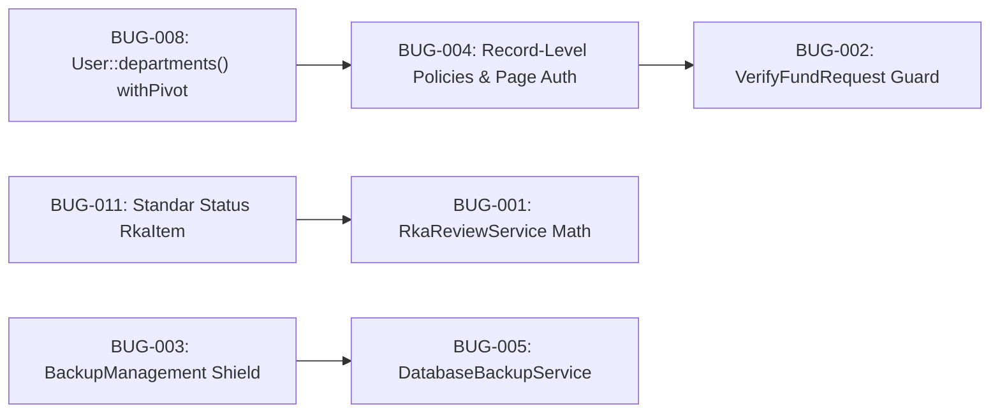

# BUG FINDINGS REPORT

**Proyek:** Sistem Informasi Keuangan & E-RKA (`Erka`) — Politeknik Kampar  
**Referensi Audit:** `CODEBASE_AUDIT_REPORT.md`  
**Tanggal Penilaian:** 15 November 2026  
**Status:** Read-Only Bug Discovery & Severity Assessment  

---

## 1. Executive Summary

Investigasi mendalam terhadap codebase aplikasi **Erka** (Laravel 13.35.0, Filament v5.10.0, Livewire v4.4.7, Filament Shield 4.3.1, MySQL 8.0) mengidentifikasi **18 temuan terkonfirmasi** dan **3 isu potensial/probabel** yang tersebar di modul **E-RKA**, **Pengajuan Dana (Fund Request)**, **Manajemen Konteks (`ContextManager`)**, **RBAC Filament Shield**, serta **Backup Database**.

Temuan paling kritis mencakup:
1. **Kerusakan logika perhitungan aritmatika & kolom *generated* pada review RKA** (`RkaReviewService`) yang mengancam integritas nominal anggaran.
2. **Celah otorisasi tingkat record & halaman (IDOR) serta *self-approval* pada `VerifyFundRequest`** yang memungkinkan pengguna tanpa hak verifikasi menyetujui pengajuan dana hingga status `approved`.
3. **Halaman `BackupManagement` terbuka untuk seluruh pengguna login** tanpa proteksi `HasPageShield` maupun `canAccess()`, serta **kelas `DatabaseBackupService` yang tidak ada** sehingga job backup gagal dijalankan.

---

## 2. Audit Scope and Methodology

Investigasi dilakukan secara *read-only* dengan menelusuri alur eksekusi dari *route*, *middleware*, *Filament Resource/Page/Action*, *Service layer*, *Eloquent Model*, *Policy*, hingga skema aktual tabel MySQL `erka` melalui kontainer Docker. Setiap temuan divalidasi dengan pembacaan kode sumber langsung dan diklasifikasikan ke dalam:
- **Confirmed Bug:** Cacat terverifikasi melalui inspeksi kode sumber atau skema database aktual.
- **Probable / Potential Issue:** Kondisi berisiko tinggi yang teridentifikasi dari kode, namun memerlukan verifikasi *runtime* interaktif.
- **Technical Debt:** Masalah kualitas kode/arsitektur yang tidak langsung menyebabkan kegagalan fungsional.

---

## 3. Severity and Priority Definitions

| Severity | Definisi | Default Priority |
|---|---|---|
| **SEV-1 — Critical** | Dampak katastrofik: bypass otorisasi/akses fitur sensitif, *self-approval*, atau korupsi data finansial kritis | **P0 — Emergency** |
| **SEV-2 — High** | Kegagalan alur bisnis utama, error *runtime* pada fitur inti, IDOR lintas unit, atau inkonsistensi transaksi DB | **P1 — Urgent** |
| **SEV-3 — Medium** | Cacat pada fitur tertentu, filter/statistik tidak akurat, atau *scoping* query kurang ketat | **P2 — High** |
| **SEV-4 — Low** | Masalah performa minor atau ketidakefisienan query tanpa kegagalan fungsional | **P3 — Normal** |
| **SEV-5 — Cosmetic / Info** | Typo label UI, file duplikat sisa pengembangan, atau *dead code* | **P4 — Low** |

---

## 4. Bug Summary Dashboard

- **Total Temuan (Confirmed + Probable/Potential):** 21 temuan
- **Confirmed Bugs:** 18 temuan
- **Probable / Potential Issues:** 3 temuan (dibahas terpisah pada Bagian 11)
- **Technical Debt:** 3 item konsolidasi (Bagian 12)

| Severity | Confirmed Count | Priority | Recommended Action |
|---|---:|---|---|
| **SEV-1 — Critical** | 4 | P0 | Immediate / Emergency |
| **SEV-2 — High** | 7 | P1 | Urgent (Before Release) |
| **SEV-3 — Medium** | 5 | P2 | Next Development Cycle |
| **SEV-4 — Low** | 1 | P3 | Planned Maintenance |
| **SEV-5 — Cosmetic** | 1 | P4 | Optional Cleanup |
| **Total Confirmed** | **18** | | |

---

## 5. Critical Findings (SEV-1)

## BUG-001 — Bug Aritmatika Pengurangan & Penulisan ke Generated Column pada `RkaReviewService`

**Classification**

| Attribute | Value |
|---|---|
| Bug ID | BUG-001 |
| Severity | SEV-1 — Critical |
| Priority | P0 — Emergency |
| Status | Confirmed |
| Category | Business Logic / Data Integrity |
| Module | E-RKA Review |
| Affected Component | `RkaReviewService` |
| Evidence | `app/Services/RkaReviewService.php:133, 381, 386, 387, 400` |

### 1. Description
Metode `reviewItem()` dan `calculateAccountHierarchy()` pada `RkaReviewService` menggunakan operasi pengurangan (`-`) alih-alih perkalian (`*`) untuk menghitung total anggaran, serta mencoba memperbarui kolom `proposed_total` yang merupakan *MySQL Stored Generated Column*.

### 2. Current Behavior
- Pada `reviewItem()` baris 381: `$newProposedTotal = $item->proposed_volume - $newUnitPrice;`
- Pada `reviewItem()` baris 386: mencoba melakukan `update(['proposed_total' => $newProposedTotal, ...])` padahal di MySQL `rka_items.proposed_total` bertipe `STORED GENERATED` (`GENERATED ALWAYS AS (proposed_volume * unit_price) STORED`).
- Pada `reviewItem()` baris 387: menimpa `proposed_volume` asli milik unit pengusul dengan `$data['approved_volume']` (atau `0`).
- Pada `reviewItem()` baris 400: `$adjustedProposedAmount = $proposedVolume - $newUnitPrice;`
- Pada `calculateAccountHierarchy()` baris 133 (untuk status `REJECTED_WITH_ADJUSTMENT`): `return (float) ($price - $item->proposed_volume);`

### 3. Expected Behavior
- Perkalian volume dengan harga satuan (`volume * unit_price`) untuk menghitung nominal total.
- Tidak menimpa `proposed_volume` asli unit saat melakukan review, dan tidak memasukkan `proposed_total` ke payload `update()`.

### 4. Impact
- Nilai penyesuaian pada `rka_adjustments.proposed_amount` dan kalkulasi hierarki `REJECTED_WITH_ADJUSTMENT` bernilai salah (bahkan negatif).
- Penulisan langsung ke kolom `STORED GENERATED` `proposed_total` berisiko memicu SQL error (`The value specified for generated column 'proposed_total' in table 'rka_items' is not allowed`).
- Data historis usulan awal unit (`proposed_volume`) terhapus/tertimpa.

### 5. Root Cause
Kesalahan operator aritmatika (`-` tertulis alih-alih `*`) dan kurangnya pemisahan antara kolom usulan awal (`proposed_volume`) dan kolom hasil review (`approved_volume`).

### 6. Evidence
- `app/Services/RkaReviewService.php:133, 381-400`
- Output `SHOW COLUMNS FROM rka_items`: kolom `proposed_total` berstatus `STORED GENERATED`.

### 7. Reproduction Steps
1. Login sebagai `wadir_keuangan` dan buka halaman Review RKA (`/admin/rka-headers/{id}/review`).
2. Jalankan aksi **Review** pada salah satu item belanja dan simpan perubahan.
3. Amati query `UPDATE rka_items` dan nilai `proposed_amount` pada `rka_adjustments`.

### 8. Recommended Solution
Perbaiki seluruh formula menjadi perkalian (`*`), hapus `proposed_total` dari array `$item->update([...])`, dan hentikan penimpaan `proposed_volume` saat review.

### 9. Testing Recommendation
Tambahkan Pest unit & feature test untuk `RkaReviewService::reviewItem()` pada semua `action_type` (`APPROVED`, `MOVED`, `REJECTED`, `REJECTED_WITH_ADJUSTMENT`).

### 10. Dependencies
Berkaitan dengan `BUG-011` (konsistensi konstanta status `RkaItem`).

---

## BUG-002 — Celah Self-Approval & Bypass Otorisasi pada `VerifyFundRequest`

**Classification**

| Attribute | Value |
|---|---|
| Bug ID | BUG-002 |
| Severity | SEV-1 — Critical |
| Priority | P0 — Emergency |
| Status | Confirmed |
| Category | Authorization / Privilege Escalation |
| Module | Pengajuan Dana (Fund Request) |
| Affected Component | `VerifyFundRequest` Page |
| Evidence | `app/Filament/Resources/FundRequests/Pages/VerifyFundRequest.php:43-46, 259-305` |

### 1. Description
Halaman `VerifyFundRequest` tidak memeriksa izin akses di `mount()`, dan method `saveVerification()` memiliki blok `else` yang langsung mengubah status pengajuan menjadi `'approved'` jika pengguna tidak memiliki role `keuangan`, `wadir_keuangan`, atau `direktur`.

### 2. Current Behavior
- `mount(int|string $record)` langsung memanggil `$this->resolveRecord($record)` tanpa `authorizeAccess()`.
- Di `saveVerification()` baris 288–291:
```php
} else {
    $stage = 'kabakku';
    $nextStatus = $isApproved ? 'approved' : 'rejected';
}
```
- Jika pengguna dengan role `pemohon` (atau `super_admin`) mengakses `/admin/fund-requests/{id}/verify` dan memanggil aksi Livewire `saveVerification()`, status `FundRequest` langsung berubah menjadi `'approved'`.

### 3. Expected Behavior
Halaman `VerifyFundRequest` hanya boleh diakses oleh role verifikator yang sesuai dengan tahapannya (`keuangan`, `wadir_keuangan`, `direktur`), dan blok `else` harus melempar `AuthorizationException` (`403`), bukan menyetujui dokumen.

### 4. Impact
Pengguna `pemohon` dapat menyetujui pengajuan dananya sendiri secara langsung ke status `approved` (melewati Keuangan, Wadir Keuangan, dan Direktur) lalu mencetak PDF resmi.

### 5. Root Cause
Tidak adanya `authorizeAccess()` pada custom Filament Page dan penggunaan fallback `else` yang permisif pada `saveVerification()`.

### 6. Evidence
`app/Filament/Resources/FundRequests/Pages/VerifyFundRequest.php:43-46, 266-291`.

### 7. Reproduction Steps
1. Login sebagai user ber-role `pemohon` yang memiliki `FundRequest` berstatus `submitted`.
2. Akses langsung URL `/admin/fund-requests/{id}/verify`.
3. Trigger aksi `saveVerification` dengan `action_type = 'approve'`.
4. Status `FundRequest` berubah menjadi `approved`.

### 8. Recommended Solution
Tambahkan pengecekan role & stage di `mount()` dan di awal `saveVerification()`; ganti blok `else` dengan `abort(403)`.

### 9. Testing Recommendation
Buat Pest feature test yang memastikan user `pemohon` mendapat respons `403` saat mengakses route `verify` maupun memanggil Livewire `saveVerification`.

### 10. Dependencies
Berkaitan dengan `BUG-004` (IDOR & Record-level Policy).

---

## BUG-003 — Halaman `BackupManagement` Terbuka Tanpa Proteksi RBAC

**Classification**

| Attribute | Value |
|---|---|
| Bug ID | BUG-003 |
| Severity | SEV-1 — Critical |
| Priority | P0 — Emergency |
| Status | Confirmed |
| Category | Authorization |
| Module | Database Backup Management |
| Affected Component | `BackupManagement` Page |
| Evidence | `app/Filament/Pages/Database/BackupManagement.php:21-129` |

### 1. Description
Custom Filament Page `BackupManagement` (`/admin/database/backup`) tidak menggunakan trait `HasPageShield` dan tidak mengimplementasikan `canAccess()`.

### 2. Current Behavior
Seluruh pengguna yang berhasil login ke panel `/admin` (termasuk 22 pengguna `pemohon`) dapat melihat menu **Backup Database**, melihat daftar seluruh `BackupRun`, dan memicu pembuatan backup database. Di tabel `permissions`, permission `View:BackupManagement` juga belum ada.

### 3. Expected Behavior
Halaman `BackupManagement` hanya boleh diakses oleh `super_admin` (atau role yang diberi permission eksplisit melalui Filament Shield).

### 4. Impact
Paparan informasi struktur tabel/metadata backup dan potensi *denial of service* (memicu dump database berulang) oleh pengguna non-administrator.

### 5. Root Cause
Lupa menambahkan `use HasPageShield;` dan belum menjalankan sinkronisasi permission Shield untuk page tersebut.

### 6. Evidence
- `app/Filament/Pages/Database/BackupManagement.php:21`
- Query database `SELECT name FROM permissions` tidak memuat `View:BackupManagement`.

### 7. Reproduction Steps
1. Login sebagai user `pemohon`.
2. Akses `/admin/database/backup`.
3. Halaman terbuka penuh beserta tombol **Buat Backup**.

### 8. Recommended Solution
Tambahkan `use BezhanSalleh\FilamentShield\Traits\HasPageShield;` pada `BackupManagement`, jalankan `shield:generate` (di lingkungan dev), dan berikan permission hanya kepada `super_admin`.

### 9. Testing Recommendation
Tambahkan Pest test akses `/admin/database/backup` untuk role `pemohon` (harus `403`) dan `super_admin` (harus `200`).

### 10. Dependencies
Berkaitan dengan `BUG-005` (`DatabaseBackupService` tidak ada) dan `BUG-016`.

---

## BUG-004 — Celah IDOR Lintas Unit pada `FundRequestPdfController` dan Custom Pages

**Classification**

| Attribute | Value |
|---|---|
| Bug ID | BUG-004 |
| Severity | SEV-1 — Critical |
| Priority | P0 — Emergency |
| Status | Confirmed |
| Category | Authorization (IDOR) |
| Module | Pengajuan Dana & E-RKA |
| Affected Component | `FundRequestPdfController`, Custom Resource Pages, Policies |
| Evidence | `FundRequestPdfController.php:11-31`, `RkaFormIndicatorAndItem.php:77`, `ReviewRkaPage.php:98`, `EditFundRequestCustom.php:49` |

### 1. Description
Endpoint preview PDF dan halaman-halaman custom Filament Resource (`RkaFormIndicatorAndItem`, `ReviewRkaPage`, `EditFundRequestCustom`) tidak memeriksa otorisasi Policy maupun kepemilikan `department_id`. Seluruh 10 Policy di `app/Policies/` juga hanya memeriksa permission role tanpa memeriksa relasi user-departemen.

### 2. Current Behavior
- `GET /fund-requests/{record}/pdf-preview` (`routes/web.php:8-10`) hanya memakai middleware `auth`. Siapa pun yang login dapat mengunduh PDF `FundRequest` berstatus `approved` milik unit lain hanya dengan mengganti `{record}` ID.
- `RkaFormIndicatorAndItem::mount()`, `ReviewRkaPage::mount()`, dan `EditFundRequestCustom::mount()` langsung memanggil `$this->resolveRecord($record)` tanpa `$this->authorizeAccess()` atau validasi `department_id`. Pembatasan hanya ada di query tabel `ListFundRequests` dan `ListRkaHeaders`.

### 3. Expected Behavior
Pengguna `pemohon` hanya dapat melihat, mengedit, atau mengunduh dokumen milik departemen tempat ia ditugaskan (`user_departments`), dan akses ke halaman edit/review harus ditolak (`403`) jika tidak berwenang.

### 4. Impact
Kebocoran data anggaran dan rincian pencairan dana antar unit kerja, serta potensi modifikasi dokumen RKA/Pengajuan Dana unit lain melalui akses URL langsung.

### 5. Root Cause
Mengandalkan *query scoping* di halaman `List*` sebagai satu-satunya kontrol isolasi data, tanpa penegakan di `Policy` maupun `mount()` pada Custom Pages dan Controller.

### 6. Evidence
- `app/Http/Controllers/FundRequestPdfController.php:11-16`
- `app/Policies/FundRequestPolicy.php:20-38` dan `app/Policies/RkaHeaderPolicy.php:20-38`
- `app/Filament/Resources/RkaHeaders/Pages/RkaFormIndicatorAndItem.php:77-85`
- `app/Filament/Resources/FundRequests/Pages/EditFundRequestCustom.php:49-52`

### 7. Reproduction Steps
1. Login sebagai `pemohon` dari Departemen A.
2. Akses `/fund-requests/{id_milik_dept_B}/pdf-preview` atau `/admin/rka-headers/{id_milik_dept_B}/form-indicator-and-item`.
3. Dokumen milik Departemen B berhasil ditampilkan.

### 8. Recommended Solution
Tambahkan pengecekan kepemilikan departemen di `FundRequestPolicy` dan `RkaHeaderPolicy` (untuk role `pemohon`), terapkan `$this->authorize('view', $record)` di `FundRequestPdfController`, dan panggil `authorize()` di `mount()` setiap Custom Resource Page.

### 9. Testing Recommendation
Tambahkan Pest test akses silang antar-departemen untuk role `pemohon` pada route PDF preview, `edit`, `form-indicator-and-item`, dan `review`.

### 10. Dependencies
Berkaitan dengan `BUG-002` dan `BUG-008`.

---

## 6. High-Severity Findings (SEV-2)

## BUG-005 — Kelas `DatabaseBackupService` Tidak Ada di Codebase

**Classification**

| Attribute | Value |
|---|---|
| Bug ID | BUG-005 |
| Severity | SEV-2 — High |
| Priority | P1 — Urgent |
| Status | Confirmed |
| Category | Missing Dependency / Runtime Crash |
| Module | Database Backup Management |
| Affected Component | `RunDatabaseBackup` Job |
| Evidence | `app/Jobs/RunDatabaseBackup.php:7, 39` |

### 1. Description
Job `RunDatabaseBackup` mengimpor dan menginjeksi `App\Services\Database\DatabaseBackupService`, tetapi kelas tersebut tidak ada di direktori `app/Services/`.

### 2. Current Behavior
Saat pengguna menekan tombol **Buat Backup** pada `BackupManagement`, record `BackupRun` dibuat dengan status `pending` dan `RunDatabaseBackup::dispatch($run->id)` dijalankan. Ketika job dieksekusi, Laravel Container melempar `BindingResolutionException` karena `App\Services\Database\DatabaseBackupService` tidak ditemukan.

### 3. Expected Behavior
`DatabaseBackupService` tersedia dan mengeksekusi proses backup SQL/CSV ke disk `backups` serta mencatat `BackupFile`.

### 4. Impact
Seluruh fitur backup database tidak berfungsi (selalu gagal).

### 5. Root Cause
Implementasi job dan UI backup dilakukan tanpa menyertakan kelas service-nya (sementara `FilamentSpatieLaravelBackupPlugin` di `AdminPanelProvider.php:82` dikomentari).

### 6. Evidence
- `app/Jobs/RunDatabaseBackup.php:7` (`use App\Services\Database\DatabaseBackupService;`)
- Daftar file di `app/Services/` hanya berisi `Context/`, `RkaApprovalService.php`, `RkaGenerateService.php`, `RkaItemService.php`, dan `RkaReviewService.php`.

### 7. Reproduction Steps
1. Buka `/admin/database/backup`.
2. Klik **Buat Backup** dan submit form (dengan `QUEUE_CONNECTION=sync`).
3. Terjadi error karena kelas `App\Services\Database\DatabaseBackupService` tidak ditemukan.

### 8. Recommended Solution
Implementasikan `App\Services\Database\DatabaseBackupService` atau aktifkan kembali `FilamentSpatieLaravelBackupPlugin` yang sudah terpasang di `composer.json`.

### 9. Testing Recommendation
Buat Pest test untuk eksekusi `RunDatabaseBackup` dengan mock/real `DatabaseBackupService`.

### 10. Dependencies
`BUG-003` harus diselesaikan bersamaan agar fitur backup aman sebelum diaktifkan.

---

## BUG-006 — Referensi Kolom Tidak Ada (`rka_status` & `review_notes`) pada RKA Services dan Actions

**Classification**

| Attribute | Value |
|---|---|
| Bug ID | BUG-006 |
| Severity | SEV-2 — High |
| Priority | P1 — Urgent |
| Status | Confirmed |
| Category | Database Schema Mismatch |
| Module | E-RKA |
| Affected Component | `RkaItemService`, `RkaApprovalService`, `RkaActions` |
| Evidence | `RkaItemService.php:132,139,414`, `RkaApprovalService.php:134`, `RkaActions.php:42` |

### 1. Description
Beberapa method pada `RkaItemService`, `RkaApprovalService`, dan `RkaActions` membaca atau menulis kolom `rka_status` dan `review_notes` pada model `RkaHeader`, padahal kedua kolom tersebut tidak ada di tabel `rka_headers`.

### 2. Current Behavior
- `RkaItemService::submitRka()` (baris 132 & 139) memeriksa dan meng-update `'rka_status' => 'submitted'`.
- `RkaItemService::ensureEditable()` (baris 414) memeriksa `$record->rka_status === 'submitted'`.
- `RkaActions::submitRka()` (baris 42) memeriksa `$page->record->rka_status === 'submitted'`.
- `RkaApprovalService::requireRevisionByDirektur()` (baris 134) menulis `'review_notes' => $comments` pada `RkaHeader`, padahal kolom di `rka_headers` bernama `general_notes`.

### 3. Expected Behavior
Menggunakan kolom `status` (dengan konstanta `RkaHeader::STATUS_*`) dan `general_notes` sesuai skema tabel `rka_headers`.

### 4. Impact
`RkaItemService::submitRka()` dan `requireRevisionByDirektur()` berisiko gagal dengan `QueryException` (*Unknown column*) saat dieksekusi, dan pengecekan `rka_status === 'submitted'` selalu bernilai `false`.

### 5. Root Cause
Ketidaksinkronan penamaan kolom antara migrasi `rka_headers` dan kode service/action.

### 6. Evidence
- Output `SHOW COLUMNS FROM rka_headers`: hanya terdapat `status` dan `general_notes`; tidak ada `rka_status` maupun `review_notes`.
- `app/Services/RkaItemService.php:132, 139, 414`
- `app/Services/RkaApprovalService.php:134`

### 7. Reproduction Steps
1. Panggil `RkaApprovalService::requireRevisionByDirektur()` (aksi **Minta Revisi** oleh Direktur).
2. MySQL melempar error karena kolom `review_notes` tidak ada di tabel `rka_headers`.

### 8. Recommended Solution
Ganti seluruh `rka_status` menjadi `status` (dan sesuaikan case `RkaHeader::STATUS_SUBMITTED`), serta ganti `review_notes` di `RkaApprovalService.php:134` menjadi `general_notes`.

### 9. Testing Recommendation
Tambahkan Pest test untuk `RkaItemService::submitRka()` dan `RkaApprovalService::requireRevisionByDirektur()`.

### 10. Dependencies
Tidak ada.

---

## BUG-007 — `EditFundRequestCustom` Menimpa `department_id` dan Memaksa `status = 'submitted'`

**Classification**

| Attribute | Value |
|---|---|
| Bug ID | BUG-007 |
| Severity | SEV-2 — High |
| Priority | P1 — Urgent |
| Status | Confirmed |
| Category | Data Corruption / Workflow Bug |
| Module | Pengajuan Dana (Fund Request) |
| Affected Component | `EditFundRequestCustom` |
| Evidence | `app/Filament/Resources/FundRequests/Pages/EditFundRequestCustom.php:87, 90-99, 227` |

### 1. Description
Saat membuka halaman edit `EditFundRequestCustom`, method `setDepartmentsActive()` menimpa `department_id` record dengan departemen aktif pengguna saat ini, dan saat `save()` status dokumen dipaksa menjadi `'submitted'`.

### 2. Current Behavior
- Baris 97: `$this->department_id = $activeDept->id;` menimpa `$this->record->department_id` yang sudah di-populate di baris 59.
- Baris 227: `'status' => 'submitted', // Tetap pertahankan status saat ini` — komentar menyatakan mempertahankan status, tetapi kode meng-hardcode `'submitted'`.

### 3. Expected Behavior
`EditFundRequestCustom` harus mempertahankan `department_id` dan `status` asli record (kecuali secara eksplisit diubah sesuai aturan workflow), serta melarang edit jika status sudah melewati tahap pengajuan (`approved`, dll.).

### 4. Impact
Jika record `draft` atau `rejected` diedit, statusnya langsung berubah menjadi `submitted`. Jika pengguna dengan departemen aktif berbeda (misal admin/multi-unit) membuka halaman edit dan menyimpan, kepemilikan departemen `FundRequest` berpindah secara diam-diam.

### 5. Root Cause
Copy-paste method `setDepartmentsActive()` dan payload `save()` dari `CreateFundRequestCustom` ke `EditFundRequestCustom`.

### 6. Evidence
`app/Filament/Resources/FundRequests/Pages/EditFundRequestCustom.php:59, 87-99, 227`.

### 7. Reproduction Steps
1. Buat `FundRequest` berstatus `draft`.
2. Buka halaman Edit (`/admin/fund-requests/{id}/edit`) lalu klik Simpan.
3. Status berubah menjadi `submitted`.

### 8. Recommended Solution
Hapus pemanggilan `setDepartmentsActive()` pada `EditFundRequestCustom::mount()` (pertahankan `$this->record->department_id`), dan gunakan `$this->record->status` atau pisahkan tombol **Simpan Draft** vs **Submit**.

### 9. Testing Recommendation
Tambahkan Pest test untuk `EditFundRequestCustom::save()` guna memverifikasi `department_id` dan `status` tidak berubah secara tidak sengaja.

### 10. Dependencies
Berkaitan dengan `BUG-004`.

---

## BUG-008 — Relasi `User::departments()` Tidak Memuat Kolom Pivot sehingga Konteks PLT Selalu `false`

**Classification**

| Attribute | Value |
|---|---|
| Bug ID | BUG-008 |
| Severity | SEV-2 — High |
| Priority | P1 — Urgent |
| Status | Confirmed |
| Category | Relationship / Logic Defect |
| Module | Context Management |
| Affected Component | `User`, `ContextManager` |
| Evidence | `app/Models/User.php:47-52`, `app/Services/Context/ContextManager.php:84-107` |

### 1. Description
Relasi `User::departments()` tidak menyertakan `->withPivot(['assignment_type', 'start_date', 'end_date'])`, menyebabkan `ContextManager::getActiveAssignmentType()` selalu mengembalikan `null`.

### 2. Current Behavior
- `User::departments()` (`User.php:47-52`) hanya memanggil `->using(UserDepartment::class)->withTimestamps()`.
- `ContextManager::getActiveAssignmentType()` (`ContextManager.php:92`) mengakses `$activeDept->pivot->assignment_type ?? null`, yang selalu bernilai `null`.
- Akibatnya `ContextManager::isPltContext()` selalu `false`, dan badge `primary`/`plt` pada komponen `context-switcher.blade.php:75` tidak pernah tampil.
- Selain itu, `ContextManager::getAvailableDepartments()` dan `setActiveDepartment()` tidak memvalidasi `start_date`/`end_date` penugasan PLT (`UserDepartment::getIsActivePltAttribute()`).

### 3. Expected Behavior
`User::departments()` memuat kolom pivot `assignment_type`, `start_date`, dan `end_date`, serta `ContextManager` hanya mengizinkan penugasan PLT yang masih aktif dalam rentang tanggalnya.

### 4. Impact
Fitur pembeda konteks PLT vs Primary tidak berfungsi, dan pengguna yang masa PLT-nya sudah berakhir tetap dapat memilih dan bertindak atas nama departemen tersebut.

### 5. Root Cause
`->withPivot(...)` hanya ditambahkan pada `Department::users()` (`Department.php:118`), namun terlewat pada `User::departments()`.

### 6. Evidence
- `app/Models/User.php:47-52`
- `app/Services/Context/ContextManager.php:84-107`

### 7. Reproduction Steps
1. Tugaskan user ke sebuah departemen dengan `assignment_type = 'plt'`.
2. Login dan periksa topbar `context-switcher` atau panggil `app(ContextManagerInterface::class)->isPltContext()`.
3. Hasilnya selalu `null` / `false`.

### 8. Recommended Solution
Tambahkan `->withPivot(['assignment_type', 'start_date', 'end_date'])` pada `User::departments()`, dan terapkan filter tanggal aktif PLT di `ContextManager`.

### 9. Testing Recommendation
Tambahkan Pest unit test untuk `ContextManager` dengan skenario `primary`, `plt` aktif, dan `plt` kedaluwarsa.

### 10. Dependencies
Tidak ada.

---

## BUG-009 — Auto-Mutasi Status `SUBMITTED` → `IN_REVIEW` Hanya Karena Membuka `ReviewRkaPage`

**Classification**

| Attribute | Value |
|---|---|
| Bug ID | BUG-009 |
| Severity | SEV-2 — High |
| Priority | P1 — Urgent |
| Status | Confirmed |
| Category | State Transition / Integrity |
| Module | E-RKA Review |
| Affected Component | `ReviewRkaPage`, `RkaReviewService` |
| Evidence | `ReviewRkaPage.php:138, 151-155`, `RkaReviewService.php:44-46` |

### 1. Description
Membuka halaman `ReviewRkaPage` otomatis mengubah status `RkaHeader` dari `SUBMITTED` menjadi `IN_REVIEW` di dalam `loadRkaRecord()`, tanpa memeriksa apakah pengguna adalah `wadir_keuangan`.

### 2. Current Behavior
Di `RkaReviewService::loadRkaRecord()` (baris 44–46) dan diulang lagi di `ReviewRkaPage::loadRkaRecord()` (baris 151–155), setiap kali halaman di-mount, status `submitted` langsung di-update menjadi `IN_REVIEW`.

### 3. Expected Behavior
Operasi `GET` / `mount()` tidak boleh memutasi state transaksi; transisi `SUBMITTED` → `IN_REVIEW` hanya boleh terjadi ketika `wadir_keuangan` secara eksplisit memulai review melalui `RkaApprovalService::startReviewByWadir()` (yang juga mencatat log di `rka_approvals`).

### 4. Impact
Pengguna `pemohon` atau role lain yang membuka URL `/admin/rka-headers/{id}/review` tanpa sengaja mengubah status RKA menjadi `IN_REVIEW` tanpa jejak audit di `rka_approvals`.

### 5. Root Cause
Side-effect mutasi database diletakkan di dalam method loader (`loadRkaRecord`) dan tidak dilindungi pemeriksaan role.

### 6. Evidence
- `app/Services/RkaReviewService.php:44-46`
- `app/Filament/Resources/RkaHeaders/Pages/ReviewRkaPage.php:151-155`

### 7. Reproduction Steps
1. Siapkan `RkaHeader` berstatus `SUBMITTED`.
2. Buka `/admin/rka-headers/{id}/review` menggunakan akun `pemohon` atau `direktur`.
3. Status `RkaHeader` di database berubah menjadi `IN_REVIEW`.

### 8. Recommended Solution
Hapus blok update status dari `RkaReviewService::loadRkaRecord()` dan `ReviewRkaPage::loadRkaRecord()`; biarkan transisi status ditangani oleh `RkaHeadersTable` action `review_wadir` atau tombol eksplisit untuk `wadir_keuangan`.

### 9. Testing Recommendation
Tambahkan Pest test yang memastikan membuka `ReviewRkaPage` tidak mengubah status `SUBMITTED` jika user bukan `wadir_keuangan`.

### 10. Dependencies
Berkaitan dengan `BUG-004`.

---

## BUG-010 — `RkaActions::editItem()` Memanggil Relasi Non-Existent `rkaIndicator`

**Classification**

| Attribute | Value |
|---|---|
| Bug ID | BUG-010 |
| Severity | SEV-2 — High |
| Priority | P1 — Urgent |
| Status | Confirmed |
| Category | Relationship Mismatch / Stale Data |
| Module | E-RKA |
| Affected Component | `RkaActions::editItem()` |
| Evidence | `app/Filament/Actions/Rka/RkaActions.php:180`, `app/Models/RkaItem.php:90-93` |

### 1. Description
Saat item belanja RKA diubah melalui aksi `editItem`, kode memanggil `$item->rkaIndicator?->recalculateMasukanTargetValue()`, padahal nama relasi pada model `RkaItem` adalah `indicator()`.

### 2. Current Behavior
Karena `$item->rkaIndicator` selalu bernilai `null` dan memakai null-safe operator (`?->`), method `recalculateMasukanTargetValue()` tidak pernah dipanggil setelah item di-edit.

### 3. Expected Behavior
Memanggil `$item->indicator?->recalculateMasukanTargetValue()` agar nilai target indikator `Masukan` ikut ter-update otomatis seperti saat `addItem` dan `deleteItem`.

### 4. Impact
Nilai target `Masukan` pada matriks indikator menjadi tidak sinkron (stale) dengan total item belanja setiap kali ada perubahan item melalui UI `editItem`.

### 5. Root Cause
Kesalahan penamaan properti relasi (`rkaIndicator` vs `indicator`).

### 6. Evidence
- `app/Filament/Actions/Rka/RkaActions.php:180`
- `app/Models/RkaItem.php:90-93` (`public function indicator(): BelongsTo`).

### 7. Reproduction Steps
1. Buka halaman `RkaFormIndicatorAndItem` dan edit nominal/volume salah satu item.
2. Periksa kolom `indicator_matrix` pada `rka_indicators`; nilai target `Masukan` tidak berubah.

### 8. Recommended Solution
Ubah `$item->rkaIndicator?->recalculateMasukanTargetValue()` menjadi `$item->indicator?->recalculateMasukanTargetValue()`.

### 9. Testing Recommendation
Tambahkan Pest test yang memverifikasi nilai target `Masukan` pada `RkaIndicator` ter-update setelah `editItem`.

### 10. Dependencies
Tidak ada.

---

## BUG-011 — Inkonsistensi Nilai Status `RkaItem` (`ACCEPTED` vs `APPROVED`)

**Classification**

| Attribute | Value |
|---|---|
| Bug ID | BUG-011 |
| Severity | SEV-2 — High |
| Priority | P1 — Urgent |
| Status | Confirmed |
| Category | Data Integrity / Constant Mismatch |
| Module | E-RKA |
| Affected Component | `RkaItem`, `RkaReviewService`, `RkaApprovalService` |
| Evidence | `app/Models/RkaItem.php:70-73`, `RkaApprovalService.php:93`, `RkaReviewService.php:395,587` |

### 1. Description
Model `RkaItem` mendefinisikan konstanta `STATUS_ACCEPTED = 'ACCEPTED'`, sedangkan `RkaReviewService` dan `RkaApprovalService` menggunakan string `'APPROVED'`.

### 2. Current Behavior
- `RkaItem.php:71`: `public const STATUS_ACCEPTED = 'ACCEPTED';`
- `RkaReviewService.php`: menyimpan `'status' => 'APPROVED'` saat review/bulk approve, dan mengecek `in_array($status, ['APPROVED', 'ACCEPTED'], true)` di baris 136.
- `RkaApprovalService.php:93`: saat Direktur mengesahkan RKA, hanya menjumlahkan item dengan `->where('status', 'APPROVED')` untuk membentuk `DepartmentBudget`.

### 3. Expected Behavior
Satu standar konstanta status untuk `RkaItem` digunakan secara konsisten di seluruh model, form, dan service.

### 4. Impact
Jika ada item yang tersimpan dengan status `'ACCEPTED'` (sesuai konstanta model), item tersebut **tidak akan ikut dihitung** saat pembentukan `DepartmentBudget` di `RkaApprovalService::approveByDirektur()`.

### 5. Root Cause
Tidak digunakannya konstanta model secara konsisten pada form/service review RKA.

### 6. Evidence
- `app/Models/RkaItem.php:70-73`
- `app/Services/RkaApprovalService.php:92-96`
- `app/Services/RkaReviewService.php:122, 136, 587`

### 7. Reproduction Steps
Inspeksi kode `RkaItem.php` vs `RkaApprovalService.php:93`.

### 8. Recommended Solution
Standarkan penggunaan konstanta di `RkaItem` (misal tambahkan `STATUS_APPROVED` atau migrasi ke satu nilai baku) dan gunakan di seluruh service.

### 9. Testing Recommendation
Test `RkaApprovalService::approveByDirektur()` untuk memastikan seluruh item yang disetujui masuk ke `DepartmentBudget`.

### 10. Dependencies
Berkaitan dengan `BUG-001`.

---

## 7. Medium-Severity Findings (SEV-3)

## BUG-012 — Bulk Action `RkaReviewService` Tidak Memfilter `rka_header_id`

| Attribute | Value |
|---|---|
| Bug ID | BUG-012 |
| Severity | SEV-3 — Medium |
| Priority | P2 — High |
| Status | Confirmed |
| Category | Data Integrity / Scoping |
| Module | E-RKA Review |
| Affected Component | `RkaReviewService::bulkApproveItems()`, `bulkMoveItems()` |
| Evidence | `app/Services/RkaReviewService.php:579, 615` |

- **Deskripsi & Perilaku:** `RkaItem::whereIn('id', $selectedItemIds)->get()` tidak menyertakan `->where('rka_header_id', $record->id)`. Jika array `$selectedItems` di Livewire dimanipulasi, item milik `RkaHeader` lain dapat ikut ter-approve atau ter-move.
- **Solusi:** Tambahkan `->where('rka_header_id', $record->id)` pada kedua query tersebut.

## BUG-013 — Hardcoded Tahun Anggaran `'2026/2027'` pada 11 Widget dan Form Pengajuan Dana

| Attribute | Value |
|---|---|
| Bug ID | BUG-013 |
| Severity | SEV-3 — Medium |
| Priority | P2 — High |
| Status | Confirmed |
| Category | Configuration / Logic Defect |
| Module | Dashboard Widgets & Pengajuan Dana |
| Affected Component | 11 Widget di `app/Filament/Widgets/` & `CreateFundRequestCustom.php:25` |
| Evidence | `SuperAdminStatsOverview.php:19`, `DepartmentStatsOverview.php:32`, `DirectorStatsOverview.php:18`, `FinanceStatsOverview.php:18`, `WadirStatsOverview.php:20`, dll. |

- **Deskripsi & Perilaku:** Seluruh statistik dashboard dan default tahun anggaran pada form pengajuan dana meng-hardcode `$currentFiscalYear = '2026/2027'`. Saat memasuki tahun anggaran baru (mis. `2027/2028`), seluruh dashboard tetap menampilkan angka `2026/2027` atau nol.
- **Solusi:** Buat helper/service terpusat yang mengambil tahun anggaran aktif dari `RkaSchedule` atau `RkaSetting`.

## BUG-014 — `orWhere` Tanpa Grouping pada Relasi `RkaHeader::incomingAdjustments()`

| Attribute | Value |
|---|---|
| Bug ID | BUG-014 |
| Severity | SEV-3 — Medium |
| Priority | P2 — High |
| Status | Confirmed |
| Category | Eloquent Query Defect |
| Module | E-RKA |
| Affected Component | `RkaHeader::incomingAdjustments()` |
| Evidence | `app/Models/RkaHeader.php:281-287` |

- **Deskripsi & Perilaku:** `return $this->hasMany(RkaAdjustment::class, 'destination_unit_id', 'department_id')->orWhere(function ($query) { $query->where('target_unit_id', $this->department_id); });` — karena `orWhere` berada di level luar, ia mengabaikan kondisi `AND` sebelumnya bila relasi di-eager-load atau di-chain dengan kondisi lain.
- **Solusi:** Gunakan query builder dengan closure grouping `where(fn ($q) => $q->where(...)->orWhere(...))` atau pisahkan menjadi `incomingMovedAdjustments()` dan `incomingSharedCosts()`.

## BUG-015 — Inkonsistensi Filter `is_imported` antara `calculatePaguRka()` dan `calculateProposedTotal()`

| Attribute | Value |
|---|---|
| Bug ID | BUG-015 |
| Severity | SEV-3 — Medium |
| Priority | P2 — High |
| Status | Confirmed |
| Category | Calculation Inconsistency |
| Module | E-RKA |
| Affected Component | `RkaHeader` Model |
| Evidence | `app/Models/RkaHeader.php:186-189, 229-232, 245-256` |

- **Deskripsi & Perilaku:** `calculateProposedTotal()` dan `calculateTotalProposedByHeader()` memfilter `->where('is_imported', 0)`, sedangkan `calculatePaguRka()` (baris 248) menjumlahkan seluruh item tanpa filter `is_imported`. Jika ada item limpahan adjustment (`is_imported = 1`), nilai `pagu_budget` berbeda dengan `$rkaHeader->total_proposed`.
- **Solusi:** Pastikan kesepakatan aturan bisnis apakah item `is_imported = 1` masuk ke `pagu_budget`, lalu satukan kedua perhitungan dalam satu helper.

## BUG-016 — Konfigurasi Super Admin (`define_via_gate => false`) & Ketidakseimbangan Permission Role

| Attribute | Value |
|---|---|
| Bug ID | BUG-016 |
| Severity | SEV-3 — Medium |
| Priority | P2 — High |
| Status | Confirmed |
| Category | RBAC Configuration |
| Module | Filament Shield RBAC |
| Affected Component | `config/filament-shield.php:74`, tabel `role_has_permissions` |
| Evidence | `config/filament-shield.php:74`, hasil query DB `role_has_permissions` |

- **Deskripsi & Perilaku:** Karena `define_via_gate => false`, `super_admin` bergantung pada permission eksplisit, namun saat ini hanya memiliki **124 dari 139 permission** (kehilangan 15 permission widget seperti `SuperAdminRecentActivity`, `Director*`, `Wadir*`, `Department*`). Sebaliknya, `wadir_keuangan` memiliki permission destruktif `Delete:Department` & `ForceDelete:Department`, dan `keuangan`/`wadir_keuangan` memiliki `View:SuperAdminStatsOverview`.
- **Solusi:** Evaluasi ulang matriks permission per role sesuai prinsip *least privilege*, dan pastikan `super_admin` memiliki seluruh permission atau aktifkan `define_via_gate => true`.

---

## 8. Low-Severity Findings (SEV-4)

## BUG-017 — Inefisiensi Query pada Dashboard Widgets (`FinanceStatsOverview` & `SuperAdminSystemHealth`)

| Attribute | Value |
|---|---|
| Bug ID | SEV-4 — Low |
| Priority | P3 — Normal |
| Status | Confirmed |
| Category | Performance |
| Module | Dashboard Widgets |
| Affected Component | `FinanceStatsOverview`, `SuperAdminSystemHealth` |
| Evidence | `FinanceStatsOverview.php:30-36`, `SuperAdminSystemHealth.php:25-29` |

- **Deskripsi & Perilaku:** `FinanceStatsOverview` memanggil `->get()` untuk memuat seluruh model `FundRequest` terverifikasi lalu menjumlahkan di PHP. `SuperAdminSystemHealth` melakukan 5 query `COUNT(*)` terpisah.
- **Solusi:** Ganti dengan agregasi SQL `SUM()` dan satu query `GROUP BY status`.

---

## 9. Cosmetic and Informational Findings (SEV-5)

## BUG-018 — Typo Grup Navigasi (`Manajeman RKA`) & File Duplikat di Repositori

| Attribute | Value |
|---|---|
| Bug ID | SEV-5 — Cosmetic |
| Priority | P4 — Low |
| Status | Confirmed |
| Category | UI Consistency / Cleanliness |
| Module | Filament Navigation & Repository |
| Affected Component | RKA Resources & Pages |
| Evidence | `RkaHeaderResource.php:25`, `RkaScheduleResource.php:23`, `RkaSettingResource.php:23`, `RkaGenerateConfigResource.php:25`, `ReviewRkaPage copy.php` |

- **Deskripsi & Perilaku:** Keempat Resource RKA menggunakan string `'Manajeman RKA'` (seharusnya `'Manajemen RKA'`), dan terdapat file duplikat `app/Filament/Resources/RkaHeaders/Pages/ReviewRkaPage copy.php`.
- **Solusi:** Perbaiki typo menjadi `'Manajemen RKA'` dan hapus `ReviewRkaPage copy.php`.

---

## 10. Findings by Module

| Modul | Bug IDs | Ringkasan |
|---|---|---|
| **Laravel Backend / Services** | `BUG-001`, `BUG-005`, `BUG-006`, `BUG-008`, `BUG-011`, `BUG-012`, `BUG-014`, `BUG-015` | Bug aritmatika review RKA, missing `DatabaseBackupService`, salah nama kolom/relasi, pivot `User::departments()` |
| **Filament 5.x** | `BUG-007`, `BUG-009`, `BUG-010`, `BUG-013`, `BUG-017`, `BUG-018` | Mutasi status di `EditFundRequestCustom` & `ReviewRkaPage`, relasi `rkaIndicator`, fiscal year hardcoded |
| **Filament Shield RBAC** | `BUG-002`, `BUG-003`, `BUG-004`, `BUG-016` | Self-approval `VerifyFundRequest`, `BackupManagement` tanpa Shield, IDOR PDF/Custom Pages, ketidaksinkronan role permission |
| **Database** | `BUG-001`, `BUG-006` | Penulisan ke generated column `proposed_total`, referensi kolom `rka_status`/`review_notes` |
| **Auth & Security** | `BUG-002`, `BUG-003`, `BUG-004` | Celah kontrol akses dan isolasi data antar-departemen |
| **Frontend** | — | Tidak ditemukan bug JS/CSS terkonfirmasi (kendati `context-switcher` terpengaruh `BUG-008`) |
| **Docker & Infrastructure** | — | Lihat `PROB-003` pada Bagian 11 |

---

## 11. Probable and Potential Issues

1. **PROB-001 (Potential Authorization Bypass pada `RkaActions` di Halaman View):**
   - `RkaHeaderResource.php:51` memetakan route `'view'` ke `RkaFormIndicatorAndItem::route('/{record}/view')`. Meskipun tombol aksi dapat disembunyikan di UI, aksi `addProgram`, `addItem`, `editItem`, `importExcel`, `deleteItem`, dan `clearAllItems` di `app/Filament/Actions/Rka/RkaActions.php` tidak memeriksa `$page->record->is_locked` maupun `status !== DRAFT` di dalam closure `action()`. Jika aksi Livewire dipanggil langsung, item pada RKA terkunci berpotensi dimodifikasi.
2. **PROB-002 (Dua Importer Excel RKA yang Berbeda):**
   - `RkaActions::importExcel()` (`RkaActions.php:211`) menggunakan `RkaItemsImport`, sedangkan `RkaItemService::importExcel()` (`RkaItemService.php:383`) menggunakan `RkaImportFormatExcel`. Perbedaan format kolom antara dua importer ini berpotensi membingungkan pengguna atau menyebabkan impor gagal jika format template berbeda.
3. **PROB-003 (Kesiapan Queue Worker untuk Backup Asinkron):**
   - `BackupManagement` men-dispatch `RunDatabaseBackup` ke queue `backups`. Saat ini runtime aktif memakai `QUEUE_CONNECTION=sync` (`php artisan about`), namun `docker-compose.yml` belum memiliki layanan worker `queue:work --queue=backups,default`. Jika `QUEUE_CONNECTION` diubah ke `database` di produksi, job backup akan tertahan di status `pending`.

---

## 12. Technical Debt

1. **Duplikasi Skema Review Item:** Terdapat kolom review di `rka_items` (`approved_volume`, `approved_total`, `is_trimmed`, `price_trimed`, `review_notes`) sekaligus tabel terpisah `rka_item_reviews` yang belum sepenuhnya dikonsolidasikan.
2. **Duplikasi Method Model:** `RkaHeader::calculateProposedTotal()` dan `RkaHeader::calculateTotalProposedByHeader()` melakukan query identik.
3. **Boilerplate Tidak Terpakai:** `app/Http/Resources/Department.php` dan `app/Filament/Resources/RkaHeaders/Pages/ReviewRkaPage copy.php` masih ada di repositori.

---

## 13. Root Cause Analysis

Mayoritas bug berakar dari 4 pola sistemik:
1. **Otorisasi Terfokus di Tabel List, Bukan di Policy & Page:** Isolasi departemen hanya diterapkan pada `getTableQuery()` di `List*`, tidak pada `Policy` maupun `mount()` di Custom Pages dan Controller (`BUG-002`, `BUG-003`, `BUG-004`).
2. **Perubahan Skema Tidak Tersinkron ke Service/Action:** Perubahan nama kolom (`rka_status` → `status`, `review_notes` → `general_notes`, `proposed_total` menjadi `STORED GENERATED`) tidak diikuti pembaruan penuh di seluruh service (`BUG-001`, `BUG-006`, `BUG-011`).
3. **Ketiadaan Automated Test Suite:** Dengan hanya 2 test bawaan Laravel, kesalahan aritmatika (`-` vs `*`), typo relasi (`rkaIndicator`), dan mutasi status di `EditFundRequestCustom` lolos ke codebase tanpa terdeteksi.
4. **Penggunaan Nilai Hardcoded & Fallback Permisif:** Tahun anggaran `'2026/2027'` dan blok `else` yang menyetujui `FundRequest` pada `VerifyFundRequest`.

---

## 14. Recommended Remediation Roadmap

### Phase 1 — Emergency (P0)
- Perbaiki `BUG-001` (`RkaReviewService` aritmatika & generated column).
- Perbaiki `BUG-002` (blok `else` & `mount()` pada `VerifyFundRequest`).
- Perbaiki `BUG-003` (`HasPageShield` pada `BackupManagement`).
- Perbaiki `BUG-004` (otorisasi `FundRequestPdfController`, Custom Pages, dan record-level Policies).

### Phase 2 — Urgent (P1)
- Perbaiki `BUG-005` (implementasikan `DatabaseBackupService` atau aktifkan plugin backup).
- Perbaiki `BUG-006` (`rka_status` → `status`, `review_notes` → `general_notes`).
- Perbaiki `BUG-007` (`EditFundRequestCustom` `department_id` & `status`).
- Perbaiki `BUG-008` (`withPivot` pada `User::departments()` & filter PLT aktif).
- Perbaiki `BUG-009` (hapus auto-mutasi `IN_REVIEW` di `ReviewRkaPage` / `RkaReviewService`).
- Perbaiki `BUG-010` (`rkaIndicator` → `indicator`) & `BUG-011` (standarisasi status `RkaItem`).

### Phase 3 — Functional Stability (P2)
- Perbaiki `BUG-012` s.d. `BUG-016` (scoping bulk action, fiscal year dinamis, `orWhere` grouping, konsistensi `calculatePaguRka`, dan audit permission Shield).

### Phase 4 — Quality and Consistency (P3)
- Perbaiki `BUG-017` (optimasi query widget) dan `PROB-001` s.d. `PROB-003`.

### Phase 5 — Minor Improvements (P4)
- Perbaiki `BUG-018` (typo `Manajeman RKA`, hapus `ReviewRkaPage copy.php`) dan rapikan Technical Debt.

---

## 15. Testing Recommendations

Setelah perbaikan diterapkan, wajib dibuat Pest feature & unit tests untuk:
1. **RBAC & IDOR Tests:** Pengujian akses antar-departemen untuk `pemohon`, proteksi `VerifyFundRequest`, `BackupManagement`, dan `FundRequestPdfController`.
2. **RKA Calculation & Workflow Tests:** Pengujian `RkaReviewService::reviewItem()` (perkalian volume × harga, pemindahan item, *shared cost*), `RkaApprovalService::approveByDirektur()` (pembentukan `DepartmentBudget`), dan `RkaItemService`.
3. **Fund Request Workflow Tests:** Pembuatan, pengeditan (`EditFundRequestCustom` mempertahankan status & departemen), serta verifikasi berjenjang.
4. **ContextManager Tests:** Pengujian `primary`, `plt` aktif, dan `plt` kedaluwarsa.

---

## 16. Dependencies and Fix Order



---

## 17. Audit Limitations

- Validasi dilakukan melalui inspeksi statis kode sumber, pembacaan skema MySQL `erka` aktual, serta eksekusi `php artisan test --compact` (hanya 2 test bawaan).
- Tidak dilakukan uji klik interaktif di browser maupun eksekusi mutasi database selama investigasi untuk menjaga integritas data lingkungan saat ini.

---

## 18. Final Assessment

Secara arsitektural, aplikasi **Erka** sudah memiliki struktur modul yang jelas, namun **belum aman untuk langsung digunakan di produksi** sebelum bug **SEV-1 (BUG-001 s.d. BUG-004)** dan **SEV-2 (BUG-005 s.d. BUG-011)** diperbaiki. Prioritas tertinggi adalah memperbaiki perhitungan review RKA serta menutup seluruh celah otorisasi pada `VerifyFundRequest`, `BackupManagement`, `FundRequestPdfController`, dan Custom Pages Filament, diikuti dengan pembangunan *automated test suite* menggunakan Pest agar regresi dapat dicegah.
