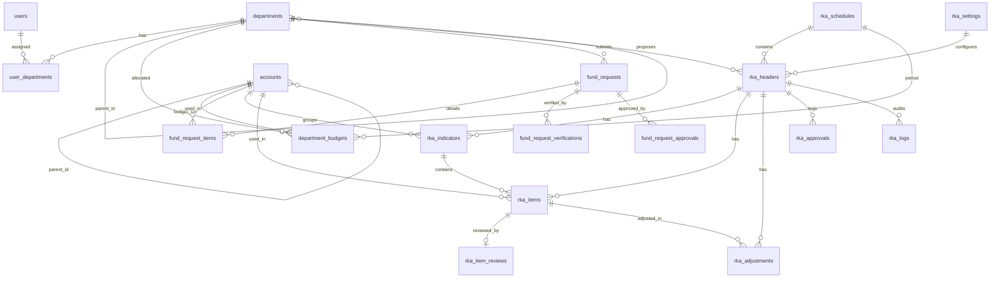

# CODEBASE AUDIT REPORT

**Proyek:** Sistem Informasi Keuangan & E-RKA (`Erka`) — Politeknik Kampar  
**Tanggal Audit:** 15 November 2026  
**Status:** Read-Only Discovery & Technical Architecture Audit  

---

## 1. Executive Summary

### Gambaran Umum Aplikasi
Aplikasi **Erka** (`APP_NAME=Erka`) adalah sistem informasi perencanaan anggaran tahunan (**E-RKA / Rencana Kerja dan Anggaran**) dan pencairan/realisasi dana (**Pengajuan Dana / Fund Request**) untuk lingkungan **Politeknik Kampar**. Aplikasi ini mengelola siklus penuh mulai dari penyusunan jadwal pengusulan RKA, konfigurasi template & indikator RKA, pengajuan item belanja berbasis *Chart of Accounts* (COA), penelaahan/pemangkasan/pemindahan anggaran (*review & adjustment*) oleh Wakil Direktur Keuangan, pengesahan oleh Direktur yang otomatis membentuk pagu unit (`department_budgets`), hingga pengajuan pencairan dana, verifikasi berjenjang (Keuangan/Ka BAKKU → Wadir BAKKU → Direktur), serta cetak formulir PDF.

### Arsitektur Keseluruhan
Aplikasi dibangun dengan pola **Monolithic Laravel 13 + Filament 5 Admin Panel** (Livewire 4 + Tailwind CSS v4), yang dikemas dalam **4 kontainer Docker** (`erka_app`, `erka_webserver`, `erka_db`, `erka_node`). Aplikasi juga mengimplementasikan **Context Switching** berbasis *session* (`ContextManager`) agar satu pengguna dapat berpindah departemen (termasuk penugasan PLT) dan berpindah peran (*role*) aktif secara dinamis.

### Stack Teknologi Utama
- **Backend:** PHP 8.3.35, Laravel Framework 13.35.0, Eloquent ORM
- **Admin Panel:** Filament v5.10.0, Livewire v4.4.7
- **RBAC:** `bezhansalleh/filament-shield` 4.3.1 + `spatie/laravel-permission` 8.3.0
- **Database:** MySQL 8.0 (database `erka`, 43 tabel)
- **Ekspor/Impor & PDF:** `maatwebsite/excel` 4.0.3, `barryvdh/laravel-dompdf` 3.1.2
- **Frontend:** Vite 8.0.0, Tailwind CSS 4.3.3 (`@tailwindcss/vite`), Node.js v22.23.0
- **Testing & Quality:** Pest 4.7.8 (`pest-plugin-laravel` 4.1.0), Laravel Pint 1.32.1

### Temuan Utama & Penilaian Umum
Secara fungsional, alur bisnis E-RKA dan Pengajuan Dana sudah terbentuk dengan baik, termasuk dukungan hierarki COA, *generated column* pada `rka_items`, serta pemisahan *Service layer* untuk proses RKA. Namun, audit menemukan **beberapa bug kritis pada logika perhitungan dan nama kolom, celah otorisasi tingkat record/halaman (IDOR), fitur backup database yang belum lengkap kelas service-nya, serta cakupan pengujian otomatis yang masih minimal (hanya 2 test bawaan Laravel)**.

---

## 2. Project Technology Stack

### 2.1 Dependensi Backend (`composer.json` & `composer show --direct`)

| Paket | Versi Terpasang | Kategori | Kegunaan & Lokasi Penggunaan |
|---|---|---|---|
| `php` | `8.3.35` | Core Runtime | Runtime PHP-FPM di kontainer `erka_app` |
| `laravel/framework` | `13.35.0` | Core Framework | Fondasi MVC, ORM, Queue, Session, Auth |
| `filament/filament` | `v5.10.0` | Core UI/Admin | Panel `/admin` (`AdminPanelProvider.php`), Resource, Page, Widget |
| `livewire/livewire` | `v4.4.7` | Transitive Core | Reaktivitas komponen Filament & `context-switcher.blade.php` |
| `bezhansalleh/filament-shield` | `4.3.1` | Core RBAC | Manajemen Role, Permission, Policy (`config/filament-shield.php`) |
| `spatie/laravel-permission` | `8.3.0` | Transitive RBAC | Tabel `roles`, `permissions`, trait `HasRoles` di `User.php` |
| `maatwebsite/excel` | `4.0.3` | Feature | Impor/ekspor Excel COA & item RKA (`app/Imports/`, `app/Exports/`) |
| `barryvdh/laravel-dompdf` | `3.1.2` | Feature | Cetak PDF pengajuan dana (`FundRequestPdfController.php`) |
| `shuvroroy/filament-spatie-laravel-backup` | `4.1.0` | Optional/Inactive | Terpasang, tetapi dikomentari di `AdminPanelProvider.php:82` |
| `laravel/tinker` | `3.0.2` | Dev/CLI | REPL Artisan |
| `pestphp/pest` | `4.7.8` | Dev/Testing | Framework pengujian (`tests/Pest.php`) |
| `pestphp/pest-plugin-laravel` | `4.1.0` | Dev/Testing | Plugin integrasi Laravel untuk Pest |
| `laravel/pint` | `1.32.1` | Dev/Quality | Code formatter PHP |
| `laravel/boost` | `2.10.2` | Dev/AI Tooling | MCP & pedoman pengembangan (`CLAUDE.md`, `boost.json`) |
| `laravel/pail` / `laravel/pao` | `1.2.7` / `1.1.5` | Dev/Tooling | Log viewer & agent-optimized output |

### 2.2 Dependensi Frontend (`package.json`)

| Paket | Versi (`package.json`) | Kegunaan |
|---|---|---|
| `vite` | `^8.0.0` | Module bundler & HMR dev server (port `5173`) |
| `laravel-vite-plugin` | `^3.1` | Integrasi Vite & Bunny Fonts (`vite.config.js`) |
| `tailwindcss` | `^4.3.3` | Utility-first CSS framework |
| `@tailwindcss/vite` | `^4.3.3` | Plugin Vite untuk Tailwind v4 |
| `concurrently` | `^10.0.3` | Utilitas menjalankan beberapa proses paralel |
| `@laravel/multiplex` | `^0.4.1` (optional) | Optional dependency Laravel |

---

## 3. Application Architecture

### 3.1 Struktur Direktori Utama
- `app/Filament/` — Seluruh antarmuka admin: `Resources/` (9 resource), `Pages/` (`Database/BackupManagement.php`), `Widgets/` (19 widget), `Actions/Rka/` (3 kelas aksi), `Imports/` (3 Filament importer).
- `app/Models/` — 22 model Eloquent untuk domain Master Data, Pengajuan Dana, E-RKA, dan Backup/System.
- `app/Services/` — Logika bisnis RKA (`RkaApprovalService`, `RkaGenerateService`, `RkaItemService`, `RkaReviewService`) dan manajemen konteks (`Context/ContextManager.php`).
- `app/Policies/` — 10 kelas Policy hasil generasi Filament Shield.
- `app/Http/Controllers/` — `Controller.php` dan `FundRequestPdfController.php`.
- `app/Http/Resources/` — `Department.php` (boilerplate, belum digunakan).
- `app/Imports/` & `app/Exports/` — Kelas `maatwebsite/excel` untuk impor RKA/COA/User dan ekspor template/data COA.
- `app/Jobs/` — `RunDatabaseBackup.php`.
- `app/Helpers/helpers.php` — Fungsi global `terbilang()`.
- `resources/views/` — View Blade kustom untuk halaman Filament, widget, PDF (`pdf/fund-request.blade.php`), dan Livewire SFC (`components/⚡context-switcher.blade.php`).
- `database/migrations/` — 43 file migrasi (batch 1 s.d. 25, seluruhnya berstatus `Ran`).

### 3.2 Pola Arsitektur & Siklus Request
```
Browser ──▶ Nginx (erka_webserver:28900) ──▶ PHP-FPM (erka_app:9000)
                                                 │
                 ┌───────────────────────────────┴───────────────────────────────┐
                 ▼                                                               ▼
      Web Routes (routes/web.php)                                  Filament Panel (/admin)
      - GET / (welcome)                                            - AdminPanelProvider (SPA, TopNav)
      - GET /fund-requests/{record}/pdf-preview                    - Middleware Auth + Session + CSRF
      - GET /accounts/download-template                            - RenderHook: @livewire('context-switcher')
                                                                   - Resource / Custom Page / Widget
                                                                                 │
                                                                                 ▼
                                                                   Service Layer & Eloquent
                                                                   - ContextManager (Session dept & role)
                                                                   - Rka*Service
                                                                                 │
                                                                                 ▼
                                                                      MySQL 8.0 (erka_db:3306)
```

---

## 4. Feature and Module Inventory

| Modul | Tanggung Jawab | Status Implementasi | File Penting |
|---|---|---|---|
| **Master Unit / Departemen** | Hierarki unit kerja, prodi, UPT, bagian (`parent_id`) | **Terimplementasi Penuh** | `DepartmentResource.php`, `Department.php` |
| **Master Kode Akun (COA)** | Hierarki 3 tingkat (`Kelompok`, `Jenis`, `Rincian`), impor/ekspor Excel | **Terimplementasi Penuh** | `AccountResource.php`, `Account.php`, `AccountImport.php`, `AccountTemplateExport.php` |
| **Alokasi Pagu Unit** | Pagu anggaran per unit, akun, tahun anggaran, & jadwal | **Terimplementasi Penuh** | `DepartmentBudgetResource.php`, `DepartmentBudget.php` |
| **Manajemen Pengguna & Konteks** | User multi-departemen (`primary`/`plt`) & multi-role switcher | **Terimplementasi (Ada Bug Pivot)** | `UserResource.php`, `ContextManager.php`, `⚡context-switcher.blade.php` |
| **Jadwal & Pengaturan RKA** | Portal jadwal buka/tutup & konfigurasi penandatangan/PDF | **Terimplementasi Penuh** | `RkaScheduleResource.php`, `RkaSettingResource.php` |
| **Auto-Generate RKA** | Generate `RkaHeader` & `RkaIndicator` massal dari template | **Terimplementasi Penuh** | `RkaGenerateConfigResource.php`, `RkaGenerateService.php` |
| **Penyusunan & Review RKA** | Input program/indikator/item, impor Excel, review/pemangkasan/pemindahan, approval berjenjang | **Terimplementasi (Ada Bug Kritis)** | `RkaHeaderResource.php`, `RkaFormIndicatorAndItem.php`, `ReviewRkaPage.php`, `RkaItemService.php`, `RkaReviewService.php`, `RkaApprovalService.php` |
| **Pengajuan Pencairan Dana** | Pengajuan dana, verifikasi item oleh Keuangan, approval bertahap, PDF preview | **Terimplementasi (Ada Celah IDOR)** | `FundRequestResource.php`, `CreateFundRequestCustom.php`, `EditFundRequestCustom.php`, `VerifyFundRequest.php`, `FundRequestPdfController.php` |
| **Dashboard Analitik (Widgets)** | 19 widget statistik, grafik, antrean verifikasi per role | **Terimplementasi (Tahun Hardcoded)** | `app/Filament/Widgets/*.php` |
| **Backup Database** | UI antrean backup & job background | **Parsial / Rusak** | `BackupManagement.php`, `RunDatabaseBackup.php` (missing `DatabaseBackupService`) |

---

## 5. Laravel Architecture

### 5.1 Service Providers & Context Management
- `bootstrap/providers.php` mendaftarkan `AppServiceProvider`, `AdminPanelProvider`, dan `ContextServiceProvider`.
- `ContextServiceProvider` mengikat `ContextManagerInterface` sebagai `scoped` service ke `ContextManager`.
- **Temuan Penting pada `ContextManager` (`app/Services/Context/ContextManager.php`):**
  - `getActiveAssignmentType()` (baris 92) membaca `$activeDept->pivot->assignment_type ?? null`. Namun relasi `User::departments()` (`app/Models/User.php:47-52`) **tidak memanggil `->withPivot(['assignment_type', 'start_date', 'end_date'])`**, sehingga `assignment_type` pada `pivot` selalu `null` dan `isPltContext()` selalu mengembalikan `false`.
  - `ContextManager` tidak memeriksa `is_active_plt` (`UserDepartment::getIsActivePltAttribute()`) saat mengambil daftar departemen atau memvalidasi pergantian departemen, sehingga penugasan PLT yang sudah kedaluwarsa (`end_date < today`) tetap dapat dipilih.

### 5.2 Routes & Controllers
- `routes/web.php` hanya mendefinisikan:
  - `GET /` → view `welcome`.
  - `GET /fund-requests/{record}/pdf-preview` → `FundRequestPdfController@preview` (middleware `auth`).
  - `GET /accounts/download-template` → unduh `Template_Import_COA_RKA.xlsx` (middleware `auth`).
- **Temuan pada `FundRequestPdfController` (`app/Http/Controllers/FundRequestPdfController.php:11-31`):**
  - Controller hanya memeriksa `strtolower($record->status) !== 'approved'`. **Tidak ada pemeriksaan otorisasi (`Gate`/`Policy` atau kepemilikan departemen)**, sehingga pengguna berstatus login dari departemen lain dapat mengakses PDF pengajuan dana departemen lain dengan menebak ID `{record}`.

### 5.3 Services & Jobs
- **`RkaItemService.php`**:
  - Baris 132, 139, dan 414 membaca/menulis kolom `rka_status` (`$rka->rka_status === 'submitted'`, `'rka_status' => 'submitted'`). Padahal pada tabel `rka_headers` tidak ada kolom `rka_status` — nama kolom yang benar adalah `status` (dengan konstanta `RkaHeader::STATUS_SUBMITTED = 'SUBMITTED'`). Akibatnya `ensureEditable()` gagal mendeteksi RKA yang sudah diajukan jika hanya mengandalkan `rka_status`.
- **`RkaReviewService.php`**:
  - **Bug perhitungan aritmatika fatal:**
    - Baris 133: `return (float) ($price - $item->proposed_volume);` (pengurangan, seharusnya perkalian atau sesuai logika harga).
    - Baris 381: `$newProposedTotal = $item->proposed_volume - $newUnitPrice;` (mengurangi volume dengan harga satuan, bukan mengalikan `proposed_volume * newUnitPrice`). Selain itu baris 386 mencoba melakukan `update(['proposed_total' => $newProposedTotal])` pada kolom `proposed_total` yang merupakan *MySQL Stored Generated Column* (`GENERATED ALWAYS AS (proposed_volume * unit_price) STORED`).
    - Baris 400: `$adjustedProposedAmount = $proposedVolume - $newUnitPrice;` (pengurangan, bukan perkalian).
  - Baris 579 & 615 (`bulkApproveItems` & `bulkMoveItems`): `RkaItem::whereIn('id', $selectedItemIds)->get()` tidak memfilter `where('rka_header_id', $record->id)`, berisiko memodifikasi item milik RKA lain jika ID dimanipulasi.
- **`RkaApprovalService.php`**:
  - Baris 93 memfilter `->where('status', 'APPROVED')`, sementara konstanta di `RkaItem.php:70-73` hanya mendefinisikan `STATUS_PENDING`, `STATUS_ACCEPTED`, `STATUS_REDUCED`, `STATUS_REJECTED` (inkonsistensi nilai status item antara model dan service).
  - Baris 134 menulis `'review_notes' => $comments` ke `RkaHeader`, padahal kolom pada tabel `rka_headers` adalah `general_notes` (tidak ada kolom `review_notes` di `rka_headers`).
- **`RunDatabaseBackup.php`**:
  - Baris 7 & 39 mengimpor dan menyuntikkan `App\Services\Database\DatabaseBackupService`, tetapi direktori `app/Services/Database/` dan kelas `DatabaseBackupService` **tidak ada di codebase**.

---

## 6. Filament 5.x Audit

### 6.1 Konfigurasi Panel (`app/Providers/Filament/AdminPanelProvider.php`)
- **Panel ID / Path:** `admin` / `/admin`.
- **Mode Navigasi & UI:** `topNavigation()`, `spa()`, `maxContentWidth(Width::Full)`, `breadcrumbs(false)`, `globalSearch(false)`, warna utama `Color::Amber`, serta `viteTheme('resources/css/filament/admin/theme.css')`.
- **Render Hook:** Menyuntikkan `@livewire('context-switcher')` pada `PanelsRenderHook::USER_MENU_BEFORE`.
- **Plugin:** `FilamentShieldPlugin::make()` aktif (`Pengaturan Akses` → `Peran & Izin`). `FilamentSpatieLaravelBackupPlugin` dikomentari (baris 82).

### 6.2 Inventaris Filament Resources (9 Resource)

| Resource | Model | Grup Navigasi | Halaman Terdaftar | Catatan |
|---|---|---|---|---|
| `AccountResource` | `Account` | Manajemen Anggaran | `index` (modal create/edit) | Impor/ekspor COA |
| `DepartmentBudgetResource` | `DepartmentBudget` | Manajemen Anggaran | `index` | Alokasi pagu unit |
| `DepartmentResource` | `Department` | Master Data | `index` | Unit kerja & hierarki |
| `UserResource` | `User` | Pengaturan Akses | `index` | Manajemen user, role, & unit |
| `FundRequestResource` | `FundRequest` | Transaksi | `index`, `create` (Custom), `edit` (Custom), `verify` (Custom) | Pencairan dana |
| `RkaHeaderResource` | `RkaHeader` | Manajeman RKA *(typo)* | `index`, `create`, `edit`, `form-indicator-and-item`, `view`, `review` | Pengusulan & review RKA |
| `RkaScheduleResource` | `RkaSchedule` | Manajeman RKA *(typo)* | `index`, `create`, `edit` | Jadwal portal RKA |
| `RkaSettingResource` | `RkaSetting` | Manajeman RKA *(typo)* | `index`, `create`, `edit` | Pengaturan TTE & PDF |
| `RkaGenerateConfigResource` | `RkaGenerateConfig` | Manajeman RKA *(typo)* | `index`, `create`, `view`, `edit` | Template auto-generate |

### 6.3 Custom Pages & Widgets
- **Custom Page di luar Resource:** `App\Filament\Pages\Database\BackupManagement` (`/admin/database/backup`). **Tidak menggunakan `HasPageShield` dan tidak mengimplementasikan `canAccess()`**, sehingga terbuka bagi seluruh user terautentikasi.
- **File Duplikat / Sisa Pengembangan:** `app/Filament/Resources/RkaHeaders/Pages/ReviewRkaPage copy.php` masih ada di repositori.
- **Widgets (19 Widget):** Seluruh 19 widget di `app/Filament/Widgets/` sudah menggunakan trait `HasWidgetShield`. Namun **11 widget dan 1 halaman form (`CreateFundRequestCustom`) melakukan hardcode `$currentFiscalYear = '2026/2027'`** alih-alih mengambil tahun anggaran aktif dari `RkaSchedule`.

---

## 7. Filament Shield RBAC Audit

### 7.1 Konfigurasi Shield (`config/filament-shield.php`)
- **Versi:** `bezhansalleh/filament-shield` `4.3.1` + `spatie/laravel-permission` `8.3.0`.
- **Super Admin:** `enabled => true`, `name => 'super_admin'`, `define_via_gate => false`. Artinya, `super_admin` **tidak** mendapat bypass otomatis via `Gate::before()`, melainkan bergantung pada permission eksplisit di database.
- **Panel User:** `enabled => true`, `name => 'panel_user'` (namun role `panel_user` belum ada di tabel `roles` saat ini).
- **Format Permission:** `PascalCase` dengan pemisah `:` (contoh: `ViewAny:FundRequest`, `Create:RkaHeader`).

### 7.2 Inventaris Role & Permission Aktual (Database `erka`)
Hasil query pada tabel `roles`, `permissions`, `model_has_roles`, dan `role_has_permissions`:

| Role (`guard: web`) | Jumlah User | Jumlah Permission | Tanggung Jawab Fungsional |
|---|---|---|---|
| `super_admin` | 1 | 124 (dari 139 total permission) | Administrator sistem penuh |
| `keuangan` | 1 | 31 | Pengelola COA, Pagu Unit, & Verifikator awal Pengajuan Dana |
| `wadir_keuangan` | 2 | 21 | Pengelola Master Unit, Reviewer RKA, & Verifikator tahap 2 |
| `direktur` | 2 | 9 | Pengesahan akhir RKA & Pengajuan Dana + Dashboard Eksekutif |
| `pemohon` | 22 | 10 | Pengusul RKA unit & Pengaju Pencairan Dana unit |

### 7.3 Matriks RBAC Ringkas

| Fitur / Modul | `super_admin` | `keuangan` | `wadir_keuangan` | `direktur` | `pemohon` |
|---|---|---|---|---|---|
| **Roles (`RoleResource`)** | CRUD + ForceDelete | - | - | - | - |
| **Users (`UserResource`)** | CRUD + ForceDelete | - | - | - | - |
| **Departments** | CRUD + ForceDelete | - | CRUD + ForceDelete | - | - |
| **Accounts (COA)** | CRUD + ForceDelete | CRUD + ForceDelete | - | - | - |
| **DepartmentBudgets** | CRUD + ForceDelete | CRUD + ForceDelete | - | - | - |
| **FundRequests** | CRUD + ForceDelete | ViewAny, View | ViewAny, View | ViewAny, View | ViewAny, View, Create, Update |
| **RkaHeaders** | CRUD + ForceDelete | - | ViewAny, View | ViewAny, View | ViewAny, View, Create |
| **RkaSchedules / Settings / Configs** | CRUD + ForceDelete | - | - | - | - |
| **BackupManagement Page** | **Terbuka (Tanpa Shield)** | **Terbuka** | **Terbuka** | **Terbuka** | **Terbuka** |

### 7.4 Celah Keamanan Otorisasi (Authorization Gaps)
1. **Tidak Ada Record-Level Authorization pada Policies:** Seluruh 10 file di `app/Policies/` hanya memeriksa `$authUser->can('...')` tanpa memeriksa apakah record (`FundRequest`, `RkaHeader`) milik departemen user yang bersangkutan. Pembatasan hanya dilakukan di `getTableQuery()` pada `ListFundRequests` dan `ListRkaHeaders`.
2. **Custom Resource Pages Tidak Memeriksa Otorisasi di `mount()`:**
   - `RkaFormIndicatorAndItem::mount()`, `ReviewRkaPage::mount()`, `EditFundRequestCustom::mount()`, dan `VerifyFundRequest::mount()` memanggil `$this->resolveRecord($record)` tanpa memanggil `$this->authorizeAccess()` atau memeriksa `department_id` / role. User `pemohon` dapat mengakses URL `/admin/rka-headers/{id}/review` atau `/admin/fund-requests/{id}/edit` milik unit lain.
   - Bahkan `ReviewRkaPage::loadRkaRecord()` otomatis mengubah status RKA dari `SUBMITTED` menjadi `IN_REVIEW` hanya karena halaman dibuka oleh siapa saja!
3. **`BackupManagement` Tanpa Proteksi:** Tidak memiliki `HasPageShield` maupun `canAccess()`, dan belum terdaftar di tabel `permissions`.
4. **Privilege Berlebihan / Tidak Sinkron:**
   - `super_admin` hanya memiliki 124 dari 139 permission di database (karena `define_via_gate => false`, beberapa permission widget seperti `Department*`, `Director*`, `Wadir*`, `SuperAdminRecentActivity` tidak dimiliki `super_admin`).
   - `keuangan` dan `wadir_keuangan` memiliki permission `View:SuperAdminStatsOverview`.
   - `wadir_keuangan` memiliki permission `ForceDelete` dan `Delete` pada `Department`.

---

## 8. Database Architecture

### 8.1 Ringkasan Skema (43 Tabel Aktual di MySQL `erka`)
Skema aktual di database MySQL (`erka`) telah berkembang jauh melampaui `DATABASE_PLAN.md`:
- **Auth & RBAC (8 tabel):** `users`, `password_reset_tokens`, `sessions`, `roles`, `permissions`, `model_has_roles`, `model_has_permissions`, `role_has_permissions`.
- **Master Data & Konteks (4 tabel):** `departments` (hierarki `parent_id`), `user_departments` (pivot `assignment_type`: `primary`/`plt`, `start_date`, `end_date`), `accounts` (hierarki `parent_id`, `level` 1–3, `is_centralized`), `department_budgets` (relasi ke `department_id`, `account_id`, `schedule_id`).
- **Modul Pengajuan Dana (5 tabel):** `fund_requests`, `fund_request_items`, `fund_request_verifications`, `fund_request_approvals`, `notifications`.
- **Modul E-RKA (9 tabel):** `rka_schedules`, `rka_settings`, `rka_generate_configs`, `rka_headers`, `rka_indicators` (menggunakan kolom JSON `indicator_matrix`), `rka_items` (memiliki *virtual/stored generated column* `proposed_total`), `rka_item_reviews`, `rka_adjustments`, `rka_approvals`, `rka_logs`.
- **Modul Backup & System Health (7 tabel):** `backup_runs`, `backup_files`, `restore_runs`, `system_health_logs`, `backup_activity_logs`, `table_empty_runs`, `table_empty_items`.
- **Framework & Queue/Import (8 tabel):** `cache`, `cache_locks`, `jobs`, `job_batches`, `failed_jobs`, `imports`, `exports`, `failed_import_rows`, `migrations`.

### 8.2 Entity Relationship Diagram (Domain Inti)



### 8.3 Catatan Integritas & Optimasi Database
- **Indeks & Foreign Key:** Sebagian besar FK sudah memiliki indeks otomatis InnoDB, dan `accounts` memiliki composite index (`idx_accounts_centralized_active`, `idx_accounts_level_active`).
- **Inkonsistensi Kolom & Model:**
  - `RkaHeader::incomingAdjustments()` (`app/Models/RkaHeader.php:281-287`) memakai `->orWhere(...)` tanpa pengelompokan closure, berpotensi membocorkan relasi jika digabungkan dengan kondisi `WHERE` lain.
  - `RkaItem` memiliki kolom `review_notes`, `is_trimmed`, `price_trimed`, `approved_volume`, `approved_total`, sekaligus tabel terpisah `rka_item_reviews` — menunjukkan transisi skema yang belum sepenuhnya dikonsolidasikan.
  - `RkaApprovalService` menulis kolom `review_notes` pada `rka_headers` yang sebenarnya bernama `general_notes`.

---

## 9. Authentication and Security

- **Mekanisme Auth:** Menggunakan sesi Laravel standar (`session` driver `database`) melalui halaman login bawaan Filament (`/admin/login`), guard `web`, dan model `App\Models\User` (`password` di-cast `hashed`).
- **CSRF & XSS:** Middleware `PreventRequestForgery` aktif pada panel Filament. Hasil pencarian `{!!` di `resources/views/` tidak menemukan output Blade mentah yang tidak di-escape.
- **Risiko Keamanan Teridentifikasi:**
  1. **IDOR pada `FundRequestPdfController::preview()`** (`routes/web.php:9`, `FundRequestPdfController.php:11`): Tidak ada verifikasi Policy atau kepemilikan departemen.
  2. **IDOR pada Custom Pages Filament** (`RkaFormIndicatorAndItem`, `ReviewRkaPage`, `EditFundRequestCustom`, `VerifyFundRequest`): Tidak memanggil `authorize()` di `mount()`.
  3. **Halaman `BackupManagement` Tanpa Otorisasi** (`BackupManagement.php:21`): Dapat diakses oleh seluruh user terautentikasi.
  4. **Mutasi Department pada `EditFundRequestCustom::mount()`** (`EditFundRequestCustom.php:97`): `setDepartmentsActive()` menimpa `$this->department_id` dengan departemen aktif di session user yang membuka halaman edit.
  5. **Konfigurasi Lingkungan:** `APP_DEBUG=true` (wajar untuk `local`, wajib dimatikan di produksi).

---

## 10. Frontend Architecture

- **Bundler & Styling:** Vite `8.0.0` dengan `laravel-vite-plugin` `3.1` dan `@tailwindcss/vite` `4.3.3` (Tailwind CSS v4).
- **Entry Points (`vite.config.js:9`):**
  - `resources/css/app.css`
  - `resources/js/app.js` (saat ini kosong, hanya berisi `//`)
  - `resources/css/filament/admin/theme.css` (tema kustom Filament 5 dengan *font* `Plus Jakarta Sans` & `JetBrains Mono` via Google Fonts, serta styling komponen `.fi-*`).
- **Komponen Kustom:** `resources/views/components/⚡context-switcher.blade.php` menggunakan format **Livewire 4 Single-File Component** yang terintegrasi ke topbar Filament melalui `PanelsRenderHook::USER_MENU_BEFORE`.
- **Catatan:** `vite.config.js` mengonfigurasi `usePolling: true` pada watcher agar HMR berjalan di dalam Docker volume mount; `theme.css` memuat Google Fonts eksternal melalui `@import url(...)` yang dapat memengaruhi waktu render awal jika jaringan terbatas.

---

## 11. Docker and Infrastructure

Aplikasi dijalankan menggunakan 4 layanan dalam jaringan bridge `erka_network` (`docker-compose.yml`):

| Service | Container | Image / Build | Port Host → Container | Volume Utama |
|---|---|---|---|---|
| `app` | `erka_app` | `Dockerfile` (`php:8.3-fpm`) | `9088:9000` | `./:/var/www/html`, `./backups:/backups` |
| `webserver` | `erka_webserver` | `nginx:alpine` | `28900:80` | `./:/var/www/html`, `./nginx/conf.d:/etc/nginx/conf.d` |
| `db` | `erka_db` | `mysql:8.0` | `3306:3306` | `dbdata:/var/lib/mysql` |
| `node` | `erka_node` | `node:22-alpine` | `5173:5173` | `./:/var/www/html` |

- **Ekstensi PHP Terpasang (`erka_app`):** `zip`, `intl`, `pdo_mysql`, `gd`, `opcache`, `mbstring`, `sodium`, dll. Batas PHP di `Dockerfile`: `upload_max_filesize=15M`, `post_max_size=50M`, `memory_limit=512M`, `max_execution_time=300`.
- **Nginx (`nginx/conf.d/default.conf`):** `client_max_body_size 32M`, meneruskan `.php` ke `erka_app:9000` menggunakan `$document_root$fastcgi_script_name`.
- **Catatan Operasional & Produksi:**
  - `php artisan about` menunjukkan `QUEUE_CONNECTION` berjalan dengan driver `sync` pada konfigurasi aktif saat ini (meskipun `.env.example` dan `config/queue.php` mengarah ke `database`), sementara `BackupManagement` men-dispatch `RunDatabaseBackup` ke queue `backups`. Jika queue driver diubah ke `database`, diperlukan kontainer/proses `queue:work` terpisah yang saat ini belum ada di `docker-compose.yml`.
  - Kredensial default MySQL (`root`/`erka`) tertulis langsung di `docker-compose.yml` (hanya cocok untuk lokal).

---

## 12. Testing and Code Quality

- **Pengujian (`php artisan test --compact`):**
  - Pest `4.7.8` terpasang dan dikonfigurasi menggunakan SQLite `:memory:` di `phpunit.xml`.
  - Saat eksekusi audit, hanya terdapat **2 test** (`tests/Feature/ExampleTest.php` dan `tests/Unit/ExampleTest.php`) yang keduanya lulus (2 assertions).
  - **Cakupan Bisnis/RBAC:** **0%** fitur bisnis (RKA, Pengajuan Dana, ContextManager, RBAC Policies, Import/Export) memiliki test otomatis.
- **Kualitas Kode & Technical Debt:**
  - Terdapat file duplikat/sisa `app/Filament/Resources/RkaHeaders/Pages/ReviewRkaPage copy.php` dan kelas tidak terpakai `app/Http/Resources/Department.php`.
  - Terdapat inkonsistensi penamaan grup navigasi (`Manajeman RKA` vs `Manajemen Anggaran`) dan inkonsistensi nama kolom (`rka_status` vs `status`, `review_notes` vs `general_notes`).
  - Terdapat duplikasi method di `RkaHeader` (`calculateProposedTotal()` dan `calculateTotalProposedByHeader()`).

---

## 13. Performance Analysis

1. **Query N+1 & Pengambilan Data Berlebihan di Widgets:**
   - `FinanceStatsOverview.php:30-32` memuat seluruh model `FundRequest` terverifikasi ke memori (`->get()`) hanya untuk menjumlahkan `total_requested` dan `total_approved` di PHP. Seharusnya menggunakan agregasi SQL `SUM()`.
   - `SuperAdminSystemHealth.php:25-29` menjalankan 5 query `COUNT(*)` terpisah ke `fund_requests`; dapat digabung menjadi 1 query `SELECT status, COUNT(*) ... GROUP BY status`.
2. **Accessor yang Memicu Query (`RkaHeader::getTotalProposedAttribute`):**
   - `RkaHeader.php:237-240` mengeksekusi query `SUM()` baru setiap kali properti `$rkaHeader->total_proposed` diakses dalam loop.
3. **Eager Loading & Hierarki Akun:**
   - `RkaItemService::calculateBudgetHierarchy()` dan `RkaReviewService::calculateAccountHierarchy()` melakukan `with('account.parent.parent')` yang baik untuk 3 level, tetapi `RkaReviewService::calculateAccountHierarchy():114` selalu memuat seluruh akun level 1 meskipun tidak ada item.
4. **Polling Tabel:**
   - `BackupManagement::table()` menggunakan `->poll('10s')` yang akan terus mengirim request Livewire setiap 10 detik selama halaman terbuka.

---

## 14. Issues and Risk Register

| ID | Issue | Category | Severity | Evidence | Recommendation |
|---|---|---|---|---|---|
| **ISS-01** | **Bug Aritmatika Review RKA:** Pengurangan `proposed_volume - unit_price` alih-alih perkalian & update ke generated column `proposed_total` | Correctness / Data Integrity | **Critical** | `app/Services/RkaReviewService.php:133,381,386,400` | Perbaiki formula menjadi perkalian (`volume * price`) dan hapus update manual ke `proposed_total` (biarkan MySQL generated column menghitungnya). |
| **ISS-02** | **Celah IDOR pada Preview PDF & Custom Pages:** Tidak ada pengecekan Policy/kepemilikan departemen di `FundRequestPdfController` dan `mount()` Custom Pages | Security / RBAC | **Critical** | `FundRequestPdfController.php:11`, `RkaFormIndicatorAndItem.php:77`, `ReviewRkaPage.php:98`, `EditFundRequestCustom.php:49`, `VerifyFundRequest.php:43` | Tambahkan `$this->authorize('view', $record)` / `authorizeAccess()` serta validasi `department_id` & role aktif. |
| **ISS-03** | **Halaman `BackupManagement` Tanpa Otorisasi:** Tidak memakai `HasPageShield` maupun `canAccess()` | Security / RBAC | **Critical** | `app/Filament/Pages/Database/BackupManagement.php:21` | Tambahkan `use HasPageShield;` dan generate permission Shield untuk page tersebut. |
| **ISS-04** | **Missing Class `DatabaseBackupService`:** Job backup mereferensikan service yang tidak ada di codebase | Functionality | **High** | `app/Jobs/RunDatabaseBackup.php:7,39` | Implementasikan `App\Services\Database\DatabaseBackupService` atau gunakan plugin `filament-spatie-laravel-backup` yang sudah terpasang. |
| **ISS-05** | **Kolom Tidak Ada (`rka_status` & `review_notes`):** Referensi ke `rka_status` dan `review_notes` pada `rka_headers` yang seharusnya `status` dan `general_notes` | Correctness | **High** | `RkaItemService.php:132,139,414`, `RkaApprovalService.php:134` | Ganti seluruh referensi `rka_status` ke `status` (dengan konstanta `RkaHeader::STATUS_*`) dan `review_notes` pada `RkaHeader` ke `general_notes`. |
| **ISS-06** | **Pivot `assignment_type` Hilang di `User::departments()`:** `ContextManager::isPltContext()` selalu `false` & PLT kedaluwarsa tidak difilter | Functionality / Logic | **High** | `app/Models/User.php:47-52`, `ContextManager.php:92,95-102` | Tambahkan `->withPivot(['assignment_type', 'start_date', 'end_date'])` pada `User::departments()` dan filter PLT aktif. |
| **ISS-07** | **Auto-Mutasi Status saat Membuka `ReviewRkaPage`:** Membuka halaman review langsung mengubah `SUBMITTED` → `IN_REVIEW` tanpa cek role | Integrity / Security | **High** | `ReviewRkaPage.php:138,151-155`, `RkaReviewService.php:44-46` | Pindahkan transisi status ke aksi eksplisit oleh `wadir_keuangan` atau batasi akses halaman hanya untuk role berwenang. |
| **ISS-08** | **Hardcoded Tahun Anggaran `2026/2027`:** 11 Widget dan `CreateFundRequestCustom` meng-hardcode tahun anggaran | Maintainability | **Medium** | `app/Filament/Widgets/*.php`, `CreateFundRequestCustom.php:25` | Ambil tahun anggaran aktif secara dinamis dari `RkaSchedule::active()->latest()->first()` atau konfigurasi terpusat. |
| **ISS-09** | **Bulk Action RKA Tidak Scope ke `rka_header_id`:** `bulkApproveItems` & `bulkMoveItems` hanya memakai `whereIn('id', ...)` | Data Integrity | **Medium** | `RkaReviewService.php:579,615` | Tambahkan `->where('rka_header_id', $record->id)` pada query `RkaItem`. |
| **ISS-10** | **Nihilisnya Automated Test:** Hanya 2 test bawaan Laravel, tidak ada test RBAC, Service, maupun Resource | Quality / Risk | **Medium** | `tests/Feature/ExampleTest.php`, `tests/Unit/ExampleTest.php` | Tambahkan Pest feature & unit tests untuk seluruh alur RKA, Pengajuan Dana, ContextManager, dan RBAC. |
| **ISS-11** | **Inefisiensi Query pada Widget & Model:** `->get()` untuk sum di PHP & 5 query count terpisah | Performance | **Low** | `FinanceStatsOverview.php:30-36`, `SuperAdminSystemHealth.php:25-29` | Ganti dengan query agregasi `SUM()` dan `GROUP BY status` di SQL. |
| **ISS-12** | **File Duplikat & Typo Penamaan:** `ReviewRkaPage copy.php`, `Manajeman RKA`, `orWhere` tanpa grouping di `RkaHeader` | Cleanliness / Debt | **Low** | `ReviewRkaPage copy.php`, `RkaHeaderResource.php:25`, `RkaHeader.php:284` | Hapus file copy, perbaiki typo label navigasi, dan bungkus `orWhere` dalam closure. |

---

## 15. Recommended Improvements

### Immediate (Segera / Prioritas Keamanan & Kebenaran Data)
1. Perbaiki bug aritmatika di `RkaReviewService.php` (`133, 381, 386, 400`) dan referensi kolom `rka_status` / `review_notes` di `RkaItemService.php` & `RkaApprovalService.php`.
2. Terapkan `HasPageShield` pada `BackupManagement.php` dan tambahkan pengecekan Policy + kepemilikan departemen pada `FundRequestPdfController` serta seluruh Custom Resource Pages (`mount()`).
3. Tambahkan `->withPivot(['assignment_type', 'start_date', 'end_date'])` pada `User::departments()`.

### Short-Term (1–2 Minggu)
1. Implementasikan `DatabaseBackupService` atau aktifkan kembali `FilamentSpatieLaravelBackupPlugin` yang sudah terpasang.
2. Tambahkan validasi record-level di `FundRequestPolicy` dan `RkaHeaderPolicy` (memeriksa `department_id` untuk role `pemohon`), serta sinkronkan permission `super_admin` dan `wadir_keuangan`.
3. Hapus `ReviewRkaPage copy.php` dan perbaiki typo `Manajeman RKA` menjadi `Manajemen RKA`.

### Medium-Term (1 Bulan)
1. Ganti seluruh hardcode `'2026/2027'` di 11 Widget dan `CreateFundRequestCustom` dengan resolver tahun anggaran aktif.
2. Bangun suite Pest test untuk `RkaReviewService`, `RkaApprovalService`, `ContextManager`, dan otorisasi RBAC tiap role.
3. Optimasi query pada `FinanceStatsOverview` dan `SuperAdminSystemHealth`.

### Long-Term (Arsitektural)
1. Konsolidasikan skema review item RKA (memilih satu sumber kebenaran antara kolom di `rka_items` atau tabel `rka_item_reviews`).
2. Tambahkan worker queue terpisah di `docker-compose.yml` apabila fitur backup asinkron dan ekspor/impor besar dijalankan secara non-sync di produksi.

---

## 16. Implementation Roadmap

| Phase | Objective | Tasks | Priority | Dependencies |
|---|---|---|---|---|
| **Phase 1: Critical Fixes** | Menutup celah keamanan & bug perhitungan finansial | Perbaikan `RkaReviewService`, `RkaItemService`, `RkaApprovalService`; proteksi `BackupManagement`, `FundRequestPdfController`, dan Custom Pages; perbaikan `User::departments()` | **P0 (Immediate)** | Tidak ada |
| **Phase 2: RBAC & Policy Hardening** | Memastikan otorisasi record-level & sinkronisasi role | Update `FundRequestPolicy` & `RkaHeaderPolicy`; audit ulang permission `super_admin`, `keuangan`, `wadir_keuangan`; bersihkan file duplikat | **P1 (Short-term)** | Phase 1 |
| **Phase 3: Test Suite & Stability** | Membangun jaring pengaman regresi | Tulis Pest tests (RBAC, RKA calculation, FundRequest flow, ContextManager); perbaiki `DatabaseBackupService` | **P2 (Medium-term)** | Phase 1 & 2 |
| **Phase 4: Optimization & Refactor** | Menghilangkan hardcode & optimasi performa | Dinamisasi fiscal year pada widget; optimasi query agregasi widget; konsolidasi `rka_item_reviews` | **P3 (Long-term)** | Phase 3 |

---

## 17. Important Files Reference

- `app/Providers/Filament/AdminPanelProvider.php` — Konfigurasi panel admin Filament 5, tema, plugin Shield, dan hook `context-switcher`.
- `app/Services/Context/ContextManager.php` — Pengelola konteks departemen & role aktif berbasis session.
- `app/Services/RkaReviewService.php` — Logika perhitungan hierarki anggaran, pemangkasan, pemindahan, dan *shared cost* RKA.
- `app/Services/RkaApprovalService.php` — Alur persetujuan RKA berjenjang dan sinkronisasi pagu ke `DepartmentBudget`.
- `app/Services/RkaItemService.php` — Pengelolaan CRUD item/program RKA dan impor Excel.
- `app/Services/RkaGenerateService.php` — Generator otomatis `RkaHeader` & `RkaIndicator`.
- `app/Http/Controllers/FundRequestPdfController.php` — Endpoint preview PDF pengajuan pencairan dana.
- `app/Filament/Pages/Database/BackupManagement.php` & `app/Jobs/RunDatabaseBackup.php` — Antarmuka & job backup database.
- `config/filament-shield.php` — Konfigurasi RBAC Filament Shield.
- `docker-compose.yml` & `Dockerfile` — Definisi infrastruktur 4 kontainer Docker.

---

## 18. Audit Limitations

1. **Cakupan Pembacaan File:** Tidak seluruh file di `app/Imports/`, `app/Exports/`, `app/Filament/Imports/`, dan 43 file migrasi dibaca baris demi baris; struktur tabel dan indeks diverifikasi langsung melalui `information_schema` database MySQL `erka`.
2. **Eksekusi Runtime UI:** Audit ini tidak melakukan uji coba klik interaktif di browser terhadap setiap formulir Filament, sehingga potensi error runtime pada skema form/blade tertentu hanya diidentifikasi melalui inspeksi statis kode PHP/Blade.
3. **Code Coverage:** Persentase *code coverage* tidak diukur dengan Xdebug/PCOV; temuan pengujian didasarkan pada eksekusi `php artisan test --compact` (2 test bawaan lulus).

---

## 19. Final Technical Assessment

Aplikasi **Erka** telah memiliki fondasi arsitektur yang solid untuk kebutuhan perencanaan dan realisasi anggaran perguruan tinggi: pemanfaatan Filament 5, Livewire 4 SFC, struktur hierarki COA 3 tingkat, *Context Switching* multi-departemen/PLT, serta pemisahan logika bisnis RKA ke dalam kelas `Service` merupakan keputusan desain yang tepat dan **layak dipertahankan**.

Namun, sebelum digunakan lebih jauh di lingkungan produksi, **perbaikan segera wajib dilakukan** pada: (1) bug perhitungan di `RkaReviewService` dan referensi kolom `rka_status`/`review_notes`, (2) penutupan celah IDOR pada `FundRequestPdfController`, Custom Resource Pages, dan `BackupManagement`, serta (3) penyediaan `DatabaseBackupService` dan penambahan test otomatis Pest agar integritas data keuangan dan keamanan akses terjamin sepenuhnya.
