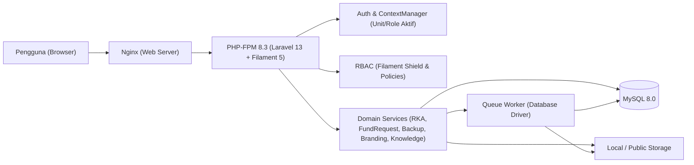

# SIMRKA / e-RKA — Politeknik Kampar

**Sistem Informasi Perencanaan dan Penganggaran (SIMRKA / e-RKA)** adalah aplikasi web terpadu untuk perencanaan Rencana Kerja dan Anggaran (RKA), pengendalian pagu unit kerja, serta pengajuan dan verifikasi pencairan dana di lingkungan **Politeknik Kampar**.


---

## Daftar Isi

1. [Tentang Aplikasi](#1-tentang-aplikasi)
2. [Fitur dan Modul](#2-fitur-dan-modul)
3. [Teknologi yang Digunakan](#3-teknologi-yang-digunakan)
4. [Arsitektur Aplikasi](#4-arsitektur-aplikasi)
5. [Struktur Direktori](#5-struktur-direktori)
6. [Persyaratan Sistem](#6-persyaratan-sistem)
7. [Instalasi Development Lokal](#7-instalasi-development-lokal)
8. [Deployment Production](#8-deployment-production)
9. [Backup dan Restore](#9-backup-dan-restore)
10. [Testing dan Quality Assurance](#10-testing-dan-quality-assurance)
11. [Troubleshooting](#11-troubleshooting)
12. [Keamanan](#12-keamanan)
13. [Kontribusi dan Pengembangan](#13-kontribusi-dan-pengembangan)
14. [Lisensi dan Informasi Institusi](#14-lisensi-dan-informasi-institusi)

---

## 1. Tentang Aplikasi

**SIMRKA (e-RKA)** dibangun untuk mendigitalisasi siklus perencanaan anggaran tahunan hingga realisasi pencairan dana di **Politeknik Kampar**. Aplikasi ini menggantikan proses penyusunan RKA berbasis spreadsheet manual yang rentan terhadap inkonsistensi kode akun, keterlambatan rekapitulasi antarunit, dan kesulitan pelacakan sisa pagu.

### Tujuan dan Ruang Lingkup

- **Perencanaan & Pengusulan RKA**: Menyediakan alur penyusunan RKA terstruktur per unit/departemen berdasarkan jadwal pengusulan, indikator kegiatan, item belanja, dan penyesuaian anggaran.
- **Pengendalian Pagu & Kode Akun (COA)**: Mengelola hierarki kode akun belanja serta alokasi pagu per unit kerja pada setiap periode jadwal RKA.
- **Review, Persetujuan, & Rekonsiliasi**: Mendukung proses review berjenjang, persetujuan RKA, pembukaan kunci (*unlock request*) RKA disetujui, import/export format Excel RKA, serta rekonsiliasi antarunit.
- **Transaksi Pencairan Dana**: Memfasilitasi pengajuan pencairan dana yang terhubung dengan RKA disetujui, verifikasi keuangan, persetujuan pimpinan, dan cetak dokumen PDF resmi.
- **Tata Kelola Hak Akses (RBAC)**: Menerapkan pemisahan kewenangan berbasis peran (*role*) dan konteks unit kerja aktif.

---

## 2. Fitur dan Modul

### A. Modul Manajemen RKA

| Modul / Menu | Deskripsi & Fungsi Utama | Aktor / Role Terkait |
|---|---|---|
| **Pengusulan & Review RKA** (`RkaHeaderResource`) | Penyusunan dokumen RKA per unit (header, indikator, item belanja, penyesuaian), submit usulan, review item, persetujuan berjenjang, log aktivitas RKA, serta import/export Excel RKA disetujui. | `pemohon`, `keuangan`, `wadir_keuangan`, `direktur`, `super_admin`, `staf_keuangan` (lihat) |
| **Jadwal Pengusulan RKA** (`RkaScheduleResource`) | Pengelolaan periode/fase pengusulan RKA dan status aktif jadwal. | `super_admin`, `keuangan` |
| **Pengaturan RKA** (`RkaSettingResource`) | Konfigurasi parameter dan aturan umum penyusunan RKA. | `super_admin`, `keuangan` |
| **Konfigurasi Generate RKA** (`RkaGenerateConfigResource`) | Pengaturan template/aturan otomatis untuk inisialisasi struktur RKA. | `super_admin`, `keuangan` |
| **Permintaan Buka Kunci RKA** (`ManageUnlockRequestsPage`) | Pengajuan dan persetujuan pembukaan kunci (*unlock*) terhadap dokumen RKA yang sudah berstatus disetujui. | `pemohon`, `keuangan`, `wadir_keuangan`, `direktur`, `super_admin` |
| **Rekonsiliasi Antarunit** (`ManageReconciliationsPage`) | Monitoring dan pencocokan penyesuaian item RKA antarunit kerja (`CrossUnitItemMatcher`, `RkaReconciliationService`). | `keuangan`, `wadir_keuangan`, `direktur`, `super_admin` |

### B. Modul Transaksi

| Modul / Menu | Deskripsi & Fungsi Utama | Aktor / Role Terkait |
|---|---|---|
| **Pengajuan Dana** (`FundRequestResource`) | Pengajuan pencairan dana oleh unit kerja yang terhubung dengan item RKA disetujui dan pagu unit, dilengkapi verifikasi bagian keuangan, persetujuan pimpinan, unggah lampiran, serta pratinjau/cetak PDF resmi. | `pemohon`, `keuangan`, `wadir_keuangan`, `direktur`, `super_admin`, `staf_keuangan` (lihat) |

### C. Modul Manajemen Anggaran & Master Data

| Modul / Menu | Deskripsi & Fungsi Utama | Aktor / Role Terkait |
|---|---|---|
| **Kode Akun (COA)** (`AccountResource`) | Pengelolaan daftar kode akun belanja hierarkis, termasuk fitur export data, download template Excel, dan import massal COA. | `super_admin`, `keuangan`, `staf_keuangan` (lihat) |
| **Alokasi Pagu Unit** (`DepartmentBudgetResource`) | Pengaturan pagu anggaran per unit kerja berdasarkan jadwal RKA, mendukung import Excel pagu unit. | `super_admin`, `keuangan`, `staf_keuangan` (lihat) |
| **Unit / Departemen** (`DepartmentResource`) | Pengelolaan master data unit kerja/departemen di lingkungan Politeknik Kampar. | `super_admin`, `keuangan`, `staf_keuangan` (lihat) |

### D. Modul Administrasi, Keamanan, & Pendukung

| Modul / Menu | Deskripsi & Fungsi Utama | Aktor / Role Terkait |
|---|---|---|
| **Pengguna** (`UserResource`) | Manajemen akun pengguna, penugasan multi-unit (`user_departments`), dan multi-role. | `super_admin` |
| **Peran & Izin** (`FilamentShieldPlugin`) | Manajemen role dan granular permission untuk resource, page, dan widget melalui **Filament Shield**. | `super_admin` |
| **Identitas Aplikasi** (`BrandIdentitySettings`) | Pengaturan nama aplikasi, tagline, deskripsi singkat, logo (light/dark/compact/login), favicon, dan logo dokumen PDF. | `super_admin` |
| **Manajemen Backup Database** (`BackupManagement`) | Pembuatan backup database (seluruh tabel atau tabel terpilih) dalam format SQL maupun CSV secara asinkron melalui queue job, serta pengunduhan arsip backup. | `super_admin` |
| **Pusat Panduan & Artikel** (`KnowledgeCenterPage`, `KnowledgeArticleResource`, `KnowledgeCategoryResource`) | Pusat dokumentasi penggunaan aplikasi berbasis role dan modul, dilengkapi ekspor buku panduan PDF (per role, lengkap, maupun per artikel). | Seluruh pengguna terautentikasi (baca), `super_admin` (kelola) |
| **Pembersihan Data RKA** (`CleanDataRkaPage`) | Alat pengembang (khusus environment non-production) untuk pratinjau dan pembersihan data operasional RKA selama pengujian. | `super_admin` (non-production) |
| **Dashboard & Context Switcher** | Dashboard analitik berbasis izin per role (statistik, grafik pencairan, matriks performa unit, antrean verifikasi/persetujuan) serta switcher unit kerja dan role aktif pada topbar. | Seluruh pengguna sesuai permission |

---

## 3. Teknologi yang Digunakan

Versi berikut diverifikasi dari `composer.lock`, `package-lock.json`, `Dockerfile`, dan `docker-compose.yml`:

| Kategori | Teknologi | Versi Terpasang | Fungsi |
|---|---|---|---|
| **Bahasa Pemrograman** | PHP | `^8.3` (`8.3-fpm` pada Docker) | Runtime backend aplikasi |
| **Framework Backend** | Laravel Framework | `v13.35.0` | Core MVC, routing, ORM, queue, scheduler |
| **Admin Panel** | Filament | `v5.10.0` | Antarmuka admin, resource, form, table, action, widget |
| **Fullstack Reactive UI** | Livewire | `v4.4.7` | Komponen interaktif & `context-switcher` |
| **RBAC & Permission** | Filament Shield (`bezhansalleh/filament-shield`) | `4.3.1` | Manajemen role dan sinkronisasi permission Filament |
| **Permission Core** | Spatie Laravel Permission | `8.3.0` | Penyimpanan role & permission pada database |
| **Database** | MySQL | `8.0` | Penyimpanan data relasional utama (SQLite `:memory:` untuk testing) |
| **Web Server** | Nginx | `nginx:alpine` | Reverse proxy HTTP/HTTPS ke PHP-FPM |
| **Export / Import Excel** | Maatwebsite Excel (`maatwebsite/excel`) + PhpSpreadsheet | `4.0.3` / `5.10.0` | Import/export RKA disetujui, COA, pagu unit, dan template Excel |
| **Generator PDF** | Barryvdh Laravel DomPDF (`barryvdh/laravel-dompdf`) | `v3.1.2` | Cetak dokumen pengajuan dana dan buku panduan PDF |
| **Backup Plugin** | `shuvroroy/filament-spatie-laravel-backup` + `spatie/laravel-backup` | `v4.1.0` / `10.3.3` | Infrastruktur paket backup Laravel |
| **Frontend Build Tool** | Vite + `laravel-vite-plugin` | `8.3.3` / `3.2.0` | Bundling asset CSS & JS |
| **CSS Framework** | Tailwind CSS + `@tailwindcss/vite` | `4.3.3` | Styling tema custom Filament dan halaman Blade |
| **Frontend Runtime** | Node.js | `22-alpine` | Eksekusi Vite dan manajemen paket NPM |
| **Testing & Code Quality** | Pest (`pestphp/pest`) & Laravel Pint | `v4.7.8` / `v1.32.1` | Pengujian otomatis (Unit/Feature) dan formatting kode PHP |

---

## 4. Arsitektur Aplikasi

### Gambaran Umum Arsitektur

- **Backend**: Laravel 13 dengan Filament 5 sebagai panel administratif utama pada path `/admin` (`AdminPanelProvider`). Logika bisnis dipisahkan ke dalam layer `app/Services/` (seperti `ApprovedRkaImportService`, `RkaApprovalService`, `RkaReconciliationService`, `FundRequestBudgetService`, `DatabaseBackupService`, `BrandSettingsService`, `KnowledgeCenterService`) serta `app/Filament/Actions/` dan `app/Policies/`.
- **Frontend & Rendering**: Menggunakan Filament SPA mode (`->spa()`), Livewire 4, dan Blade templates dengan tema khusus yang dikompilasi oleh Vite 8 dan Tailwind CSS 4 (`resources/css/filament/admin/theme.css`).
- **Database & ORM**: Eloquent ORM dengan MySQL 8.0 di environment Docker/production. Struktur database mencakup master data (`departments`, `accounts`, `users`), perencanaan RKA (`rka_schedules`, `rka_settings`, `rka_generate_configs`, `rka_headers`, `rka_indicators`, `rka_items`, `rka_adjustments`, `rka_item_reviews`, `rka_approvals`, `rka_logs`, `rka_approved_import_batches`, `rka_unlock_requests`, `rka_adjustment_matches`, `rka_reconciliation_histories`), pagu & transaksi (`department_budgets`, `fund_requests`, `fund_request_items`, `fund_request_verifications`, `fund_request_approvals`), serta tabel pendukung (`brand_settings`, `knowledge_*`, `backup_*`, `jobs`, `cache`, `sessions`, `notifications`).
- **Authentication & Context Switching**: Autentikasi panel ditangani oleh Filament (`App\Filament\Pages\Auth\Login`) dengan session driver `database`. Pengguna yang terhubung ke lebih dari satu unit kerja atau memiliki lebih dari satu peran dapat mengganti konteks unit/peran aktif melalui komponen Livewire `context-switcher` (`ContextManager` pada `ContextServiceProvider`).
- **Authorization / RBAC**: Dikelola melalui **Filament Shield** dan **Laravel Policies** (`app/Policies/*`). Dalam `AppServiceProvider::boot()`, `Gate::before` memberikan akses kepada `super_admin`, namun permission untuk **Widget** dan **Page** tetap ditegakkan secara eksplisit melalui Shield (`define_via_gate = false` pada `config/filament-shield.php`). Pembatasan data lintas unit dikontrol melalui permission khusus seperti `ViewAllUnits:FundRequest`, `ViewAllUnits:RkaHeader`, dan `ViewAllUnits:DepartmentBudget`.
- **Storage, Upload, & Export/Import**:
  - Disk `local` (`storage/app/private`) digunakan untuk file privat seperti hasil backup database (`backups/{uuid}/`) dan lampiran internal.
  - Disk `public` (`storage/app/public`, ditautkan ke `public/storage`) digunakan untuk aset branding (`branding/`).
  - Disk `backups` (`BACKUP_DISK_PATH`, default `/backups`) tersedia pada konfigurasi filesystem dan volume Docker.
  - Proses import/export Excel menggunakan `maatwebsite/excel`, sedangkan dokumen PDF dihasilkan melalui `barryvdh/laravel-dompdf`.



---

## 5. Struktur Direktori

```text
sistem-keuangan/
├── app/
│   ├── Exports/                  # Class export Excel (COA, template RKA disetujui, sheets)
│   ├── Filament/
│   │   ├── Actions/              # Custom action RKA (submit, review, direktur)
│   │   ├── Imports/              # Filament importer (Account, DepartmentBudget, User)
│   │   ├── Pages/                # Halaman kustom (Login, Backup, CleanDataRka, KnowledgeCenter, Rekonsiliasi, Unlock, Branding)
│   │   ├── Resources/            # Resource CRUD Filament (RkaHeader, FundRequest, Account, DepartmentBudget, User, dll.)
│   │   └── Widgets/              # Widget dashboard per role & konteks
│   ├── Helpers/                  # Fungsi helper global (app/Helpers/helpers.php)
│   ├── Http/
│   │   ├── Controllers/          # Controller PDF (FundRequest, KnowledgeBook) & download backup
│   │   └── Resources/            # API/HTTP resource
│   ├── Imports/                  # Import Excel (RkaImportFormatExcel, RkaItemsImport, AccountImport, UsersImport)
│   ├── Jobs/                     # Background job (RunDatabaseBackup)
│   ├── Models/                   # Eloquent models
│   ├── Policies/                 # Authorization policies (terintegrasi Filament Shield)
│   ├── Providers/                # AppServiceProvider, ContextServiceProvider, AdminPanelProvider
│   └── Services/                 # Layer logika bisnis (RKA, FundRequest, Dashboard, Backup, Branding, Knowledge, Context)
├── bootstrap/                    # Bootstrap aplikasi Laravel
├── config/                       # Konfigurasi Laravel, Shield, Backup, Filesystems, Database, dll.
├── database/
│   ├── migrations/               # Skema migrasi database
│   └── seeders/                  # Seeder master data, RBAC, akun admin awal, pengaturan, panduan
├── nginx/
│   └── conf.d/                   # Konfigurasi Nginx lokal (default.conf) dan template production (prod.conf.example)
├── public/                       # Document root publik web server
├── resources/
│   ├── css/                      # Tailwind CSS & tema Filament (resources/css/filament/admin/theme.css)
│   ├── js/                       # Entry point JavaScript
│   └── views/                    # Template Blade (PDF, komponen Livewire, halaman kustom Filament)
├── routes/
│   ├── console.php               # Perintah Artisan console
│   └── web.php                   # Route web terautentikasi (PDF preview, lampiran, download template, backup)
├── storage/                      # Logs, cache framework, file private & public
├── tests/
│   ├── Feature/                  # Pengujian fitur (RBAC, RKA, FundRequest, Backup, Keamanan, Seeder)
│   └── Unit/                     # Pengujian unit
├── .env.example                  # Template environment development/umum
├── .env.production.example       # Template environment server production
├── composer.json                 # Dependency & script PHP/Laravel
├── docker-compose.yml            # Orkestrasi container development lokal
├── docker-compose.prod.yml       # Orkestrasi container production
├── Dockerfile                    # Image PHP 8.3-FPM + ekstensi + Composer
├── Makefile                      # Shortcut perintah Docker Compose (up, stop, restart, bash-app, bash-node)
├── package.json                  # Dependency & script frontend Vite/Tailwind
├── phpunit.xml                   # Konfigurasi Pest/PHPUnit
├── vite.config.js                # Konfigurasi Vite & Tailwind CSS v4
└── README.md                     # Dokumentasi utama repository
```

---

## 6. Persyaratan Sistem

### Lingkungan Docker (Direkomendasikan)

Aplikasi ini dirancang berjalan penuh di dalam container Docker (`docker-compose.yml` dan `docker-compose.prod.yml`) dengan spesifikasi:

- **Docker Engine** & **Docker Compose** (`docker compose`)
- **Make** (opsional, untuk shortcut `Makefile`)
- **Git**

### Spesifikasi Runtime & Ekstensi (Jika Menjalankan / Build Manual)

- **PHP**: `>= 8.3` dengan ekstensi `pdo_mysql`, `zip`, `intl`, `gd` (dengan freetype & jpeg), `opcache`, `mbstring`, `xml`, `bcmath`, `curl`, `fileinfo`
- **Database**: MySQL `8.0` (atau MariaDB yang kompatibel; SQLite digunakan otomatis pada environment testing `phpunit.xml`)
- **Composer**: Composer 2.x
- **Node.js & Package Manager**: Node.js `22` (Alpine pada Docker) dan `npm` (lockfile menggunakan `package-lock.json`)
- **Web Server**: Nginx (Alpine) atau web server lain yang mengarahkan document root ke `public/`

> **Catatan Penting Environment Docker**: Apabila menggunakan environment Docker proyek, seluruh perintah `php`, `artisan`, `composer`, `pint`, `pest`, `npm`, dan `node` dijalankan melalui container (`docker compose exec app ...` atau `docker compose exec node ...`), bukan langsung di host.

---

## 7. Instalasi Development Lokal

### A. Clone Repository

```bash
git clone https://github.com/mahdiawan-nk/simrka-polkam.git
cd simrka-polkam
```

### B. Salin dan Konfigurasi Environment

```bash
cp .env.example .env
```

Sesuaikan variabel penting pada `.env` untuk environment lokal Docker (perhatikan `DB_CONNECTION` pada `.env.example` default-nya `sqlite`, ubah ke `mysql` agar terhubung ke container `db`):

```dotenv
APP_NAME="e-RKA"
APP_ENV=local
APP_KEY=
APP_DEBUG=true
APP_URL=http://localhost:28900

APP_LOCALE=id
APP_FALLBACK_LOCALE=id

DB_CONNECTION=mysql
DB_HOST=db
DB_PORT=3306
DB_DATABASE=erka
DB_USERNAME=erka
DB_PASSWORD=erka

SESSION_DRIVER=database
CACHE_STORE=database
QUEUE_CONNECTION=database
FILESYSTEM_DISK=local
MAIL_MAILER=log

# Akun Super Admin awal untuk db:seed
INITIAL_ADMIN_NAME=Administrator
INITIAL_ADMIN_EMAIL=admin@example.com
INITIAL_ADMIN_PASSWORD=CHANGE_ME_LOCAL_PASSWORD
```

> **Catatan**: `InitialAdminSeeder` mewajibkan `INITIAL_ADMIN_EMAIL` dan `INITIAL_ADMIN_PASSWORD` terisi saat pertama kali melakukan seeding jika belum ada user dengan role `super_admin`.

### C. Jalankan Container Docker

```bash
make up
# atau:
docker compose up -d
```

Layanan yang aktif pada `docker-compose.yml`:
- `erka_app` (PHP-FPM 8.3)
- `erka_webserver` (Nginx pada port host `28900:80`)
- `erka_db` (MySQL 8.0 pada port host `3306:3306`)
- `erka_node` (Node.js 22 Alpine, otomatis menjalankan `npm install && npm run dev -- --host 0.0.0.0` pada port `5173`)

### D. Install Dependency Backend

```bash
docker compose exec app composer install
```

### E. Generate Application Key

```bash
docker compose exec app php artisan key:generate
```

### F. Setup Database (Migration & Seeder)

Pastikan container `db` sudah siap menerima koneksi, lalu jalankan migrasi dan seeder awal:

```bash
docker compose exec app php artisan migrate
docker compose exec app php artisan db:seed
```

`DatabaseSeeder` bersifat *idempotent* (aman dijalankan ulang) dan mengisi data awal berikut:
- `Departmentseeder` & `AccountDataSeeder` (master unit dan kode akun dasar)
- `RoleSeeder` & `PermissionSeeder` (`super_admin`, `direktur`, `wadir_keuangan`, `keuangan`, `staf_keuangan`, `pemohon`, `panel_user`)
- `DashboardRbacSeeder` & `DashboardWidgetPermissionSeeder` (permission dashboard & widget)
- `InitialAdminSeeder` (membuat akun `super_admin` awal dari variabel `.env`)
- `ApplicationSettingsSeeder` & `KnowledgeCenterSeeder` (pengaturan awal & artikel pusat panduan)

> **Peringatan**: Hindari penggunaan `php artisan migrate:fresh` pada database yang sudah berisi data operasional karena akan menghapus seluruh tabel dan data.

### G. Storage Link dan Permission

```bash
docker compose exec app php artisan storage:link
```

Pastikan direktori `storage/` dan `bootstrap/cache/` dapat ditulis oleh user aplikasi (`appuser` dengan `APP_UID`/`APP_GID` yang sesuai di `.env` atau default `1000:1000`).

### H. Build Asset Frontend

Pada mode Docker development, container `node` otomatis menjalankan Vite dev server (`npm run dev -- --host 0.0.0.0`). Untuk menjalankan build produksi atau manual di dalam container `node`:

```bash
# Install dependency frontend (jika belum otomatis)
docker compose exec node npm install

# Development server (HMR)
docker compose exec node npm run dev

# Production build
docker compose exec node npm run build
```

### I. Menjalankan Aplikasi & Proses Latar Belakang

1. **Akses Aplikasi**: Buka `http://localhost:28900/admin` pada browser.
2. **Queue Worker (Opsional di lokal, wajib jika menguji Backup/Job asinkron)**:
   ```bash
   docker compose exec app php artisan queue:work --sleep=3 --tries=3
   ```
3. **Scheduler (Opsional di lokal)**:
   ```bash
   docker compose exec app php artisan schedule:work
   ```

---

## 8. Deployment Production

Repository menyediakan konfigurasi production siap pakai melalui `docker-compose.prod.yml`, `.env.production.example`, dan `nginx/conf.d/prod.conf.example`.

### A. Persiapan Server

- OS Linux server (misalnya Ubuntu LTS / Debian) dengan **Docker Engine** dan **Docker Compose** terpasang.
- Port `80` (HTTP) dan `443` (HTTPS) terbuka pada firewall.
- Sertifikat SSL/TLS valid (misalnya dari Let's Encrypt) ditempatkan pada `./nginx/certs/fullchain.pem` dan `./nginx/certs/privkey.pem`.

### B. Clone Repository

Clone repository pada direktori target di server dan checkout ke branch yang ditentukan untuk rilis (sesuaikan nama branch rilis organisasi):

```bash
git clone https://github.com/mahdiawan-nk/simrka-polkam.git
cd simrka-polkam
```

### C. Konfigurasi Environment Production

Salin template production dan lengkapi nilainya:

```bash
cp .env.production.example .env
```

Pastikan variabel berikut terkonfigurasi dengan aman:
- `APP_ENV=production`
- `APP_DEBUG=false`
- `APP_URL=https://simrka.polkam.ac.id` (sesuaikan domain aktual)
- `DB_CONNECTION=mysql`, `DB_HOST=db`, `DB_DATABASE`, `DB_USERNAME`, `DB_PASSWORD`, serta `DB_ROOT_PASSWORD` (dibutuhkan oleh `docker-compose.prod.yml` untuk inisialisasi container `db`)
- `SESSION_ENCRYPT=true`, `SESSION_SECURE_COOKIE=true`, `SESSION_HTTP_ONLY=true`, `SESSION_SAME_SITE=lax`
- `LOG_CHANNEL=daily`, `LOG_LEVEL=warning`
- `MAIL_MAILER=smtp` beserta konfigurasi SMTP institusi
- `INITIAL_ADMIN_NAME`, `INITIAL_ADMIN_EMAIL`, `INITIAL_ADMIN_PASSWORD` (untuk inisialisasi pertama kali)

### D. Konfigurasi Web Server (Nginx)

Salin konfigurasi Nginx production dan sesuaikan `server_name` serta path sertifikat SSL:

```bash
cp nginx/conf.d/prod.conf.example nginx/conf.d/default.conf
```

Pastikan pada konfigurasi Nginx:
- `root` mengarah ke `/var/www/html/public`.
- `fastcgi_pass` mengarah ke `erka_app_prod:9000`.
- Akses ke file tersembunyi (seperti `.env`, `.git`) diblokir (`location ~ /\.(?!well-known).* { deny all; }`).

### E. Build Asset & Jalankan Container Production

1. Build asset frontend sebelum atau menggunakan container Node sementara, atau pastikan `public/build` sudah ter-generate:
   ```bash
   docker compose run --rm --no-deps node sh -c "npm ci && npm run build"
   ```
   *(Atau jalankan `npm ci && npm run build` melalui container `node` jika `docker-compose.yml` digunakan untuk build).*
2. Jalankan stack production (`app`, `queue`, `scheduler`, `webserver`, `db`):
   ```bash
   docker compose -f docker-compose.prod.yml up -d --build
   ```
3. Install dependency PHP tanpa paket development:
   ```bash
   docker compose -f docker-compose.prod.yml exec app composer install --no-dev --optimize-autoloader
   ```
4. Generate `APP_KEY` (hanya pada instalasi pertama kali):
   ```bash
   docker compose -f docker-compose.prod.yml exec app php artisan key:generate --force
   ```

### F. Database Migration, Seeding Awal, & Storage Link

Selalu lakukan backup database sebelum menjalankan migrasi pada server yang sudah memiliki data.

```bash
# Migrasi database production
docker compose -f docker-compose.prod.yml exec app php artisan migrate --force

# Seeding awal (HANYA pada instalasi pertama; seeder bersifat idempotent, namun tinjau sebelum dijalankan di data existing)
docker compose -f docker-compose.prod.yml exec app php artisan db:seed --force

# Tautan storage publik
docker compose -f docker-compose.prod.yml exec app php artisan storage:link
```

### G. Optimasi Laravel

```bash
docker compose -f docker-compose.prod.yml exec app php artisan optimize
docker compose -f docker-compose.prod.yml exec app php artisan filament:optimize
```

### H. Queue Worker dan Scheduler

Pada `docker-compose.prod.yml`, service **queue** dan **scheduler** sudah didefinisikan sebagai container terpisah:
- `erka_queue_prod`: menjalankan `php artisan queue:work --sleep=3 --tries=3 --max-time=3600`
- `erka_scheduler_prod`: menjalankan `php artisan schedule:run --no-interaction` setiap 60 detik.

Jika melakukan deployment manual di Linux tanpa Docker, jalankan `queue:work` di bawah **Supervisor** dan daftarkan `* * * * * cd /path/to/project && php artisan schedule:run >> /dev/null 2>&1` pada **crontab**.

### I. Checklist Keamanan & Verifikasi Production

- [ ] `APP_ENV=production` dan `APP_DEBUG=false`.
- [ ] HTTPS aktif dengan redirect HTTP -> HTTPS serta header keamanan (`HSTS`, `X-Frame-Options`, `X-Content-Type-Options`).
- [ ] File `.env` tidak dapat diakses publik dan tidak masuk ke repository Git.
- [ ] Halaman pengembangan `CleanDataRkaPage` otomatis nonaktif saat `APP_ENV=production`.
- [ ] Uji login ke `/admin`, verifikasi aset CSS/JS termuat, dan uji pembuatan backup database.

---

## 9. Backup dan Restore

Aplikasi menyediakan fitur **Manajemen Backup Database** (`app/Filament/Pages/Database/BackupManagement.php` & `app/Services/Database/DatabaseBackupService.php`) yang terintegrasi dengan queue job `RunDatabaseBackup`.

### Backup Melalui Panel Admin

1. Masuk sebagai `super_admin` dan buka menu **Manajemen Backup Database** (`/admin/database/backup`).
2. Pilih tipe backup: **Full Database** atau **Tabel Tertentu**.
3. Pilih format keluaran: **SQL** atau **CSV**.
4. Sistem menjalankan job `RunDatabaseBackup` di latar belakang (membutuhkan queue worker aktif) dan menyimpan arsip ke disk `local` (`storage/app/private/backups/<uuid>/`).
5. File hasil backup dapat diunduh melalui rute terautentikasi `/database/backups/files/{backupFile}/download`.

### Backup Manual via Docker (Database & Storage)

- **Backup Database MySQL**:
  ```bash
  docker compose exec db mysqldump -u erka -p erka > backup_erka_$(date +%Y%m%d_%H%M%S).sql
  ```
- **Backup File Storage**:
  Arsipkan direktori `storage/app/private` (lampiran & backup aplikasi) dan `storage/app/public` (aset branding).

### Restore Database

Restore database dilakukan secara manual oleh administrator database menggunakan file `.sql` hasil backup:

```bash
docker compose exec -T db mysql -u erka -p erka < backup_erka_YYYYMMDD_HHMMSS.sql
```

> **Catatan**: Belum tersedia fitur restore otomatis satu-klik dari UI admin; seluruh proses restore database maupun pemulihan file `storage/app` dilakukan secara manual setelah verifikasi integritas file backup.

---

## 10. Testing dan Quality Assurance

Pengujian otomatis menggunakan **Pest** (`phpunit.xml` dikonfigurasi dengan SQLite `:memory:`, `CACHE_STORE=array`, `QUEUE_CONNECTION=sync`).

### Menjalankan Seluruh Test Suite

```bash
docker compose exec app vendor/bin/pest
# atau:
docker compose exec app php artisan test --compact
```

### Menjalankan File Test Tertentu

```bash
docker compose exec app vendor/bin/pest tests/Feature/RkaReviewServiceTest.php
docker compose exec app vendor/bin/pest tests/Feature/AuthAndIdorSecurityTest.php
```

### Formatting & Linting Kode PHP (Laravel Pint)

```bash
docker compose exec app vendor/bin/pint --dirty --format agent
# Cek tanpa mengubah file:
docker compose exec app vendor/bin/pint --test
```

### Pemeriksaan Konfigurasi & Route

```bash
docker compose exec app php artisan about
docker compose exec app php artisan migrate:status
docker compose exec app php artisan route:list
```

---

## 11. Troubleshooting

| Permasalahan | Kemungkinan Penyebab | Solusi |
|---|---|---|
| **Database connection failed** | Container `db` belum siap, `DB_HOST` masih `127.0.0.1` alih-alih `db`, atau kredensial `.env` tidak cocok dengan `docker-compose.yml`. | Pastikan `DB_HOST=db` pada `.env`, cek status container dengan `docker compose ps`, dan pastikan service `db` sehat. |
| **Asset CSS/JS Filament atau Tailwind tidak termuat** | Manifest Vite (`public/build/manifest.json`) belum dibangun atau container `node` tidak berjalan. | Jalankan `docker compose exec node npm run build` (production) atau pastikan container `node` aktif saat development. |
| **Permission denied pada `storage/` atau `bootstrap/cache/`** | Kepemilikan direktori tidak sesuai dengan user PHP-FPM (`appuser`). | Sesuaikan `APP_UID` dan `APP_GID` saat build container atau perbaiki permission direktori `storage` dan `bootstrap/cache`. |
| **Backup database tetap berstatus pending / tidak selesai** | Queue worker tidak berjalan (`QUEUE_CONNECTION=database`). | Jalankan `docker compose exec app php artisan queue:work` (lokal) atau pastikan container `erka_queue_prod` berjalan di production. |
| **Upload file / lampiran gagal** | Ukuran file melebihi batas `client_max_body_size` Nginx (`32M`) atau `upload_max_filesize` PHP (`15M`). | Pastikan ukuran berkas sesuai batas atau sesuaikan konfigurasi Nginx dan `Dockerfile` bila diperlukan. |
| **Perubahan konfigurasi `.env` tidak terbaca** | Cache konfigurasi Laravel masih aktif. | Jalankan `docker compose exec app php artisan optimize:clear`. |
| **Error `InitialAdminSeeder` gagal saat `db:seed`** | `INITIAL_ADMIN_EMAIL` atau `INITIAL_ADMIN_PASSWORD` kosong pada `.env` dan belum ada akun `super_admin`. | Isi `INITIAL_ADMIN_EMAIL` dan `INITIAL_ADMIN_PASSWORD` di `.env`, lalu jalankan ulang `php artisan db:seed`. |

---

## 12. Keamanan

- **Proteksi Environment**: Jangan pernah melakukan commit file `.env`, `.env.production`, sertifikat SSL, atau file backup database ke dalam repository Git.
- **Mode Debug**: Selalu pastikan `APP_DEBUG=false` dan `APP_ENV=production` di server production.
- **Prinsip Least Privilege & RBAC**: Berikan peran sesuai tanggung jawab pengguna melalui **Filament Shield**. Hindari memberikan role `super_admin` atau permission `ViewAllUnits:*` kepada pengguna unit biasa.
- **Enkripsi Transport & Cookie**: Gunakan HTTPS/TLS pada Nginx production dengan `SESSION_SECURE_COOKIE=true` dan `SESSION_ENCRYPT=true`.
- **Upload & Storage**: File sensitif disimpan pada disk `local` (`storage/app/private`) dan hanya dapat diakses melalui controller terautentikasi dengan pemeriksaan otorisasi.
- **Pemantauan Log**: Pantau log harian pada `storage/logs/` secara berkala.

---

## 13. Kontribusi dan Pengembangan

1. Buat branch fitur atau perbaikan dari branch utama (`main`), misalnya `feature/nama-fitur` atau `fix/nama-perbaikan`.
2. Seluruh eksekusi PHP, Artisan, Composer, Pest, Pint, dan NPM wajib dijalankan melalui container Docker (`docker compose exec app ...` atau `docker compose exec node ...`).
3. Ikuti standar kode proyek:
   - Jalankan Laravel Pint sebelum commit (`docker compose exec app vendor/bin/pint --dirty --format agent`).
   - Tambahkan atau perbarui pengujian Pest pada `tests/Feature` atau `tests/Unit` untuk setiap perubahan logika bisnis atau otorisasi.
   - Pastikan seluruh test lulus sebelum mengajukan Pull Request.
4. Catatan repository: Aturan `.gitignore` mengabaikan seluruh file `*.md` selain `README.md` di root repository agar dokumentasi internal sementara tidak ikut ter-commit.

---

## 14. Lisensi dan Informasi Institusi

- **Lisensi Perangkat Lunak**: Mengacu pada `composer.json`, proyek ini menggunakan lisensi [MIT](https://opensource.org/licenses/MIT).
- **Institusi**: **Politeknik Kampar** — Sistem Informasi Perencanaan dan Penganggaran (SIMRKA / e-RKA).
