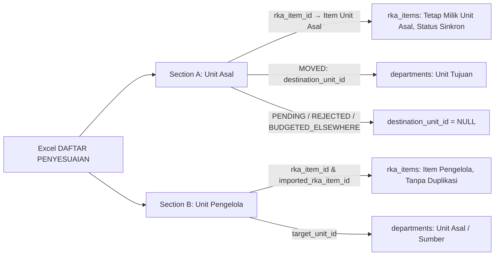

# Dokumentasi Implementasi: Penyesuaian Import Approved RKA — Section A & Section B

**Tanggal:** 2026-11-16  
**Branch:** `feature/rka-approved-excel-import`  
**Audit Pendukung:** [APPROVED-RKA-ADJUSTMENT-AUDIT.md](APPROVED-RKA-ADJUSTMENT-AUDIT.md)

---

## 1. Ringkasan Masalah Awal

1. **Status Section A & Section B tidak sepenuhnya konsisten dengan review manual (`RkaReviewService`)**:
   - `NativeRkaWorkbookParser` belum memetakan `REJECTED_WITH_ADJUSTMENT` di Section A dan meng-hardcode seluruh Section B menjadi `ACTION_SHARED_COST` (mengabaikan `MOVED` maupun `ADDED_BY_REVIEWER`).
   - `ApprovedRkaImportService::buildAdjustmentPayload()` tidak mengisi `rka_indicator_id` pada Section A dan tidak menyetel `approved_amount = 0` untuk seluruh aksi Section A (`MOVED`, `REJECTED`, `REJECTED_WITH_ADJUSTMENT`, `REMOVED`, `BUDGETED_ELSEWHERE`, `PENDING`).
2. **Relasi `rka_item_id` & `imported_rka_item_id`**:
   - Pada Section A, jika item asal sudah ada di `rka_items` pada `rka_header_id` Draft/Reimport namun tidak muncul di sheet `BELANJA` Excel, `rka_item_id` menjadi `null` dan status item pada `rka_items` tidak diselaraskan.
   - Pada Section B, parser hanya mengisi `imported_item_id` lewat formula referensi sheet (jika bukan formula langsung, gagal terhubung) dan `rka_item_id` selalu `null`.
3. **Idempotency**:
   - `persistAdjustments()` belum menggunakan `updateOrCreate` berbasis `rka_header_id + rka_item_id + section_type` atau `source_ref_id`.

---

## 2. Konsep Section A & Section B



- **Section A (Item Milik Unit Asal):** Item tetap milik `rka_header_id` unit asal (tidak dihapus dan kepemilikan tidak dipindahkan). `destination_unit_id` hanya diisi jika `action_type = MOVED`. Seluruh status Section A memiliki `approved_amount = 0` pada unit asal.
- **Section B (Item Milik Unit Pengelola):** Item belanja tetap berada di `rka_items` unit pengelola tanpa duplikasi. `target_unit_id` menyimpan unit asal/sumber. Jika item belanja pengelola teridentifikasi unik, `rka_item_id` dan `imported_rka_item_id` ditautkan ke item tersebut.

---

## 3. Struktur Database (Sebelum & Sesudah)

Tidak ada perubahan schema (tidak ada migration baru). Seluruh kolom pada `rka_items` dan `rka_adjustments` sudah tersedia:
- **Sebelum:** `rka_adjustments.rka_indicator_id` = `NULL` pada import Section A; `rka_adjustments.rka_item_id` = `NULL` pada Section B; `rka_adjustments.action_type` pada Section B selalu `SHARED_COST`; `approved_amount` pada Section A selain `PENDING` masih mengikuti Excel jika terisi.
- **Sesudah:** `rka_indicator_id` terisi dari item asal Section A; `rka_item_id` dan `imported_rka_item_id` terhubung deterministik pada Section B tanpa membuat `RkaItem` duplikat; `action_type` Section B membaca `MOVED` / `ADDED_BY_REVIEWER` / `SHARED_COST`; seluruh aksi Section A menyetel `approved_amount = 0`; `rka_items.status` pada Section A diselaraskan tanpa menghapus item.

---

## 4. Perubahan File dan Class

| File | Perubahan |
|---|---|
| `app/Services/ApprovedRkaImport/NativeRkaWorkbookParser.php` | Memperluas `mapAdjustmentActionType()` (`REJECTED_WITH_ADJUSTMENT`, `MOVED`, `BUDGETED_ELSEWHERE`, `REJECTED`, `REMOVED`, `PENDING`), menambah `mapSectionBActionType()` (`MOVED`, `ADDED_BY_REVIEWER`, `SHARED_COST`), serta menambah pencocokan deterministik unik Section B ke `BELANJA` pengelola saat formula referensi tidak tersedia. |
| `app/Services/ApprovedRkaImport/ApprovedRkaImportService.php` | Memperbarui `buildAdjustmentPayload()` (`rka_indicator_id`, `approved_amount = 0` untuk Section A, relasi `rka_item_id` + `imported_rka_item_id` untuk Section B), menambah `findUniqueExistingItemId()` untuk pencocokan deterministik item eksisting di DB, dan menambah `upsertIdempotentAdjustment()` pada `persistAdjustments()` & `persistAdjustmentsForDraft()`. |
| `resources/views/filament/resources/rka-headers/components/adjustment-sections.blade.php` | Menampilkan `Unit Asal / Sumber` Section B dari relasi `$adj->targetUnit?->name ?? '—'` (konsisten dengan Section A, tanpa hardcode `'Internal / Pusat'`). |
| `tests/Feature/ApprovedRkaAdjustmentConsistencyTest.php` | Test suite khusus untuk Skenario 1–8 (P3M, Prodi TIF, UPT ICT). |

---

## 5. Mapping Excel ke Database & Aturan Relasi

| Bagian Excel | `section_type` | `action_type` | `rka_item_id` | `imported_rka_item_id` | `destination_unit_id` | `target_unit_id` | `approved_amount` |
|---|---|---|---|---|---|---|---|
| Section A (`MOVED`) | `A` | `MOVED` | Item unit asal (jika unik) | `NULL` | Unit tujuan | `NULL` | `0.00` |
| Section A (`PENDING` / `REJECTED` / `REJECTED_WITH_ADJUSTMENT` / `REMOVED` / `BUDGETED_ELSEWHERE`) | `A` | Sesuai status | Item unit asal (jika unik) | `NULL` | `NULL` | `NULL` | `0.00` |
| Section B (`MOVED` / `SHARED_COST` / `ADDED_BY_REVIEWER`) | `B` | Sesuai status | Item unit pengelola (jika unik) | Item unit pengelola (jika unik) | `NULL` | Unit asal/sumber | Sesuai Excel |

---

## 6. Aturan Kepemilikan Item

1. `rka_items.rka_header_id` **tidak pernah** diubah oleh proses adjustment Section A maupun Section B.
2. Item Section A yang berstatus `MOVED`, `PENDING`, `REJECTED`, `REMOVED`, atau `BUDGETED_ELSEWHERE` **tetap ada** di `rka_items` unit asal (`approved_volume = 0`, `approved_total = 0`, `is_trimmed = true`).
3. Section B **tidak pernah** membuat `RkaItem` baru; item belanja pengelola berasal dari worksheet `BELANJA` atau item eksisting pada RKA pengelola.

---

## 7. Contoh Query Verifikasi Database

```sql
-- Verifikasi Section A (kepemilikan item asal & destination_unit_id)
SELECT a.id, a.rka_header_id, a.section_type, a.action_type, a.rka_item_id, a.rka_indicator_id,
       a.destination_unit_id, a.target_unit_id, a.approved_amount, i.rka_header_id AS item_owner_header_id, i.status AS item_status
FROM rka_adjustments a
LEFT JOIN rka_items i ON i.id = a.rka_item_id
WHERE a.section_type = 'A'
ORDER BY a.id DESC
LIMIT 20;

-- Verifikasi Section B (relasi item pengelola & unit sumber target_unit_id tanpa duplikasi)
SELECT a.id, a.rka_header_id, a.section_type, a.action_type, a.rka_item_id, a.imported_rka_item_id,
       a.destination_unit_id, a.target_unit_id, a.approved_amount, d.name AS source_unit_name
FROM rka_adjustments a
LEFT JOIN departments d ON d.id = a.target_unit_id
WHERE a.section_type = 'B'
ORDER BY a.id DESC
LIMIT 20;
```

---

## 8. Risiko atau Keterbatasan

1. Pada workbook Excel yang tidak mencantumkan item `MOVED` / `REJECTED` di sheet `BELANJA` dan juga belum memiliki item tersebut di RKA Draft DB, `rka_item_id` secara sah bernilai `NULL` agar tidak terbentuk relasi palsu.
2. Pencocokan berbasis konten (`kode_rekening` + `uraian` + `nominal`) hanya membentuk relasi bila tepat 1 kandidat cocok (`MATCH_UNIQUE`); jika terdapat >1 item identik (`MATCH_AMBIGUOUS`), relasi dibiarkan `NULL` untuk pemeriksaan manual.
