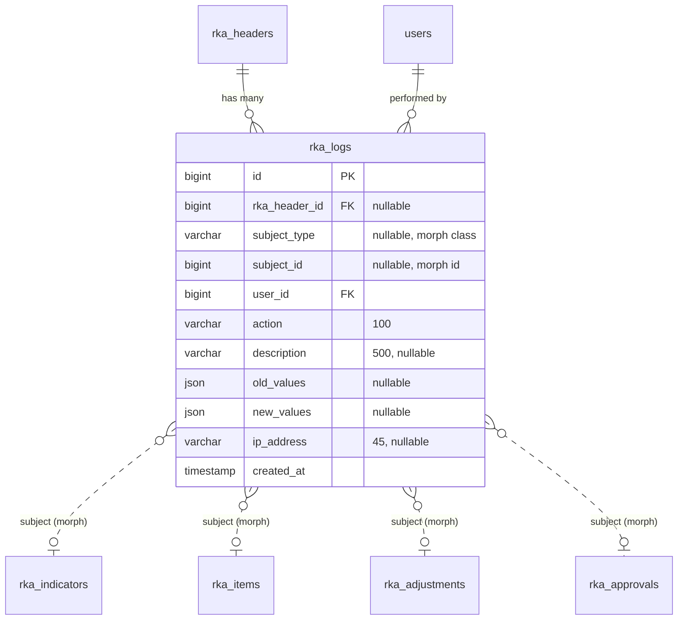

# RKA Comprehensive Activity Log Design (`rka_logs`)

## A. Audit Schema Existing (`rka_logs`)

Hasil inspeksi aktual tabel `rka_logs` di MySQL (`erka`):

| Kolom | Tipe | Nullable | Default | Keterangan |
|---|---|---|---|---|
| `id` | `bigint unsigned` | NO | `auto_increment` | Primary Key |
| `rka_header_id` | `bigint unsigned` | YES | `NULL` | FK -> `rka_headers.id` (`ON DELETE CASCADE`) |
| `user_id` | `bigint unsigned` | NO | - | FK -> `users.id` |
| `action` | `varchar(100)` | NO | - | Kode event/aksi (`RkaLog::ACTION_*`) |
| `old_values` | `json` | YES | `NULL` | Snapshot nilai sebelum perubahan |
| `new_values` | `json` | YES | `NULL` | Snapshot nilai sesudah perubahan / metadata |
| `ip_address` | `varchar(45)` | YES | `NULL` | IP client saat aksi dilakukan |
| `created_at` | `timestamp` | NO | `CURRENT_TIMESTAMP` | Waktu pencatatan aktivitas |

Index existing:
- `PRIMARY KEY (id)`
- `rka_logs_rka_header_id_foreign (rka_header_id)`
- `rka_logs_user_id_foreign (user_id)`

---

## B. Kebutuhan Pencatatan Aktivitas RKA

`RkaLog` berfungsi sebagai **centralized activity history** untuk `RkaHeader` dan seluruh entitas turunannya:

1. **`RkaHeader`**:
   - Pembuatan RKA (`GENERATED`, `CREATED`)
   - Perubahan metadata header (`UPDATED`)
   - Penghapusan header (`DELETED`)
   - Perubahan status alur persetujuan (`SUBMITTED`, `REVIEW_STARTED`, `FORWARDED_TO_DIREKTUR`, `APPROVED`, `REVISION_REQUIRED`)
2. **`RkaIndicator`**:
   - Penambahan program/indikator (`PROGRAM_ADDED`)
3. **`RkaItem`**:
   - Penambahan item (`ITEM_ADDED`)
   - Perubahan item (`ITEM_UPDATED`)
   - Penghapusan item (`ITEM_DELETED`)
   - Pembersihan seluruh item (`ITEMS_CLEARED`)
   - Import Excel item (`ITEMS_IMPORTED`)
4. **`RkaAdjustment`**:
   - Review item yang menghasilkan/memperbarui adjustment (`ITEM_REVIEWED`)
   - Bulk approve (`ITEMS_BULK_APPROVED`) & bulk move (`ITEMS_BULK_MOVED`)
   - Penambahan penyesuaian manual Section B (`ADJUSTMENT_ADDED`)
   - Penghapusan penyesuaian (`ADJUSTMENT_DELETED`)
   - Import adjustment ke item (`ADJUSTMENT_IMPORTED`)
5. **`RkaApproval`**:
   - Pencatatan keputusan persetujuan (`RkaApproval` terkait `SUBMITTED`, `FORWARDED`, `APPROVED`, `REVISION_REQUIRED`).

---

## C. Gap Analysis

| Aspek | Kondisi Existing | Gap | Solusi |
|---|---|---|---|
| Entity tracking | Hanya `rka_header_id` | Tidak dapat memfilter/menelusuri langsung record entitas anak (`RkaItem`, `RkaAdjustment`, `RkaIndicator`, `RkaApproval`) tanpa parsing JSON | Tambah kolom nullable `subject_type` (`varchar(120)`) & `subject_id` (`bigint unsigned`) + index `(subject_type, subject_id)` |
| Deskripsi ringkas | Di-derive di accessor `RkaLog::getDescriptionAttribute()` | Tidak tersimpan eksplisit di database untuk audit eksternal/query langsung | Tambah kolom nullable `description` (`varchar(500)`) dengan fallback accessor tetap aktif untuk row lama |
| Performa query | Hanya FK index tunggal | Filter per header + urutan terbaru & filter per action belum terindeks optimal | Tambah composite index `(rka_header_id, created_at)` dan `(rka_header_id, action)` |

---

## D. ERD & Desain Schema Additive

Migrasi bersifat **additive & reversible** (tidak mengubah atau menghapus data `rka_logs` existing):
- `subject_type` `string(120)->nullable()->after('rka_header_id')`
- `subject_id` `unsignedBigInteger()->nullable()->after('subject_type')`
- `description` `string(500)->nullable()->after('action')`
- Index:
  - `idx_rka_logs_subject (subject_type, subject_id)`
  - `idx_rka_logs_header_created (rka_header_id, created_at)`
  - `idx_rka_logs_header_action (rka_header_id, action)`

---

## E. Alur Penyimpanan Skenario Utama

1. **Generate / Create RKA Header**: `subject = RkaHeader`, `action = GENERATED|CREATED`, `new_values = {department_id, fiscal_year, status}`.
2. **Update / Delete RKA Header**: `subject = RkaHeader`, `action = UPDATED|DELETED`, `old_values` & `new_values` berisi diff atribut yang berubah.
3. **Add Program / Indicator**: `subject = RkaIndicator`, `action = PROGRAM_ADDED`, `new_values = {program_name, indicator_name, target_description}`.
4. **Add / Update / Delete Item**: `subject = RkaItem`, `action = ITEM_ADDED|ITEM_UPDATED|ITEM_DELETED`, `old_values`/`new_values` berisi `activity_name`, `account_code`, `proposed_volume`, `unit_price`, `total_proposed`.
5. **Import / Clear Items**: `subject = RkaHeader`, `action = ITEMS_IMPORTED|ITEMS_CLEARED`, `new_values` berisi ringkasan jumlah item & total anggaran.
6. **Review Item (`RkaReviewService::reviewItem`)**: `subject = RkaAdjustment` (jika ada adjustment) atau `RkaItem`, `action = ITEM_REVIEWED`, `old_values` (status & nilai sebelum review), `new_values` (`adjustment_status`, `section_type`, `approved_amount`, `target_department_id` bila `MOVED`, `note`).
7. **Cross-Unit `MOVED` / Bulk Move**: `subject = RkaAdjustment` (single) / `RkaHeader` (bulk), mencatat `source_department_id`, `target_department_id`, dan daftar/jumlah item terdampak.
8. **Workflow Approval (`RkaApprovalService`)**: `subject = RkaApproval` (dengan `rka_header_id` terhubung ke header), mencatat transisi `status` header (`old_values` -> `new_values`) dan catatan review/persetujuan.

---

## F. Verifikasi Query

- **Timeline per RKA Header (terurut terbaru):**
  `RkaLog::where('rka_header_id', $headerId)->with('user')->latest('created_at')->latest('id')->paginate(10)`
- **Filter per Subject Entity:**
  `RkaLog::forSubject($item)->get()` menggunakan index `idx_rka_logs_subject`.
- **Filter per Action & User pada UI:**
  Kombinasi `where('rka_header_id', ...)` + optional `where('action', ...)` + optional `where('user_id', ...)` memanfaatkan index `idx_rka_logs_header_action` dan `idx_rka_logs_header_created`.

---

## G. Strategi Transaksi, Error Handling & Keamanan

- Pencatatan log dilakukan **di dalam transaksi database** yang sama dengan mutasi bisnis sehingga jika transaksi di-rollback, log tidak tercatat sebagai aktivitas palsu (konsisten atomik).
- `RkaActivityLogService` menyaring field sensitif (`password`, `remember_token`, `api_token`, dll.) sebelum menyimpan ke `old_values`/`new_values`.
- `RkaLog` bersifat **append-only** di UI: tidak ada action Create, Edit, atau Delete di tampilan Riwayat Aktivitas.
- Akses halaman yang menampilkan Riwayat Aktivitas (`ReviewRkaPage`, `RkaFormIndicatorAndItem`) dijaga oleh policy `view` pada `RkaHeader`.

---

## H. Duplicate Activity Log Investigation

### Gejala Masalah
Pada pengujian langsung aplikasi SIMRKA sebelum perbaikan, satu aktivitas review item (`PENDING`) menghasilkan **dua record identik** pada tabel `rka_logs` (`id = 108` dan `id = 109`, `rka_header_id = 116`, `user_id = 7`, `action = REVIEW_UPDATE`, `item_id = 325`, `created_at = 2026-11-15 14:34:38`).

### Root Cause
Hasil audit menyeluruh terhadap seluruh pemanggilan `RkaLog::record()`, `RkaActivityLogService`, Model Observer, Model Events (`created`/`updated`/`saved`/`deleted`), Event/Listener, Filament Pages, dan Filament Actions:
- **Tidak ditemukan** Model Observer maupun Model Events pada model RKA (`RkaHeader`, `RkaIndicator`, `RkaItem`, `RkaAdjustment`, `RkaApproval`).
- **Penyebab utama duplikasi** adalah blok logging ganda di dalam `App\Services\RkaReviewService`:
  1. `RkaReviewService::reviewItem()` memiliki dua blok `if ($actionType === 'MOVED') ... else ...` berurutan yang keduanya memanggil `RkaLog::record()`, sehingga setiap review item atau move item menghasilkan 2 log identik.
  2. `RkaReviewService::bulkMoveItems()` juga memiliki dua blok `if ($items->isNotEmpty())` berurutan yang keduanya mencatat `ACTION_ADJUSTMENT_MOVE` untuk header asal dan target.

### Pemetaan Jalur Aktivitas

| Aktivitas | Entry Point | Service / Action | Observer / Event | Lokasi Logging | Potensi Duplikasi |
|---|---|---|---|---|---|
| Create / Update / Delete RKA Header | `CreateRkaHeader`, `EditRkaHeader` | Filament Page lifecycle | Tidak ada | `CreateRkaHeader::afterCreate`, `EditRkaHeader::afterSave`, `DeleteAction::before` | Tidak ada |
| Generate RKA | `RkaSchedulesTable` | `RkaGenerateService::generate()` | Tidak ada | `RkaGenerateService::generate()` | Tidak ada |
| Tambah Program / Item / Update / Hapus / Clear / Import | `RkaFormIndicatorAndItem` (`RkaActions`) atau `RkaItemService` | `RkaActions` / `RkaItemService` | Tidak ada | `RkaActions` (UI) atau `RkaItemService` (service) — tidak saling memanggil untuk item/program | Tidak ada |
| Submit / Start Review / Forward / Approve / Revision | `RkaActions::submitRka`, `RkaReviewActions`, `RkaDirekturActions` | `RkaApprovalService` | Tidak ada | `RkaApprovalService` (action UI hanya memanggil service) | Tidak ada |
| Review Item & Bulk Move | `RkaReviewActions` | `RkaReviewService::reviewItem()`, `bulkMoveItems()` | Tidak ada | `RkaReviewService` (sebelumnya memiliki blok logging ganda) | **YA (sudah diperbaiki)** |
| Add / Delete Adjustment & Bulk Approve | `RkaReviewActions` | `RkaReviewService` | Tidak ada | `RkaReviewService` | Tidak ada |

### Perubahan Arsitektur & Pencegahan Duplikasi
1. **Satu Sumber Pencatatan:** Seluruh aktivitas RKA dipusatkan melalui `App\Services\RkaActivityLogService::log()` tanpa Model Observer paralel. Action UI hanya memanggil service (kecuali `RkaActions` item/program yang mengeksekusi langsung tanpa memanggil `RkaItemService`).
2. **Pembersihan Blok Ganda:** Blok logging duplikat pada `RkaReviewService::reviewItem()` dan `RkaReviewService::bulkMoveItems()` telah dihapus.
3. **Idempotency Support:** `RkaActivityLogService::log()` mendukung parameter opsional `?string $idempotencyKey = null` untuk mencegah duplikasi pada skenario retry dengan identitas event yang sama, tanpa memblokir dua aktivitas sah yang terjadi berurutan oleh user dan subject yang sama.

### Kondisi Data Historis
Hasil query read-only pada tabel `rka_logs` database `erka`:
- Total record: `2` (`id = 108` dan `id = 109`, keduanya `REVIEW_UPDATE` pada `rka_header_id = 116`, `created_at = 2026-11-15 14:34:38`).
- Sesuai aturan keselamatan data, record historis tersebut **tidak dihapus secara otomatis**.

### Hasil Regression Test
Diverifikasi pada `tests/Feature/RkaActivityLogTest.php` melalui entry point bisnis (`addProgram`, `addItem`, `updateItem` berurutan, `submitByPemohon`, `startReviewByWadir`, `reviewItem`, `addAdjustment`, `deleteAdjustment`, `bulkMoveItems`, `approveByDirektur`, `generate`, `idempotencyKey` retry, dan rollback transaksi).
