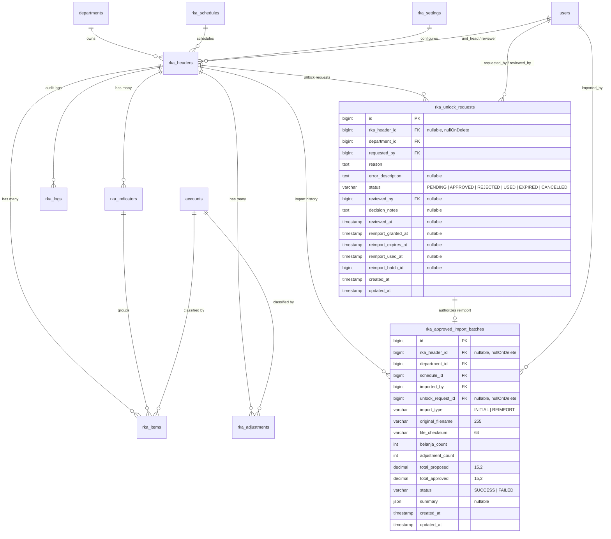

# ERD & Desain Schema Database — Import Approved RKA & Controlled Unlock

## 1. Mermaid ERD

---

## 2. Detail Tabel & Kolom Baru

### 2.1. `rka_approved_import_batches`
Menyimpan riwayat setiap eksekusi Import Approved RKA (baik `INITIAL` maupun `REIMPORT`).
- Foreign key `rka_header_id` menggunakan `nullOnDelete()` agar riwayat import **tidak ikut terhapus** jika `rka_headers` dihapus.
- Foreign key `unlock_request_id` menggunakan `nullOnDelete()`.
- Index: `(rka_header_id, created_at)`, `(department_id, schedule_id)`.

### 2.2. `rka_unlock_requests`
Menyimpan pengajuan pembukaan kunci oleh `pemohon` serta keputusan persetujuan/penolakan oleh tim keuangan (`keuangan` / `wadir_keuangan`).
- Foreign key `rka_header_id` menggunakan `nullOnDelete()` untuk menjaga audit history.
- Kolom `status`: `PENDING`, `APPROVED`, `REJECTED`, `USED`, `EXPIRED`, `CANCELLED`.
- Kolom one-time reimport authorization: `reimport_granted_at`, `reimport_expires_at`, `reimport_used_at`, `reimport_batch_id`.
- Index: `(rka_header_id, status)`, `(department_id, status)`, `(requested_by, status)`.

### 2.3. Penambahan Kolom Additive pada `rka_items` & `rka_adjustments`
- `source_ref_id` (`varchar(64)`, nullable, indexed) pada `rka_items` dan `rka_adjustments` untuk menyimpan `ITEM_REF_ID` / `ADJ_REF_ID` asal dari Excel template agar proses **import ulang (reimport)** dapat melakukan rekonsiliasi secara deterministik tanpa duplikasi.
