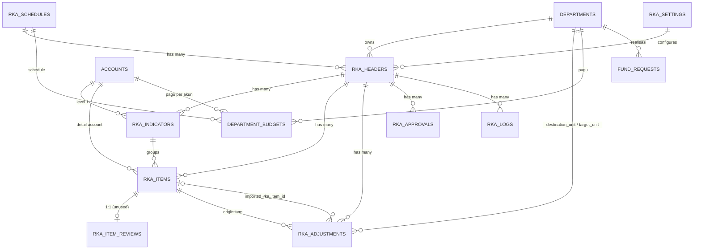
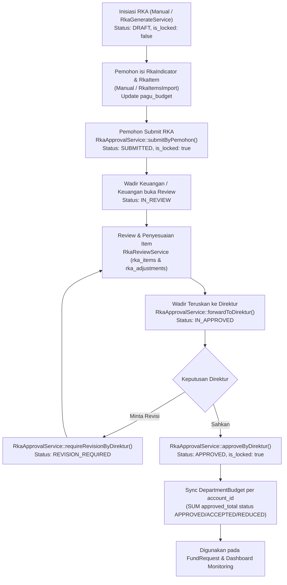
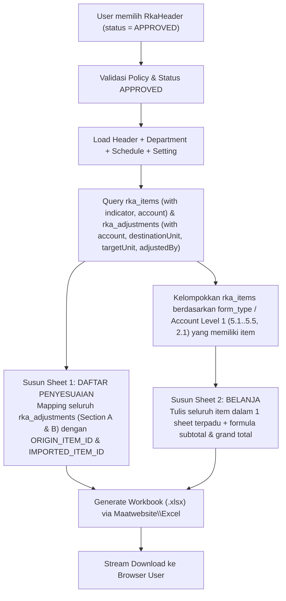
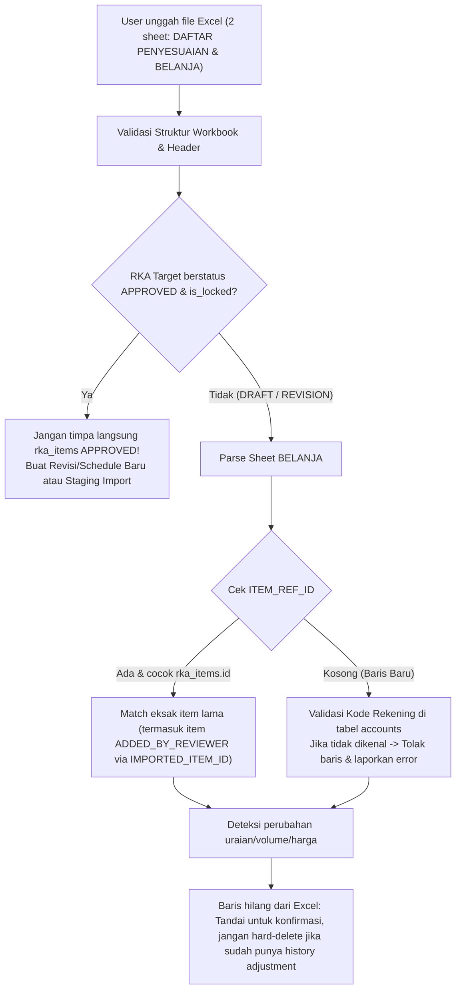

# Audit Mendalam Codebase SIMRKA: Existing RKA Workflow & Proposed Approved RKA Excel Template

**Repository:** `mahdiawan-nk/simrka-polkam`  
**Branch Aktif:** `feature/rka-approved-excel-import` (working tree bersih / *clean* sebelum penulisan laporan)  
**Tanggal Audit:** 15 November 2026  
**Mode Pekerjaan:** Audit & Dokumentasi Saja (*Read-Only* terhadap source code dan database)

---

## 1. Executive Summary

Modul **Pengusulan & Review RKA** pada aplikasi SIMRKA (`app/Filament/Resources/RkaHeaders`) sudah memiliki fondasi alur kerja *end-to-end* mulai dari pembuatan dokumen RKA (`RkaGenerateService` atau CRUD `RkaHeaderResource`), pengisian program/indikator (`RkaIndicator`) dan item belanja (`RkaItem`) baik secara manual maupun impor Excel (`RkaItemsImport` / `RkaImportFormatExcel`), pengajuan oleh unit (`RkaApprovalService::submitByPemohon`), penelaahan dan penyesuaian oleh tim keuangan/Wadir Keuangan (`RkaReviewService`, `ReviewRkaPage`), hingga pengesahan oleh Direktur (`RkaApprovalService::approveByDirektur`) yang otomatis membentuk pagu transaksi per akun pada tabel `department_budgets`.

Namun, audit menemukan beberapa fakta krusial yang wajib menjadi dasar perancangan fitur baru **Generate Approved RKA Excel Template** (2 sheet: `DAFTAR PENYESUAIAN` dan `BELANJA`):

1. **Belum ada fitur export/generate template RKA yang sudah disetujui** di seluruh codebase (`app/Exports/` hanya berisi `AccountExport` dan `AccountTemplateExport`).
2. **File referensi `05_RKA_2026-2027_UPT_ICT.xlsx` tidak ditemukan di dalam repository workspace**, sehingga struktur format Excel existing hanya dapat diverifikasi melalui `App\Imports\RkaImportFormatExcel` dan `App\Imports\RkaItemsImport`.
3. **Delapan konstanta status penyesuaian** pada `App\Models\RkaAdjustment` tidak semuanya memiliki jalur eksekusi yang seragam:
   - `MOVED`, `BUDGETED_ELSEWHERE`, `REJECTED_WITH_ADJUSTMENT`, `REJECTED`, `REMOVED`, dan `PENDING` tersedia di form review item (`ReviewItemForm`), namun `PENDING` pada `ReviewItemForm` diarahkan ke `section_type = 'B'` pada `rka_adjustments` (padahal `PENDING` adalah item ditunda).
   - `SHARED_COST` dan `ADDED_BY_REVIEWER` **tidak ada** di `ReviewItemForm`; keduanya hanya tersedia melalui form tambah penyesuaian manual (`AddAdjustmentForm` → `RkaReviewService::addAdjustment()`).
   - `RkaReviewService::addAdjustment()` **tidak mengisi** kolom `unit_symbol` (yang bertipe `NOT NULL` di migrasi `2026_10_17_031130_add_column_table_rka_adjustments.php`), dan `RkaReviewService::importAdjustmentToItem()` **tidak mengisi** kolom `form_type` (yang bertipe `NOT NULL` di `rka_items`).
4. **Tabel `rka_item_reviews` dan `rka_logs` belum terhubung** ke alur `RkaReviewService` maupun `RkaApprovalService` saat ini; seluruh hasil review item disimpan langsung di kolom `rka_items` (`approved_volume`, `approved_total`, `price_trimed`, `is_trimmed`, `status`, `review_notes`).
5. **Berita Acara** belum ditemukan implementasinya di codebase (`BeritaAcara` tidak ada di model, controller, maupun view).
6. **Penyatuan 6 kelompok belanja ke dalam 1 sheet `BELANJA`** sangat mungkin dilakukan dengan mengacu pada `form_type` / prefix kode `Account` Level 1 (`5.1`, `5.2`, `5.3`, `5.4`, `5.5`, `2.1`) serta relasi `rka_items.rka_indicator_id` dan `rka_items.account_id`.

---

## 2. Scope Audit

Audit dilakukan secara *read-only* terhadap repository `mahdiawan-nk/simrka-polkam` pada branch `feature/rka-approved-excel-import` dengan cakupan:

1. **Direktori Fokus Utama:** `app/Filament/Resources/RkaHeaders/` (Catatan: nama aktual folder menggunakan `RkaHeaders`, bukan `RKAHeaders`).
2. **Action & Service RKA:** `app/Filament/Actions/Rka/`, `app/Services/Rka*.php`, `app/Imports/Rka*.php`.
3. **Models & Migrations:** Seluruh model RKA (`RkaHeader`, `RkaIndicator`, `RkaItem`, `RkaAdjustment`, `RkaItemReview`, `RkaApproval`, `RkaLog`, `RkaSchedule`, `RkaSetting`, `RkaGenerateConfig`) serta model terkait (`Account`, `Department`, `DepartmentBudget`, `FundRequest`, `User`).
4. **RBAC & Context:** `app/Policies/RkaHeaderPolicy.php`, `app/Services/Context/ContextManager.php`, `app/Providers/Filament/AdminPanelProvider.php`.
5. **Views & Tests:** `resources/views/filament/resources/rka-headers/`, `tests/Feature/RkaReviewServiceTest.php`, `tests/Feature/RkaSchemaAndStatusTest.php`.

**Hal di luar cakupan / tidak ditemukan:**
- File Excel eksternal `05_RKA_2026-2027_UPT_ICT.xlsx` tidak ada di dalam workspace.
- Tidak ada eksekusi mutasi database, migrasi, atau perubahan source code.

---

## 3. Daftar File dan Class yang Dipelajari

| Kategori | File Path | Class / Komponen |
|---|---|---|
| Filament Resource | `app/Filament/Resources/RkaHeaders/RkaHeaderResource.php` | `RkaHeaderResource` |
| Filament Pages | `app/Filament/Resources/RkaHeaders/Pages/ListRkaHeaders.php` | `ListRkaHeaders` |
| Filament Pages | `app/Filament/Resources/RkaHeaders/Pages/CreateRkaHeader.php` | `CreateRkaHeader` |
| Filament Pages | `app/Filament/Resources/RkaHeaders/Pages/EditRkaHeader.php` | `EditRkaHeader` |
| Filament Pages | `app/Filament/Resources/RkaHeaders/Pages/RkaFormIndicatorAndItem.php` | `RkaFormIndicatorAndItem` |
| Filament Pages | `app/Filament/Resources/RkaHeaders/Pages/ReviewRkaPage.php` | `ReviewRkaPage` |
| Filament Tables | `app/Filament/Resources/RkaHeaders/Tables/RkaHeadersTable.php` | `RkaHeadersTable` |
| Filament Schemas | `app/Filament/Resources/RkaHeaders/Schemas/RkaHeaderForm.php` | `RkaHeaderForm` |
| Filament Schemas | `app/Filament/Resources/RkaHeaders/Schemas/AddProgramForm.php` | `AddProgramForm` |
| Filament Schemas | `app/Filament/Resources/RkaHeaders/Schemas/AddItemForm.php` | `AddItemForm` |
| Filament Schemas | `app/Filament/Resources/RkaHeaders/Schemas/ImportExcelForm.php` | `ImportExcelForm` |
| Filament Schemas | `app/Filament/Resources/RkaHeaders/Schemas/ReviewItemForm.php` | `ReviewItemForm` |
| Filament Schemas | `app/Filament/Resources/RkaHeaders/Schemas/AddAdjustmentForm.php` | `AddAdjustmentForm` |
| Filament Schemas | `app/Filament/Resources/RkaHeaders/Schemas/BulkMoveForm.php` | `BulkMoveForm` |
| Filament Actions | `app/Filament/Actions/Rka/RkaActions.php` | `RkaActions` |
| Filament Actions | `app/Filament/Actions/Rka/RkaReviewActions.php` | `RkaReviewActions` |
| Filament Actions | `app/Filament/Actions/Rka/RkaDirekturActions.php` | `RkaDirekturActions` |
| Services | `app/Services/RkaItemService.php` | `RkaItemService` |
| Services | `app/Services/RkaReviewService.php` | `RkaReviewService` |
| Services | `app/Services/RkaApprovalService.php` | `RkaApprovalService` |
| Services | `app/Services/RkaGenerateService.php` | `RkaGenerateService` |
| Services | `app/Services/Context/ContextManager.php` | `ContextManager` |
| Imports | `app/Imports/RkaItemsImport.php` | `RkaItemsImport` |
| Imports | `app/Imports/RkaImportFormatExcel.php` | `RkaImportFormatExcel` |
| Models | `app/Models/RkaHeader.php`, `RkaIndicator.php`, `RkaItem.php`, `RkaAdjustment.php`, `RkaItemReview.php`, `RkaApproval.php`, `RkaLog.php`, `RkaSchedule.php`, `RkaSetting.php`, `RkaGenerateConfig.php` | Model domain RKA |
| Models Pendukung | `app/Models/Account.php`, `Department.php`, `DepartmentBudget.php`, `FundRequest.php`, `User.php` | Master & Transaksi |
| Policies & Panel | `app/Policies/RkaHeaderPolicy.php`, `app/Providers/Filament/AdminPanelProvider.php` | Authorization & Panel |
| Blade Views | `resources/views/filament/resources/rka-headers/pages/review-rka-page.blade.php`, `resources/views/filament/resources/rka-headers/components/adjustment-sections.blade.php` | UI Review & Adjustment |
| Tests | `tests/Feature/RkaReviewServiceTest.php`, `tests/Feature/RkaSchemaAndStatusTest.php` | Feature tests RKA |

---

## 4. Existing Architecture RKA

Arsitektur modul RKA di SIMRKA mengikuti pola **Filament 5.x + Service Layer + Action Classes**:

1. **Resource & Pages Layer (`app/Filament/Resources/RkaHeaders/`):**
   - `RkaHeaderResource` mendaftarkan 6 route halaman: `index`, `create`, `edit`, `form-indicator-and-item`, `view` (keduanya memakai `RkaFormIndicatorAndItem`), dan `review` (`ReviewRkaPage`).
   - `RkaHeadersTable` menampilkan daftar RKA dan mengatur visibilitas action per role & status (`form_indicator_and_item`, `view`, `submit_rka`, `review_wadir`, `review_direktur`).
2. **Action Layer (`app/Filament/Actions/Rka/`):**
   - `RkaActions`: Action penyusunan unit (`submitRka`, `addProgram`, `addItem`, `editItem`, `importExcel`, `deleteItem`, `clearAllItems`, `calculatePagu`).
   - `RkaReviewActions`: Action review tim keuangan/Wadir (`reviewItem`, `importAdjustmentToItem`, `bulkApprove`, `bulkMove`, `addAdjustment`, `deleteAdjustment`).
   - `RkaDirekturActions`: Action alur pengesahan (`forwardToDirektur`, `approveDirektur`, `requireRevisionDirektur`).
3. **Service Layer (`app/Services/`):**
   - `RkaGenerateService`: Auto-generate `RkaHeader` (status `DRAFT`) dan `RkaIndicator` berdasarkan `RkaSchedule` dan `RkaGenerateConfig` aktif.
   - `RkaItemService`: Mengelola CRUD item, submit RKA, kalkulasi hierarki anggaran per indikator, dan impor Excel (catatan: `RkaActions::importExcel` memanggil `RkaItemsImport` langsung, sedangkan `RkaItemService::importExcel` memanggil `RkaImportFormatExcel`).
   - `RkaReviewService`: Mengelola seluruh kalkulasi review (`calculateSummaryData`, `calculateAccountHierarchy`, `calculateKontrolPagu`, `calculateRekapByKelompok`, `calculateBudgetHierarchy`), penyimpanan review item, bulk actions, serta `importAdjustmentToItem()`.
   - `RkaApprovalService`: Mengelola transisi status dokumen (`DRAFT` → `SUBMITTED` → `IN_REVIEW` → `IN_APPROVED` → `APPROVED` / `REVISION_REQUIRED`), mencatat `RkaApproval`, dan melakukan sinkronisasi pagu ke `DepartmentBudget` saat `APPROVED`.

---

## 5. Database Schema dan Entity Relationships

### 5.1 Ringkasan Tabel & Model

| Model / Class | Tabel | PK | FK Utama | Soft Delete | Keterangan Penting |
|---|---|---|---|---|---|
| `RkaHeader` | `rka_headers` | `id` | `schedule_id`, `department_id`, `setting_id`, `unit_head_user_id`, `reviewer_user_id` | Tidak | Unique constraint: `unique_schedule_department (schedule_id, department_id)`. Status: `DRAFT`, `SUBMITTED`, `IN_REVIEW`, `IN_APPROVED`, `REVISION_REQUIRED`, `APPROVED`. |
| `RkaIndicator` | `rka_indicators` | `id` | `rka_header_id`, `account_id` | Tidak | `indicator_matrix` bertipe JSON array. Mengelompokkan item berdasarkan program/kegiatan dan akun Level 1 (`5.1`, `5.2`, dst.). |
| `RkaItem` | `rka_items` | `id` | `rka_header_id`, `rka_indicator_id`, `account_id` | Tidak | `proposed_total` adalah **stored generated column** (`proposed_volume * unit_price`). Memiliki `group_header`, `form_type`, `approved_volume`, `approved_total`, `price_trimed`, `is_trimmed`, `is_imported`, `status`, `review_notes`. |
| `RkaAdjustment` | `rka_adjustments` | `id` | `rka_header_id`, `rka_indicator_id`, `rka_item_id`, `account_id`, `destination_unit_id`, `target_unit_id`, `adjusted_by`, `imported_rka_item_id` | Tidak | Menyimpan penyesuaian Section `A` dan `B`, `proposed_volume`, `unit_symbol`, `unit_price`, `proposed_amount`, `approved_amount`, `action_type`, `is_imported`. |
| `RkaItemReview` | `rka_item_reviews` | `id` | `rka_item_id` (unique), `reviewer_id` | Tidak | Tabel 1:1 untuk review item, memiliki `applyReview()` dan `resetToPending()`, namun **belum digunakan** oleh `RkaReviewService`. |
| `RkaApproval` | `rka_approvals` | `id` | `rka_header_id`, `approver_user_id` | Tidak | `$timestamps = false`, hanya `signed_at`. Menyimpan `stage` (`KA_UNIT_SUBMIT`, `VERIFIKASI_1`, `WADIR2_REVIEW`, `DIREKTUR_APPROVAL`) dan `action`. |
| `RkaLog` | `rka_logs` | `id` | `rka_header_id`, `user_id` | Tidak | `$timestamps = false`, hanya `created_at`. `RkaLog::record()` belum dipanggil di service mana pun. |
| `RkaSchedule` | `rka_schedules` | `id` | `created_by` | Tidak | Menyimpan `fiscal_year`, `period_range`, `phase_name`, `start_at`, `end_at`, `is_active`, `allow_late_submission`. |
| `RkaSetting` | `rka_settings` | `id` | `director_user_id` | Tidak | Konfigurasi penandatangan & PDF (`signing_place`, `director_name`, `foundation_head_name`, JSON config). |
| `RkaGenerateConfig` | `rka_generate_configs` | `id` | `rka_setting_id`, `created_by` | Tidak | Menyimpan `selected_department_ids` (JSON) dan `template_indicators` (JSON). |
| `Account` | `accounts` | `id` | `parent_id` (self-ref) | Tidak | Hierarki COA (`code`, `code_clean`, `name`, `level`, `level_label`, `is_centralized`). |
| `Department` | `departments` | `id` | `parent_id` (self-ref) | Tidak | Unit kerja (`type`, `code`, `level_code`, `name`). |
| `DepartmentBudget` | `department_budgets` | `id` | `department_id`, `account_id`, `schedule_id` | Tidak | Unique constraint: `dept_account_fiscal_unique (department_id, account_id, fiscal_year)`. Menyimpan `allocated_amount`. |
| `FundRequest` | `fund_requests` | `id` | `department_id`, `created_by` | Tidak | Transaksi pencairan dana yang mengecek pagu pada `DepartmentBudget`. |

### 5.2 Diagram Entity Relationship (Existing)

---

## 6. Existing RKA Workflow

Berikut rekonstruksi alur RKA aktual berdasarkan kode yang berjalan saat ini:

1. **Inisiasi RKA (`DRAFT`):**
   - *Manual:* `CreateRkaHeader` membuat `RkaHeader` baru dan mengarahkan ke `RkaFormIndicatorAndItem`.
   - *Otomatis:* `RkaGenerateService::generate()` membuat `RkaHeader` (`status = 'DRAFT'`, `pagu_budget = 0`, `is_locked = false`) dan `RkaIndicator` untuk setiap departemen pada `RkaGenerateConfig` aktif.
2. **Pengisian Program & Detail Item (`DRAFT`):**
   - Pada halaman `RkaFormIndicatorAndItem`, pemohon menambah program (`RkaActions::addProgram`) dan item belanja (`RkaActions::addItem` atau `RkaActions::importExcel` → `RkaItemsImport`).
   - Setiap penambahan/edit/hapus item memanggil `RkaIndicator::recalculateMasukanTargetValue()` dan `RkaHeader::calculatePaguRka()`, yang memperbarui `rka_headers.pagu_budget` dari `SUM(proposed_total)` item dengan `is_imported = 0`.
3. **Pengajuan Unit (`DRAFT` → `SUBMITTED`):**
   - Pemohon menekan `submit_rka` pada `RkaHeadersTable` atau `submitRka` pada `RkaFormIndicatorAndItem`.
   - Keduanya memanggil `RkaApprovalService::submitByPemohon()`, mengubah `status = 'SUBMITTED'`, `is_locked = true`, `submitted_at = now()`, dan mencatat `RkaApproval` (`stage = 'KA_UNIT_SUBMIT'`, `action = 'SUBMITTED'`).
   - *(Catatan: `RkaItemService::submitRka()` juga ada tetapi menulis `'submitted'` huruf kecil tanpa mencatat `RkaApproval` atau `submitted_at`.)*
4. **Mulai Review (`SUBMITTED` → `IN_REVIEW`):**
   - Saat `wadir_keuangan` mengklik `review_wadir` di `RkaHeadersTable`, `RkaApprovalService::startReviewByWadir()` mengubah status menjadi `IN_REVIEW` dan mencatat `RkaApproval` (`stage = 'WADIR2_REVIEW'`, `action = 'SUBMITTED'`).
   - Selain itu, `RkaReviewService::loadRkaRecord()` dan `ReviewRkaPage::loadRkaRecord()` juga otomatis mengubah `submitted` → `IN_REVIEW` jika dibuka oleh role `keuangan`, `wadir_keuangan`, atau `direktur`.
5. **Review & Penyesuaian Item (`IN_REVIEW` / `REVISION_REQUIRED`):**
   - Pada `ReviewRkaPage`, reviewer melakukan `reviewItem`, `bulkApprove`, `bulkMove`, `addAdjustment`, `deleteAdjustment`, atau `importAdjustmentToItem` melalui `RkaReviewService`.
   - Perubahan langsung ditulis ke tabel `rka_items` dan `rka_adjustments`.
6. **Penerusan ke Direktur (`IN_REVIEW` / `REVISION_REQUIRED` → `IN_APPROVED`):**
   - `wadir_keuangan` menekan `forwardToDirektur` (`RkaDirekturActions::forwardToDirektur` → `RkaApprovalService::forwardToDirektur()`). Status menjadi `IN_APPROVED`, tercatat di `rka_approvals` (`stage = 'WADIR2_REVIEW'`, `action = 'APPROVED'`).
7. **Pengesahan atau Revisi Direktur (`IN_APPROVED` → `APPROVED` / `REVISION_REQUIRED`):**
   - *Revisi:* `RkaApprovalService::requireRevisionByDirektur()` mengubah status ke `REVISION_REQUIRED` (tetap `is_locked = true`, dikembalikan ke Wadir Keuangan).
   - *Sahkan:* `RkaApprovalService::approveByDirektur()` mengubah status ke `APPROVED`, `is_locked = true`, mengagregasi `SUM(approved_total)` dari `rka_items` berstatus `APPROVED`, `ACCEPTED`, `REDUCED` per `account_id`, lalu melakukan `DepartmentBudget::updateOrCreate(...)`.
8. **Penggunaan pada Transaksi & Monitoring:**
   - `CreateFundRequestCustom` dan `EditFundRequestCustom` membaca `DepartmentBudget` berdasarkan `department_id`, `account_id`, dan `fiscal_year` untuk menampilkan pagu unit saat pengajuan dana (`FundRequest`).
   - Widget dashboard (`DepartmentStatsOverview`, `DirectorStatsOverview`, `WadirDepartmentUtilizationTable`, dll.) memantau alokasi dari `DepartmentBudget`.
9. **Tahapan yang Tidak Ditemukan di Codebase:**
   - Pembuatan **Berita Acara** review/pengesahan tidak ditemukan di codebase.
   - Pencatatan audit log ke `rka_logs` (`RkaLog::record()`) tidak dipanggil di mana pun.

### 6.1 Diagram Existing RKA Workflow

---

## 7. Existing Review dan Approval Process

Halaman `ReviewRkaPage` memiliki 4 tab utama (`ringkasan`, `sheet_rka`, `penyesuaian`, `rekap`) serta filter `selectedDepartmentId` untuk berpindah antar unit pada `schedule_id` yang sama:

- **Ringkasan (`summaryData` & `rekapByKelompok`):** Menampilkan total usulan awal (`pagu_budget`), total dipindahkan (`MOVED`), pos terpusat (`BUDGETED_ELSEWHERE`), tambahan pusat (`Section B`), usulan dibahas, dan total disetujui (`calculateApprovedTotal()`).
- **Sheet RKA (`sheet_rka`):** Menampilkan hierarki akun dan item per `RkaIndicator` (`calculateBudgetHierarchy()`). Secara default bagi `pemohon`, `showAllItems = false` (hanya menampilkan item berstatus `APPROVED`, `REJECTED_WITH_ADJUSTMENT`, `REJECTED`).
- **Penyesuaian (`penyesuaian`):** Merender `adjustment-sections.blade.php` yang memisahkan `Section A` (usulan unit yang dipindah/tidak dianggarkan) dan `Section B` (pos dikelola unit ini untuk unit lain / tambahan reviewer). Pada Section B tersedia tombol `importAdjustmentToItem` untuk menyalin data penyesuaian menjadi baris `RkaItem` (`is_imported = true`).
- **Rekap (`rekap`):** Menampilkan rekapitulasi hierarki akun (`calculateAccountHierarchy()`) dan kontrol pagu (`calculateKontrolPagu()`).

---

## 8. Analisis Delapan Status Penyesuaian

Seluruh konstanta berada di `App\Models\RkaAdjustment` (baris 79–86). Berikut hasil penelusuran implementasi aktualnya:

| Konstanta | Sumber Input UI | Perubahan `rka_items` | Record `rka_adjustments` yang Dibuat | Nilai `proposed_amount` & `approved_amount` | Dampak Total & Histori |
|---|---|---|---|---|---|
| `MOVED` | `ReviewItemForm` & `BulkMoveForm` | `status = 'MOVED'`, `approved_volume = 0`, `approved_total = 0`, `is_trimmed = true` | **2 record:** 1. Unit asal: `section_type = 'A'`, `destination_unit_id = targetDept` 2. Unit tujuan (jika punya `RkaHeader` di schedule & setting sama): `section_type = 'B'`, `target_unit_id = originDept` | Sec A: `proposed_amount = proposed_total`, `approved_amount = 0`. Sec B: `approved_amount = data['approved_total']` (atau `proposed_total` pada `bulkMoveItems`). | Mengurangi total disetujui unit asal; menambah Section B unit tujuan. Jika di-import di unit tujuan via `importAdjustmentToItem()`, dibuat `RkaItem` baru dengan `is_imported = true` dan `imported_rka_item_id` terisi. |
| `BUDGETED_ELSEWHERE` | `ReviewItemForm` | `status = 'BUDGETED_ELSEWHERE'`, `approved_volume = 0`, `approved_total = 0`, `is_trimmed = true` | 1 record di unit asal (`section_type = 'A'`), `destination_unit_id = null`, `target_unit_id = null`. | `proposed_amount = proposed_total`, `approved_amount = 0`. | Item asal tetap tersimpan di `rka_items` dengan `approved_total = 0`. Dihitung sebagai `pos_cost` di `calculateSummaryData()`. |
| `REJECTED_WITH_ADJUSTMENT` | `ReviewItemForm` | `status = 'REJECTED_WITH_ADJUSTMENT'`, `approved_volume = 0`, `approved_total = 0`, `price_trimed = newUnitPrice`, `is_trimmed = true` | 1 record di unit asal (`section_type = 'A'`), `unit_price = newUnitPrice`. | `proposed_amount = proposed_total`, `approved_amount = 0`. | Item tetap tersimpan. `RkaReviewService::calculateAccountHierarchy()` masih menghitung `proposed_total`-nya sebagai `usulan` dan `approved_total` (`0`) sebagai `approved`. |
| `REJECTED` | `ReviewItemForm` & `AddAdjustmentForm` | `status = 'REJECTED'`, `approved_volume = 0`, `approved_total = 0`, `price_trimed = originalUnitPrice`, `is_trimmed = true` | 1 record di unit asal (`section_type = 'A'`). | `proposed_amount = proposed_total`, `approved_amount = 0`. | Item tetap tersimpan dengan nilai disetujui `0`. |
| `REMOVED` | `ReviewItemForm` & `AddAdjustmentForm` | `status = 'REMOVED'`, `approved_volume = 0`, `approved_total = 0`, `is_trimmed = true` | 1 record di unit asal (`section_type = 'A'`). | `proposed_amount = proposed_total`, `approved_amount = 0`. | Item **tidak dihapus fisik** dari `rka_items` (soft/status-based), hanya dinolkan nilai disetujuinya. |
| `PENDING` | `ReviewItemForm` | `status = 'PENDING'`, `approved_volume = 0`, `approved_total = 0`, `is_trimmed = true` | **Anomali kode:** Di `RkaReviewService::reviewItem()` baris 473–474, `PENDING` tidak masuk array `$rejectedStatuses`, sehingga masuk ke **`section_type = 'B'`** (`Penyesuaian Unit Pengelola`) dengan `approved_amount = data['approved_total'] ?? 0`. | `proposed_amount = proposed_total`, `approved_amount = data['approved_total'] ?? 0`. | Tidak masuk agregasi `DepartmentBudget` saat `approveByDirektur()`, namun masuk ke Section B di tab Penyesuaian. |
| `SHARED_COST` | Hanya `AddAdjustmentForm` | Tidak mengubah item asal (`rka_item_id = null`) | 1 record manual (`section_type = 'B'` jika dipilih B), `target_unit_id = unit penerima manfaat`. | Sesuai input manual form (`proposed_amount`, `approved_amount`). | Baru menjadi `RkaItem` jika reviewer menekan `importAdjustmentToItem()`. |
| `ADDED_BY_REVIEWER` | Hanya `AddAdjustmentForm` | Tidak mengubah item asal (`rka_item_id = null`) | 1 record manual (`section_type = 'B'` jika dipilih B). | Sesuai input manual form (`proposed_amount`, `approved_amount`). | Baru menjadi `RkaItem` jika reviewer menekan `importAdjustmentToItem()`. |

**Catatan Penting Histori:**
- `RkaReviewService::reviewItem()` menggunakan `RkaAdjustment::updateOrCreate()` dengan kunci `[rka_header_id, rka_item_id, section_type]`, sehingga jika status item diubah ulang, record `rka_adjustments` sebelumnya **ditimpa** (atau dihapus jika diubah ke `APPROVED`). Histori versi perubahan tidak disimpan karena `rka_logs` belum digunakan.

---

## 9. Analisis Sheet `BELANJA`

Berdasarkan model `RkaItem`, `RkaIndicator`, `Account`, serta pengelompokan pada `RkaReviewService::calculateRekapByKelompok()` (baris 233–240), terdapat 6 kelompok belanja utama:

- `5.1` — Belanja Pegawai
- `5.2` — Belanja Barang dan Jasa
- `5.3` — Belanja Modal
- `5.4` — Belanja Hibah
- `5.5` — Belanja Pajak
- `2.1` — Pembayaran Kewajiban Jangka Pendek

Untuk menyatukan keenam kelompok ke dalam **satu sheet `BELANJA`** tanpa membuat sheet kosong bagi kelompok yang tidak digunakan unit:

1. **Identifikasi Kelompok & Kode Rekening:**
   - Kolom `Kode Rekening` diisi dari `Account::$code` (misal `5.2.1.01`).
   - Kolom `Kelompok Belanja` diisi dari nama akun Level 1 atau label `form_type` (`5.1`..`5.5`, `2.1`), sehingga seluruh kelompok berada dalam satu tabel terpadu dan dapat difilter/dikelompokkan.
2. **Dukungan Multi-Unit & Opsionalitas Kelompok:**
   - Hanya item yang benar-benar ada pada `RkaHeader` (`rka_items`) yang diekspor ke sheet `BELANJA`. Jika suatu unit hanya memiliki `5.2`, maka hanya baris `5.2` yang muncul.
3. **Rekomendasi Struktur Kolom Sheet `BELANJA`:**

| Kolom | Header Rekomendasi | Sumber Data Database | Keterangan |
|---|---|---|---|
| A | `ITEM_REF_ID` *(hidden/locked atau ID)* | `rka_items.id` | Kunci unik untuk menjaga relasi saat re-import di masa depan. |
| B | `KELOMPOK_BELANJA` | `rka_items.form_type` + nama akun Level 1 | Menyatukan 6 kelompok dalam 1 sheet. |
| C | `PROGRAM_KEGIATAN` | `rka_indicators.program_name` / `activity_name` | Konteks indikator asal item. |
| D | `KODE_REKENING` | `accounts.code` | Kode rekening detail item. |
| E | `NAMA_REKENING` | `accounts.name` | Nama akun rekening. |
| F | `GROUP_HEADER` | `rka_items.group_header` | Sub-kelompok uraian (hasil impor format Excel). |
| G | `URAIAN_ITEM` | `rka_items.description` | Deskripsi item belanja. |
| H | `VOL_USULAN` | `rka_items.proposed_volume` | Volume usulan awal unit. |
| I | `SATUAN` | `rka_items.unit_symbol` | Satuan volume. |
| J | `HARGA_SATUAN_USULAN` | `rka_items.unit_price` | Harga satuan usulan awal. |
| K | `NILAI_USULAN` | `rka_items.proposed_total` (formula Excel `H*J`) | Total usulan awal. |
| L | `VOL_DISETUJUI` | `rka_items.approved_volume` | Volume hasil review/pengesahan. |
| M | `HARGA_SATUAN_DISETUJUI` | `rka_items.price_trimed` (jika `is_trimmed` & >0, else `unit_price`) | Harga satuan final hasil review. |
| N | `NILAI_DISETUJUI` | `rka_items.approved_total` (formula Excel `L*M`) | Total anggaran disetujui. |
| O | `STATUS_ITEM` | `rka_items.status` | `APPROVED`, `ACCEPTED`, `REDUCED`, `MOVED`, `REJECTED`, dll. |
| P | `ASAL_ITEM` | `rka_items.is_imported` (+ unit sumber jika dari Section B) | Membedakan usulan asli unit vs limpahan/tambahan. |
| Q | `KETERANGAN_REVIEW` | `rka_items.review_notes` | Catatan reviewer pada item. |

---

## 10. Analisis Sheet `DAFTAR PENYESUAIAN`

Sheet `DAFTAR PENYESUAIAN` merepresentasikan seluruh record `rka_adjustments` milik `RkaHeader` terkait (baik `section_type = 'A'` maupun `'B'`), mencakup seluruh 8 status (`MOVED`, `BUDGETED_ELSEWHERE`, `REJECTED_WITH_ADJUSTMENT`, `REJECTED`, `REMOVED`, `PENDING`, `SHARED_COST`, `ADDED_BY_REVIEWER`).

**Rekomendasi Struktur Kolom Sheet `DAFTAR PENYESUAIAN`:**

| Kolom | Header Rekomendasi | Sumber Data Database | Keterangan |
|---|---|---|---|
| A | `ADJ_REF_ID` | `rka_adjustments.id` | Identitas baris penyesuaian. |
| B | `ORIGIN_ITEM_ID` | `rka_adjustments.rka_item_id` | Relasi ke `rka_items.id` asal (null jika manual `SHARED_COST`/`ADDED_BY_REVIEWER`). |
| C | `IMPORTED_ITEM_ID` | `rka_adjustments.imported_rka_item_id` | Relasi ke `rka_items.id` hasil impor di unit pengelola. |
| D | `BAGIAN` | `rka_adjustments.section_type` (`A` / `B`) | `A` = Dipindah/Ditolak dari unit; `B` = Dikelola untuk unit lain / Tambahan. |
| E | `STATUS_PENYESUAIAN` | `rka_adjustments.action_type` | Salah satu dari 8 konstanta `ACTION_*`. |
| F | `KODE_REKENING` | `accounts.code` | Kode rekening terkait. |
| G | `URAIAN` | `rka_adjustments.description` | Uraian item penyesuaian. |
| H | `UNIT_ASAL` | Sec A: `rkaHeader.department.name`; Sec B (`MOVED`/`SHARED_COST`): `targetUnit.name` atau `rkaHeader.department.name` | Menjaga kejelasan unit sumber usulan. |
| I | `UNIT_TUJUAN` | Sec A (`MOVED`): `destinationUnit.name`; Sec B (`SHARED_COST`): `targetUnit.name` | Unit tujuan pengalihan / penerima manfaat. |
| J | `VOL_USULAN` | `rka_adjustments.proposed_volume` | Volume usulan. |
| K | `SATUAN` | `rka_adjustments.unit_symbol` | Satuan. |
| L | `HARGA_SATUAN` | `rka_adjustments.unit_price` | Harga satuan. |
| M | `JUMLAH_USULAN` | `rka_adjustments.proposed_amount` | Nominal usulan awal. |
| N | `JUMLAH_DISETUJUI` | `rka_adjustments.approved_amount` | Nominal disetujui (`0` untuk Sec A penolakan/pemindahan, nominal final untuk Sec B). |
| O | `KETERANGAN_REVIEWER` | `rka_adjustments.notes` | Catatan alasan penyesuaian. |
| P | `REVIEWER` | `adjustedBy.name` | Nama user yang melakukan penyesuaian. |

**Perilaku Khusus per Status di Sheet `DAFTAR PENYESUAIAN`:**
- **`MOVED`:** Pada RKA unit asal muncul di Bagian `A` (`UNIT_TUJUAN` = `destinationUnit`, `JUMLAH_DISETUJUI = 0`); pada RKA unit pengelola muncul di Bagian `B` (`ORIGIN_ITEM_ID` sama, `IMPORTED_ITEM_ID` terisi jika sudah di-import ke `BELANJA`).
- **`SHARED_COST`:** Muncul di Bagian `B` unit pengelola dengan `UNIT_TUJUAN` = `targetUnit` dan `ORIGIN_ITEM_ID = null` (jika dibuat manual lewat `AddAdjustmentForm`).
- **`BUDGETED_ELSEWHERE`, `REJECTED_WITH_ADJUSTMENT`, `REJECTED`, `REMOVED`:** Muncul di Bagian `A` dengan `JUMLAH_DISETUJUI = 0` dan tetap membawa `ORIGIN_ITEM_ID` ke `rka_items.id`.
- **`PENDING`:** Saat ini tersimpan di `section_type = 'B'` oleh `RkaReviewService::reviewItem()`, perlu diekspos dengan label jelas dan `ORIGIN_ITEM_ID` agar tidak hilang.
- **`ADDED_BY_REVIEWER`:** Muncul di Bagian `B` dengan `ORIGIN_ITEM_ID = null`; jika sudah diimpor ke RKA unit, `IMPORTED_ITEM_ID` merujuk ke item baru di sheet `BELANJA`.

---

## 11. Proposed Template Generation Flow

Alur konseptual pembuatan file Excel template dari RKA yang sudah disetujui (`status === RkaHeader::STATUS_APPROVED`):

**Ketersediaan Data pada RKA `APPROVED`:**
- Seluruh data header (`department`, `schedule`, `setting`, `pagu_budget`), item (`rka_items`), indikator (`rka_indicators`), dan penyesuaian (`rka_adjustments`) **sudah tersedia** di database pada RKA yang berstatus `APPROVED`.
- **Catatan data tidak konsisten yang perlu ditangani saat generate:** Jika ada adjustment manual (`AddAdjustmentForm`) yang `unit_symbol`-nya kosong atau `rka_items` hasil `importAdjustmentToItem()` yang `form_type`-nya kosong, generator harus melakukan *fallback* `form_type` dari prefix `Account::$code` (2 segmen pertama, misal `5.2`).

---

## 12. Proposed Future Import Flow

Untuk mendukung pengunggahan kembali (*re-import*) template oleh unit/keuangan di masa depan tanpa merusak RKA yang telah disetujui:

**Jawaban atas 10 Pertanyaan Kunci Import Masa Depan:**
1. **Dapatkah diunggah kembali?** Ya, dengan syarat kolom referensi (`ITEM_REF_ID`, `ADJ_REF_ID`) dipertahankan sebagai kolom tersembunyi/terkunci.
2. **Identifikasi item sama:** Menggunakan `ITEM_REF_ID` (`rka_items.id`), bukan mencocokkan `description` seperti pada `RkaItemsImport::updateOrCreate()` saat ini (yang rentan duplikasi jika uraian diubah).
3. **Identifikasi item tambahan reviewer:** Ditandai oleh `ASAL_ITEM` / `is_imported = true` dan tertaut dengan `IMPORTED_ITEM_ID` di sheet `DAFTAR PENYESUAIAN`.
4. **Identifikasi item dipindahkan:** Terlihat di sheet `DAFTAR PENYESUAIAN` dengan `STATUS_PENYESUAIAN = MOVED` dan `ORIGIN_ITEM_ID` / `UNIT_TUJUAN`.
5. **Membedakan ditolak vs dihapus:** Melalui kolom `STATUS_ITEM` / `STATUS_PENYESUAIAN` (`REJECTED` vs `REMOVED`).
6. **Kelompok belanja tanpa item:** Diabaikan secara normal karena semua kelompok berada dalam 1 sheet `BELANJA` (tidak ada validasi wajib isi ke-6 kelompok).
7. **Unit mengubah uraian/volume:** Jika `ITEM_REF_ID` ada, sistem mendeteksi *diff* terhadap `description`/`proposed_volume` dan mencatat perubahan (atau memblokir jika kolom `APPROVED` dikunci).
8. **Pengguna menghapus baris Excel:** Jangan langsung `delete()` permanen jika item tersebut sudah memiliki relasi `rka_adjustments`; tampilkan *preview diff* sebelum konfirmasi.
9. **Kode rekening tidak dikenal:** Validasi lookup `accounts.code` sebelum `DB::transaction`; kumpulkan daftar baris error dan batalkan import (jangan diam-diam `continue` seperti `RkaImportFormatExcel` saat ini).
10. **Menjaga integritas & histori review:** RKA `APPROVED` tidak boleh ditimpa langsung karena sudah tersinkron ke `department_budgets`. Re-import sebaiknya masuk ke siklus jadwal revisi/perubahan baru atau tabel *staging*, serta mencatat audit trail ke `rka_logs`.

---

## 13. Data Mapping

Ringkasan pemetaan utama untuk implementasi template Excel:

| Konsep | Sumber Database | Target Excel (Sheet & Kolom) |
|---|---|---|
| Identitas RKA | `rka_headers` (`id`, `department.name`, `schedule.fiscal_year`, `status`) | Header info di atas tabel pada kedua sheet |
| Kelompok Belanja | `accounts` Level 1 (`5.1`, `5.2`, `5.3`, `5.4`, `5.5`, `2.1`) via `rka_items.form_type` | `BELANJA` → `KELOMPOK_BELANJA` |
| Detail Item | `rka_items` (`id`, `description`, `group_header`, `proposed_volume`, `unit_symbol`, `unit_price`, `proposed_total`, `approved_volume`, `approved_total`, `status`, `review_notes`, `is_imported`) | `BELANJA` → baris item |
| Penyesuaian Section A & B | `rka_adjustments` (`id`, `rka_item_id`, `imported_rka_item_id`, `section_type`, `action_type`, `account_id`, `description`, `destination_unit_id`, `target_unit_id`, `proposed_volume`, `unit_symbol`, `unit_price`, `proposed_amount`, `approved_amount`, `notes`, `adjusted_by`) | `DAFTAR PENYESUAIAN` → baris penyesuaian |

---

## 14. RBAC dan Authorization

- **Panel & Plugin:** `AdminPanelProvider` menggunakan `FilamentShieldPlugin`.
- **Policy:** `RkaHeaderPolicy` melindungi seluruh operasi standar (`ViewAny:RkaHeader`, `View:RkaHeader`, `Create:RkaHeader`, `Update:RkaHeader`, `Delete:RkaHeader`, dll.).
- **Organizational Scope (`canAccessRecord`):**
  - Role `super_admin`, `direktur`, `keuangan`, `wadir_keuangan` dapat mengakses seluruh `RkaHeader`.
  - User unit (`pemohon`) hanya dapat mengakses `RkaHeader` yang `department_id`-nya terdaftar pada relasi `User::departments()` (tabel `user_departments`).
- **Query Scope (`ListRkaHeaders::getTableQuery`):**
  - Menggunakan `ContextManagerInterface` (`getActiveRole()`, `getActiveDepartment()`).
  - `keuangan` & `wadir_keuangan` hanya melihat RKA dengan `status != 'draft'`.
  - `pemohon` hanya melihat RKA milik departemen aktif di *Context Switcher*.
- **Action-Level Authorization:**
  - `submit_rka` & `form_indicator_and_item`: hanya `pemohon` saat `DRAFT`.
  - `review_wadir` & `addAdjustment`/`deleteAdjustment`: hanya `wadir_keuangan`.
  - `review_direktur`, `approveDirektur`, `requireRevisionDirektur`: hanya `direktur` saat `IN_APPROVED`.
- **Risiko RBAC untuk Fitur Baru:** Action download template RKA `APPROVED` wajib memeriksa `$user->can('view', $rkaHeader)` dan membatasi status `APPROVED` agar unit tidak dapat mengunduh RKA unit lain.

---

## 15. Integrasi Transaksi dan Realisasi

1. Saat `RkaApprovalService::approveByDirektur()` dijalankan:
   - Mengagregasi `SUM(approved_total)` dari `rka_items` berstatus `APPROVED`, `ACCEPTED`, dan `REDUCED` yang dikelompokkan per `account_id`.
   - Menyimpan/memperbarui tabel `department_budgets` (`department_id`, `account_id`, `schedule_id`, `fiscal_year`, `allocated_amount`).
2. Saat unit mengajukan pencairan dana (`CreateFundRequestCustom` / `EditFundRequestCustom`):
   - Sistem membaca `DepartmentBudget` berdasarkan `department_id`, `account_id`, dan `fiscal_year` untuk menampilkan sisa/pagu anggaran unit.
3. **Catatan Penting:** `department_budgets` memiliki unique key `dept_account_fiscal_unique (department_id, account_id, fiscal_year)`. Jika dalam 1 tahun anggaran terdapat lebih dari 1 `schedule_id` (misal RKA Murni dan RKA Perubahan), `DepartmentBudget::updateOrCreate` dengan kunci `[department_id, account_id, schedule_id]` berpotensi menabrak constraint `dept_account_fiscal_unique` apabila `fiscal_year`-nya sama.

---

## 16. Gap Analysis

| Aspek | Status Dukungan | Temuan & Referensi Codebase |
|---|---|---|
| Data item & pengelompokan 6 belanja dalam 1 sheet | **Sudah Didukung** | `RkaItem` (`form_type`, `account_id`), `RkaReviewService::calculateRekapByKelompok()`. |
| Data 8 status penyesuaian | **Didukung Sebagian** | Konstanta lengkap di `RkaAdjustment`, namun `PENDING` salah masuk Section B di `RkaReviewService::reviewItem()`, dan `SHARED_COST`/`ADDED_BY_REVIEWER` hanya ada di `AddAdjustmentForm`. |
| Export / Generate Template Excel RKA `APPROVED` | **Belum Didukung** | Belum ada class export di `app/Exports/` maupun action download di `RkaHeadersTable` / `ReviewRkaPage`. |
| Relasi `rka_adjustments` ↔ `rka_items` | **Sudah Didukung** | `rka_adjustments.rka_item_id` (asal) dan `rka_adjustments.imported_rka_item_id` (hasil impor). |
| Histori perubahan review & audit log | **Belum Didukung** | `rka_item_reviews` (`RkaItemReview`) dan `rka_logs` (`RkaLog`) tersedia di DB/model, tetapi belum dipanggil oleh `RkaReviewService` / `RkaApprovalService`. |
| Berita Acara pengesahan RKA | **Belum Didukung** | Tidak ditemukan model, service, maupun template Berita Acara di codebase. |
| Referensi format `05_RKA_2026-2027_UPT_ICT.xlsx` | **Belum Dapat Dipastikan** | File `.xlsx` tidak ada di workspace; struktur Excel hanya diketahui dari `RkaImportFormatExcel` & `RkaItemsImport`. |

---

## 17. Risk Assessment

1. **Risiko Inkonsistensi Kolom Database (`RkaReviewService`):**
   - `RkaReviewService::addAdjustment()` tidak mengisi `unit_symbol` padahal kolom `rka_adjustments.unit_symbol` `NOT NULL`.
   - `RkaReviewService::importAdjustmentToItem()` tidak mengisi `form_type` padahal kolom `rka_items.form_type` `NOT NULL`.
2. **Risiko Kehilangan Histori Penyesuaian:**
   - `RkaAdjustment::updateOrCreate()` menimpa record penyesuaian sebelumnya jika reviewer mengubah status item, dan menghapusnya jika status diubah ke `APPROVED`.
3. **Risiko Perubahan Data Setelah `APPROVED`:**
   - Jika fitur re-import di masa depan langsung memodifikasi `rka_items` pada `RkaHeader` berstatus `APPROVED`, maka total `rka_items` tidak lagi sinkron dengan `department_budgets.allocated_amount` yang sudah dipakai oleh `FundRequest`.
4. **Risiko Ketidaksesuaian Total `pagu_budget`:**
   - `RkaHeader::calculatePaguRka()` mengecualikan `is_imported = 1`, sedangkan `RkaHeader::calculateApprovedTotal()` menjumlahkan seluruh `rka_items` termasuk `is_imported = 1`.
5. **Risiko Duplikasi Saat Re-Import:**
   - `RkaItemsImport` mencocokkan item berdasarkan `description`. Jika unit mengubah 1 huruf saja pada uraian saat re-import, akan tercipta item duplikat jika tidak memakai `ITEM_REF_ID`.

---

## 18. Rekomendasi Arsitektur

1. **Pisahkan Export Service / Class Khusus:** Buat `App\Exports\ApprovedRkaTemplateExport` (menggunakan `maatwebsite/excel` ^4.0 yang sudah terpasang) dengan `WithMultipleSheets` yang menghasilkan tepat 2 sheet: `DaftarPenyesuaianSheet` (`DAFTAR PENYESUAIAN`) dan `BelanjaSheet` (`BELANJA`).
2. **Gunakan Query Builder / Service Terpusat:** Buat `App\Services\RkaApprovedTemplateService` untuk menyiapkan dataset terverifikasi dari `RkaHeader` (`status = APPROVED`), termasuk fallback `form_type` dari kode `Account` dan resolusi `unit_asal` / `unit_tujuan`.
3. **Sertakan Kolom Referensi Tersembunyi (`ITEM_REF_ID`, `ADJ_REF_ID`, `ORIGIN_ITEM_ID`):** Agar template siap untuk alur *round-trip import* di masa depan tanpa memutus relasi `rka_items` ↔ `rka_adjustments`.
4. **Lindungi RKA `APPROVED` dari Mutasi Langsung:** Untuk alur import di masa depan, arahkan ke `RkaHeader` berstatus `DRAFT` atau mekanisme *RKA Perubahan* tersendiri, bukan menimpa `RkaHeader` yang sudah `APPROVED`.

---

## 19. Proposed Implementation Roadmap

1. **Fase 1 — Klarifikasi & Stabilisasi Data Eksisting:**
   - Konfirmasi layout visual/kolom `05_RKA_2026-2027_UPT_ICT.xlsx` dari pengguna.
   - Perbaikan bug minor pada `RkaReviewService` (`unit_symbol` di `addAdjustment`, `form_type` di `importAdjustmentToItem`, dan klasifikasi `PENDING` di `reviewItem`).
2. **Fase 2 — Implementasi Generate Approved RKA Excel Template:**
   - Implementasi `RkaApprovedTemplateService` & `ApprovedRkaTemplateExport` (2 sheet: `DAFTAR PENYESUAIAN` & `BELANJA`).
   - Penambahan action download pada `RkaHeadersTable` dan `ReviewRkaPage` (hanya untuk `status === APPROVED` dengan cek `RkaHeaderPolicy::view`).
   - Pengujian Pest untuk memastikan seluruh 6 kelompok belanja masuk ke 1 sheet `BELANJA` dan seluruh 8 status terpetakan di `DAFTAR PENYESUAIAN`.
3. **Fase 3 — Persiapan & Implementasi Re-Import (Tahap Berikutnya):**
   - Implementasi importer berbasis `ITEM_REF_ID` dengan *dry-run validation preview* dan perlindungan terhadap RKA `APPROVED`.

---

## 20. Pertanyaan dan Keputusan yang Membutuhkan Persetujuan Pengguna

1. **Dokumen Referensi Excel:** File `05_RKA_2026-2027_UPT_ICT.xlsx` tidak ditemukan di repository. Apakah file tersebut dapat dilampirkan/diunggah untuk memverifikasi header institusi, penamaan kolom persis, dan styling yang diharapkan pada sheet `BELANJA` dan `DAFTAR PENYESUAIAN`?
2. **Perlakuan Status `PENDING` pada Penyesuaian:** Saat ini `RkaReviewService::reviewItem()` memasukkan status `PENDING` ke `Section B` (`Penyesuaian Unit Pengelola`). Apakah pada sheet `DAFTAR PENYESUAIAN` status `PENDING` tetap ditampilkan di Bagian B atau dipindahkan ke Bagian A (usulan yang ditunda/belum disetujui)?
3. **Cakupan Baris di Sheet `BELANJA`:** Apakah sheet `BELANJA` pada template `APPROVED` hanya memuat item yang disetujui (`APPROVED`, `ACCEPTED`, `REDUCED`, termasuk hasil impor Section B), atau memuat seluruh `rka_items` termasuk yang `MOVED`/`REJECTED` dengan `approved_total = 0`?
4. **Tujuan Pengisian Ulang Template oleh Unit:** Ketika template yang dihasilkan nantinya diisi ulang oleh unit/divisi, apakah hasilnya akan diimpor sebagai **RKA Tahun Anggaran Berikutnya (`DRAFT` baru)** atau sebagai **Revisi/Perubahan RKA pada Tahun Anggaran yang sama**?
5. **Perbaikan Bug Existing Sebelum/Bersamaan Fitur Baru:** Apakah perbaikan bug di `RkaReviewService` (`unit_symbol` pada `addAdjustment()` dan `form_type` pada `importAdjustmentToItem()`) disetujui untuk dimasukkan ke lingkup implementasi nanti?
