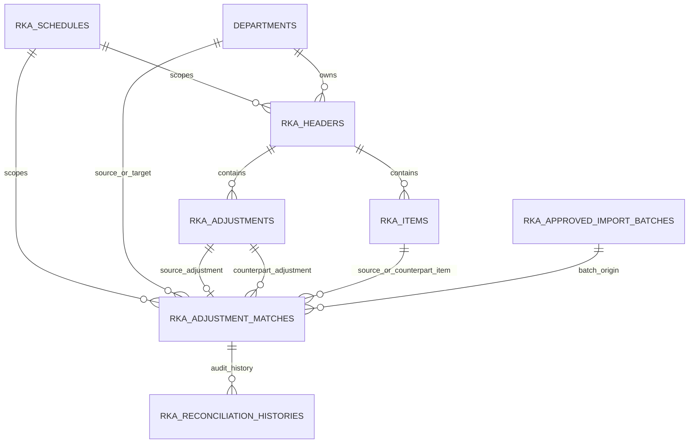

# Arsitektur Cross-Unit Reconciliation Engine (PHASE 3)

Dokumen ini menjelaskan desain teknis, ERD, aturan pencocokan item lintas unit, mekanisme antrean `WAITING_COUNTERPART`, serta alur audit trail untuk **Cross-Unit Reconciliation Engine**.

---

## 1. Entity Relationship Diagram (ERD)

---

## 2. Prinsip Dasar & Pemisahan Status

**Prinsip Utama:**
- **Worksheet `BELANJA`**: hanya digunakan untuk mengimpor item belanja Approved milik unit masing-masing (`RkaItem`). Tidak pernah digunakan sebagai sumber matching lintas unit.
- **Worksheet `DAFTAR PENYESUAIAN` (`Section A` + `Section B`)**: satu-satunya sumber kebenaran pembentukan relasi penyesuaian antarunit (`RkaAdjustmentMatch`).

Sistem memisahkan secara tegas antara:
1. **Status RKA (`rka_headers.status`)**: `APPROVED` + `is_locked = true` (tidak pernah diubah oleh rekonsiliasi).
2. **Tipe Penyesuaian (`rka_adjustments.action_type`)**: `MOVED`, `NOT_BUDGETED`, `PENDING`, `SHARED_COST`, `ADDITIONAL`.
3. **Status Validasi Excel**: `SESUAI`, `PERLU PERHATIAN`, `TIDAK DITEMUKAN`, `TIDAK VALID`.
4. **Status Rekonsiliasi (`rka_adjustment_matches.reconciliation_status`)**:
   - `WAITING_COUNTERPART`: Unit lawan belum mengimpor RKA pada jadwal yang sama.
   - `MATCHED`: Pasangan unik dan seluruh atribut wajib konsisten — **otomatis SAH tanpa persetujuan Finance**.
   - `REVIEW_REQUIRED`: Ditemukan lebih dari satu kandidat pasangan (`MATCH_AMBIGUOUS`).
   - `CONFLICT`: Kandidat unik ditemukan, namun terdapat perbedaan nilai, volume, satuan, atau harga satuan (`MATCH_CONFLICT`).
   - `UNMATCHED`: Unit lawan sudah mengimpor RKA pada jadwal yang sama, namun tidak ada kandidat yang cocok (`MATCH_NONE`).
   - `CANCELLED`: Relasi dibatalkan oleh Finance disertai alasan wajib.

---

## 3. Aturan Pencocokan (`CrossUnitItemMatcher`)

Lokasi: `app/Services/Rka/Reconciliation/CrossUnitItemMatcher.php`

Pencocokan bersifat deterministik dan *explainable* (menyimpan `matched_attributes`, `differing_attributes`, `differences`, `candidates_compared`, dan `reason` dalam `match_details` JSON):
1. **Boundary Wajib**: `schedule_id` harus sama dan `source_department_id !== candidate_department_id`.
2. **Kompatibilitas Pasangan Unit**:
   - Section A `MOVED` <-> Section B (`target_unit_id === source_department_id`). Jika `destination_unit_id` pada Section A terisi, wajib cocok dengan unit pengelola Section B.
   - Section B <-> Section A `MOVED` pada `target_unit_id`.
3. **Kode Rekening**: `account_id` harus identik (tidak boleh mencocokkan jika `account_id` berbeda atau null).
4. **Uraian Ternormalisasi**: Pencocokan deterministik setelah normalisasi huruf kecil/spasi/tanda hubung dan pemisahan prefix kategori sebelum `–` / `-` (contoh: `Aplikasi premium/lisensi – Pembelian Akun Turnitin` cocok dengan `Pembelian Akun Turnitin`).
5. **Atribut Wajib**: `proposed_amount`, `proposed_volume` (jika > 0), `unit_symbol`, dan `unit_price` (jika > 0) harus konsisten. Jika berbeda -> `CONFLICT`.

---

## 4. Antrean `WAITING_COUNTERPART`, Konkurensi, & Idempotency

Lokasi: `app/Services/Rka/Reconciliation/RkaReconciliationService.php`

1. **Eksekusi Pasca-Commit**: Dipanggil setelah `DB::transaction()` pada `ApprovedRkaImportService::executeImport()` dan `executeReimport()` selesai.
2. **Concurrency Control**: Dilindungi `Cache::lock("rka_reconciliation_schedule_{$scheduleId}", 15)`.
3. **Unique Constraint & Pencegahan Pasangan Ganda**:
   - Tabel `rka_adjustment_matches` memiliki `UNIQUE(source_adjustment_id)`.
   - Ketika unit lawan mengimpor kemudian (mis. P3M import lebih dahulu -> 23 baris `WAITING_COUNTERPART`, lalu UPT ICT import), sistem mengevaluasi ulang antrean `WAITING_COUNTERPART` pada `schedule_id` yang sama sehingga baris `Turnitin` otomatis bertransisi ke `MATCHED` tanpa membentuk record cermin ganda.
4. **Audit Trail**: Perubahan status dicatat ke `rka_reconciliation_histories` (hanya jika ada perubahan state) dan diringkas ke `rka_logs` menggunakan `idempotencyKey`.
