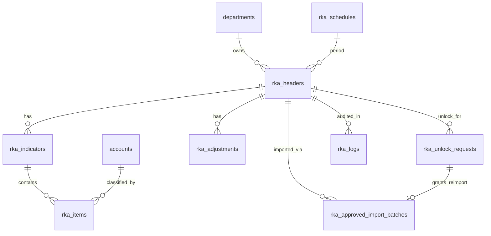

# ERD & Rancangan Schema — Native Excel Import Approved RKA (PHASE 3)

## 1. Reuse Schema Existing (Tanpa Duplikasi Tabel)

Hasil audit schema aktual menunjukkan tabel pendukung PHASE 3 sudah tersedia melalui migrasi `2026_11_15_152559_create_rka_approved_import_and_unlock_tables.php`:

1. **`rka_headers`** — menyimpan dokumen RKA hasil import (`status = APPROVED`, `is_locked = true`, `pagu_budget`, `general_notes`).
2. **`rka_indicators`** — menyimpan program, kegiatan, lokasi, dan `indicator_matrix` per kelompok belanja yang memiliki item.
3. **`rka_items`** — menyimpan item belanja hasil parsing hierarki rekening, dilengkapi `source_ref_id` (indexed `idx_rka_items_source_ref`, format deterministik `NATIVE:{GROUP}:{ACCOUNT_CODE}:{SEQ}`).
4. **`rka_adjustments`** — menyimpan catatan penyesuaian dari `DAFTAR PENYESUAIAN` beserta `source_ref_id` (`idx_rka_adjustments_source_ref`, format `NATIVE:ADJ:{SECTION}:{SEQ}`), `section_type` (`A`/`B`, `PENDING` dipaksa `A`), dan keterangan asli.
5. **`rka_approved_import_batches`** — mencatat riwayat batch import (`INITIAL` / `REIMPORT`), `original_filename`, `file_checksum` (SHA-256), `belanja_count`, `adjustment_count`, `total_proposed`, `total_approved`, `status`, dan `summary` (JSON metadata hasil rekonsiliasi, identitas workbook, & berita acara).
6. **`rka_unlock_requests`** — mencatat siklus permintaan buka kunci (`PENDING` → `APPROVED` / `REJECTED` → `USED` / `EXPIRED`), `reimport_granted_at`, `reimport_expires_at`, `reimport_used_at`, dan `reimport_batch_id`.
7. **`rka_logs`** — audit trail tunggal via `RkaActivityLogService` tanpa duplikasi log.

## 2. Diagram Relasi (ERD)

