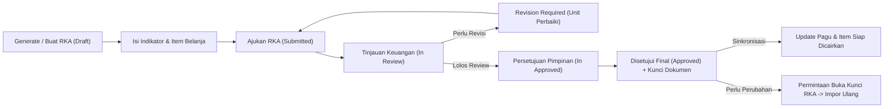
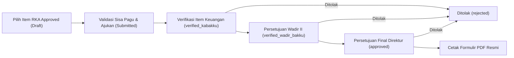

# Workflow Bisnis Aktual

Seluruh alur kerja berikut diverifikasi langsung dari implementasi Service Layer (`app/Services/`), Action Classes (`app/Filament/Actions/`), dan Policies.

---

## 1. Alur Perencanaan & Pengesahan RKA

- **Layanan Terkait**: `RkaGenerateService`, `RkaItemService`, `RkaReviewService`, `RkaApprovalService`, `ApprovedRkaImportService`, `RkaUnlockRequestService`, `RkaReconciliationService`, `RkaActivityLogService`.
- **Integritas Transaksi**: Seluruh mutasi item, persetujuan, impor ulang, dan rekonsiliasi dibungkus `DB::transaction()` dengan `lockForUpdate()`.
- **Aturan Rekonsiliasi & PENDING**: Item berstatus `PENDING` pada adjustment dicatat pada Section A dan tidak dianggap sebagai alokasi unit tujuan hingga direkonsiliasi.

---

## 2. Alur Pengajuan Pencairan Dana (*Fund Request*)

- **Layanan Terkait**: `FundRequestBudgetService`, `FundRequestDetailService`, `FundRequestPdfController`.
- **Validasi Pagu**: Sistem menghitung total terpakai dari pengajuan aktif lain (`ACTIVE_BALANCE_STATUSES`) secara terkunci (`lockForUpdate`) sehingga total pengajuan tidak dapat melebihi sisa pagu item maupun pagu akun/unit.
- **Cetak Dokumen**: Menghasilkan PDF A4 resmi dengan kop surat dari `RkaSetting`, rincian item dimohonkan vs disetujui, serta blok tanda tangan.

---

## 3. Alur Knowledge Center & Buku Panduan PDF

- **Pengelolaan**: Admin dengan izin `KnowledgeArticleResource` & `KnowledgeCategoryResource` menyusun artikel, menargetkan peran (`roles`), menambahkan diagram alur kerja dan langkah visual/screenshot beserta anotasi, lalu menerbitkan (`published`).
- **Akses Pembaca**: `KnowledgeCenterService` memfilter artikel `published` sesuai peran aktif dari `ContextManager`. Pengguna mengunduh PDF panduan sesuai perannya melalui `KnowledgeBookPdfService` (dan `super_admin` dapat mengunduh Buku Panduan Lengkap seluruh sistem).
